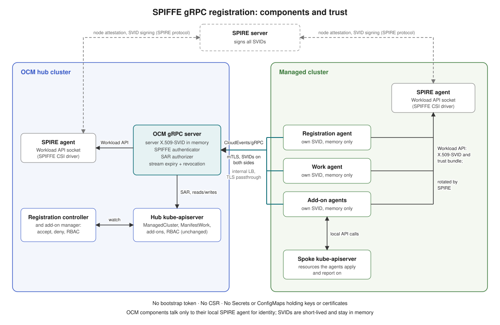
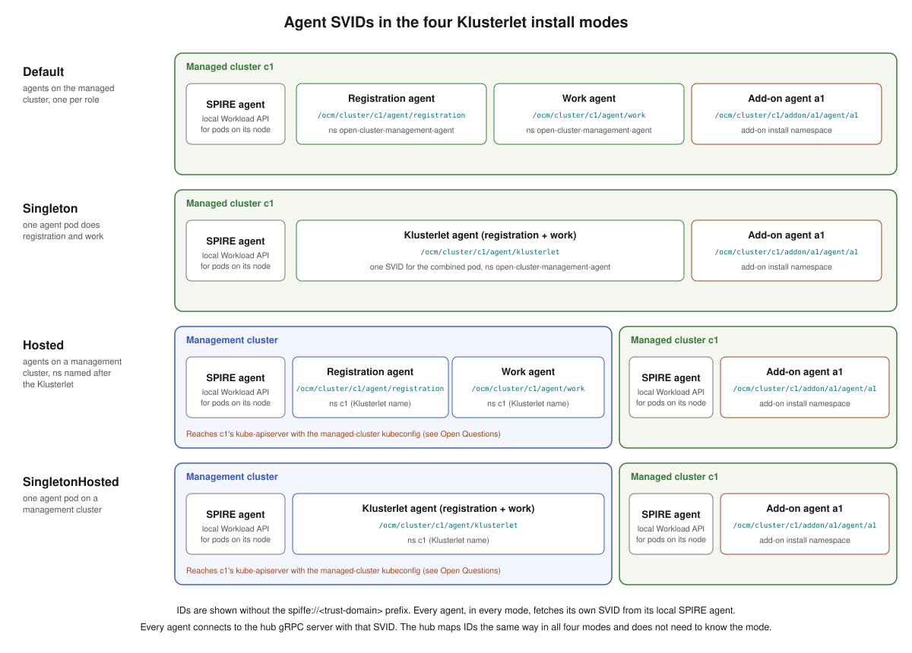
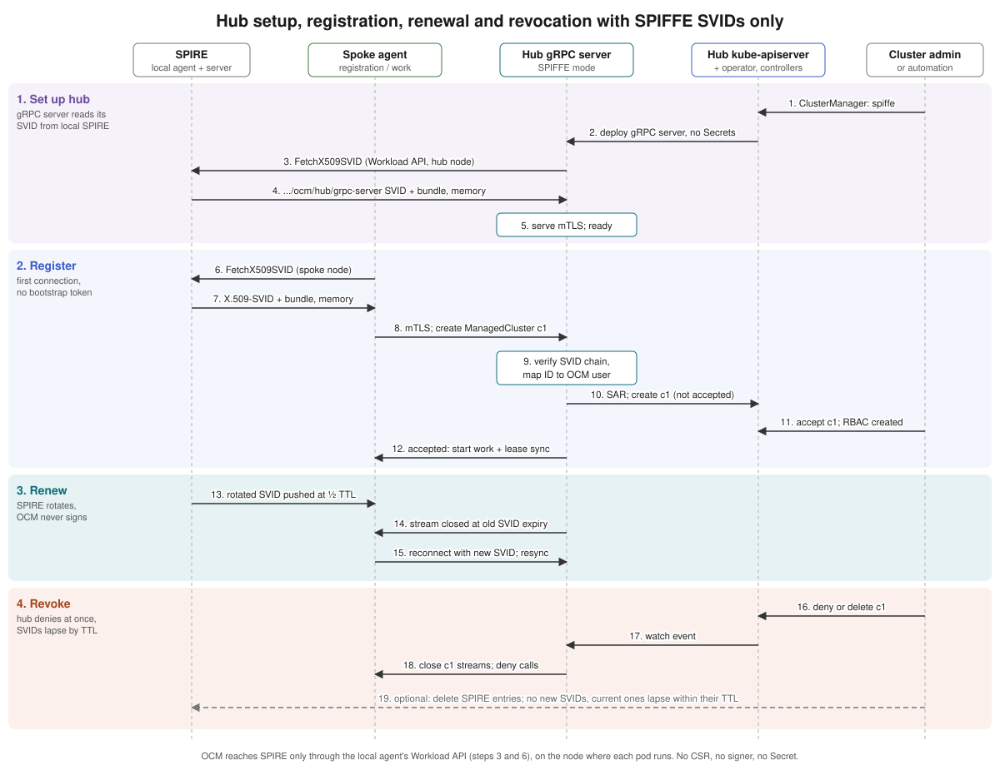

# SPIFFE gRPC registration

## Release Signoff Checklist

- [ ] Enhancement is `implementable`
- [ ] Design details are appropriately documented from clear requirements
- [ ] Test plan is defined
- [ ] Graduation criteria for dev preview, tech preview, GA
- [ ] User-facing documentation is created in [website](https://github.com/open-cluster-management-io/open-cluster-management-io.github.io/)

## Summary

This proposal adds a new registration driver, `spiffe`, in which every OCM agent identity is a
short-lived [SPIFFE](https://spiffe.io/) SVID issued by [SPIRE](https://spiffe.io/docs/latest/spire-about/).
Klusterlet agents and add-on agents connect to the hub gRPC server over mutual TLS with their own
X.509-SVIDs, and the hub gRPC server authenticates with its own X.509-SVID. Registration, renewal
and revocation all work without a bootstrap token, without a CertificateSigningRequest, without a
hub signing key, and without any Secret or ConfigMap that holds a private key, public key or
certificate. The only identity service OCM talks to is the local SPIRE agent, through the SPIFFE
Workload API.

The driver works in all four Klusterlet install modes (`Default`, `Singleton`, `Hosted` and
`SingletonHosted`) and applies the same model to add-ons.

The driver is new. It reuses the CloudEvents-over-gRPC transport, the per-resource gRPC services
and the SubjectAccessReview authorizer from [gRPC based registration](../141-grpc-based-registration/README.md),
but replaces its entire identity layer.

## Motivation

The existing registration drivers (`csr`, `grpc`, `awsirsa`) and add-on registration drivers
(`csr`, `token`) all leave long-lived or reusable credentials in OCM's hands:

- A bootstrap kubeconfig or bootstrap token must be distributed to each managed cluster and is
  valid until someone removes it.
- The `csr` and `grpc` drivers have the hub sign client certificates, so the hub holds a signing
  key (`signer-secret`) and the hub gRPC server holds a serving certificate in a Secret.
- The agent's private key and certificate are written to the `hub-kubeconfig-secret`, and each
  add-on's credentials to `<addon>-hub-kubeconfig` or `<addon>-<signer>-client-cert` Secrets.
  Anyone who can read those Secrets can act as the cluster or the add-on.
- Renewal is OCM's job (CSR rotation), and revoking a cluster or add-on does not invalidate a
  certificate that was already issued.

Many platforms already run SPIRE as their workload identity system. In those environments the
platform wants a single place that issues and rotates identities, short credential lifetimes, and
no key material at rest. OCM should be able to plug into that model instead of running its own
certificate authority.

### Goals

- Add a `spiffe` registration driver to the hub (`ClusterManager`) and the agent (`Klusterlet`).
- Use only SPIRE-issued SVIDs for every Klusterlet agent, every add-on agent and the hub gRPC
  server, for the whole lifecycle: register, renew, revoke and unjoin.
- Support all four Klusterlet install modes: `Default`, `Singleton`, `Hosted` and
  `SingletonHosted`.
- Support add-ons with the same model: each add-on agent registers, renews and is revoked using
  only its own SVID.
- Agents hold only short-lived SVIDs, in memory. Nothing OCM creates stores key material.
- OCM does not create Secrets or ConfigMaps for private keys, public keys or certificates, and does
  not sign anything.
- Apart from the local SPIRE agent's Workload API, OCM contacts no other identity or key service
  (no KMS, cloud identity provider, OIDC endpoint or SPIRE server API).
- Keep the hub-side user experience unchanged: ManagedCluster acceptance, add-on enablement, RBAC,
  ManifestWork and add-on APIs work as today.
- Allow existing clusters to move to the new driver one at a time.

### Non-Goals

- Installing, configuring or operating SPIRE. SPIRE topology, node attestation and registration
  entries are the platform's responsibility; this proposal only defines what OCM expects of them.
- Changing the existing `csr`, `grpc` or `awsirsa` drivers, or the `csr` and `token` add-on
  drivers.
- Giving agents or add-ons a kubeconfig for the hub kube-apiserver. In this mode they reach the
  hub only through the gRPC server.
- `customSigner` add-on registrations. They exist to have the hub sign client certificates; in
  this mode an add-on that needs a client certificate uses its SVID instead.
- JWT-SVID authentication (see [Alternatives](#alternatives)).

## Proposal



- **SPIRE** issues every identity. A SPIRE agent runs on each node of the hub, the managed
  clusters and, in hosted modes, the management clusters, and exposes the Workload API through
  the SPIFFE CSI driver.
- **Each OCM workload gets its own SVID.** The hub gRPC server, every Klusterlet agent and every
  add-on agent fetch their own X.509-SVID and trust bundle from the Workload API of the cluster
  they run on. SPIRE pushes a new SVID before the current one expires.
- **The hub gRPC server** serves TLS with its SVID, requires a client SVID from the configured
  trust domain, maps the client's SPIFFE ID to an OCM user and groups, and authorizes every
  CloudEvent with SubjectAccessReview, as today.
- **Agents** verify that the server presents the exact hub SPIFFE ID, so a load balancer or a
  certificate from the same trust domain cannot impersonate the hub.

### SPIFFE ID scheme

The hub derives the OCM identity from the path of the client's SPIFFE ID, so no per-cluster
configuration is needed on the hub. The user and group names match what the `csr` and `grpc`
drivers and the add-on framework use today, so the existing RBAC created by the registration
controller and the add-on manager, and the existing identity checks, apply without change.

| Workload | SPIFFE ID | OCM user | OCM groups |
| --- | --- | --- | --- |
| Hub gRPC server | `spiffe://<td>/ocm/hub/grpc-server` | n/a (server) | n/a |
| Registration agent (`Default`, `Hosted`) | `spiffe://<td>/ocm/cluster/<cluster>/agent/registration` | `system:open-cluster-management:<cluster>:registration` | `system:open-cluster-management:<cluster>`, `system:open-cluster-management:managed-clusters` |
| Work agent (`Default`, `Hosted`) | `spiffe://<td>/ocm/cluster/<cluster>/agent/work` | `system:open-cluster-management:<cluster>:work` | same as above |
| Klusterlet agent (`Singleton`, `SingletonHosted`) | `spiffe://<td>/ocm/cluster/<cluster>/agent/klusterlet` | `system:open-cluster-management:<cluster>:klusterlet` | same as above |
| Add-on agent (all modes) | `spiffe://<td>/ocm/cluster/<cluster>/addon/<addon>/agent/<agent>` | `system:open-cluster-management:cluster:<cluster>:addon:<addon>:agent:<agent>` | `system:open-cluster-management:cluster:<cluster>:addon:<addon>`, `system:open-cluster-management:addon:<addon>` |

`<td>` is the trust domain configured on the hub. The hub rejects any SVID whose trust domain or
path does not match this scheme, any request where the cluster in the event differs from the
cluster in the SVID, and any add-on request where the add-on in the event differs from the add-on
in the SVID.

The platform must make sure SPIRE only issues `.../cluster/<cluster>/...` IDs to workloads that
really belong to cluster `<cluster>`, for example by binding registration entries to the node
attestation of the SPIRE agents that run that cluster's agents. See
[Risks and Mitigation](#risks-and-mitigation).

### Install modes



The rule is the same in every mode: each agent gets its SVID from the local SPIRE agent, on the
node where the agent's pod runs. The hub also treats every mode the same way: it sees an SVID,
maps it, and authorizes the request. The modes differ only in where the agent pods run.

| Mode | Klusterlet agent pods run on | Klusterlet SVIDs |
| --- | --- | --- |
| `Default` | Managed cluster, `open-cluster-management-agent` | `agent/registration`, `agent/work` |
| `Singleton` | Managed cluster, `open-cluster-management-agent` | `agent/klusterlet` |
| `Hosted` | Management cluster, namespace named after the Klusterlet | `agent/registration`, `agent/work` |
| `SingletonHosted` | Management cluster, namespace named after the Klusterlet | `agent/klusterlet` |

- In every mode, each Deployment mounts the local Workload API with a `csi.spiffe.io` volume and
  has no bootstrap or hub-kubeconfig Secret volume.
- In `Singleton` and `SingletonHosted` modes the one agent pod runs registration and work and has
  a single SVID. Hub RBAC is granted to the cluster's groups, so one identity covers both roles.
- In `Hosted` and `SingletonHosted` modes one management cluster runs the agents of every cluster
  it hosts, so the SPIRE registration entries there must select on the Klusterlet's namespace:
  only the agents in namespace `c1` can get `.../cluster/c1/...` IDs.
- In `Hosted` and `SingletonHosted` modes the agents still reach the managed cluster's
  kube-apiserver with the managed-cluster kubeconfig the user provides today
  (`external-managed-kubeconfig`). That credential is for the managed cluster, not the hub, and is
  not changed by this proposal; see [Open Questions](#open-questions).
- Add-on agents run where the add-on is installed: on the managed cluster in all modes, or on the
  management cluster for hosted add-ons. Like the Klusterlet agents, they get their SVIDs from
  the local SPIRE agent.

### Lifecycle



The steps are the same in every install mode. "Registration agent" below means the registration
agent in `Default` and `Hosted` modes, and the Klusterlet agent in the singleton modes.

**Set up the hub.**

1. The platform gives the hub gRPC server pod its identity: SPIRE agents run on the hub nodes, and a
   SPIRE registration entry maps the gRPC server pod (by namespace, ServiceAccount and label) to
   `spiffe://<td>/ocm/hub/grpc-server`. OCM does not create this entry.
2. The admin configures the `ClusterManager` with the `spiffe` driver, for example with
   `clusteradm init`.
3. The cluster-manager operator deploys the gRPC server with a `csi.spiffe.io` volume for the
   local Workload API and no Secret volumes. It creates no signing key, serving certificate,
   bootstrap ServiceAccount or token.
4. The gRPC server opens a Workload API `X509Source` and receives, in memory, its own X.509-SVID and
   the trust bundle for the trust domain, plus any federated trust domains. It reports not ready
   until the first SVID arrives.
5. It serves mTLS: it presents its SVID and verifies client SVIDs against the trust bundle. SPIRE
   pushes rotated SVIDs and bundle updates over the same stream, and new handshakes use them.
   The server also starts watching `ManagedCluster` and `ManagedClusterAddOn` for revocation.

Reading its own SVID and the trust bundle from the local Workload API is all the hub does with
SPIRE. It does not call the SPIRE server, create registration entries, mint SVIDs for agents or
publish a CA bundle for agents; agents get the trust bundle from their own local Workload API.

**Register.**

1. The registration agent fetches its X.509-SVID and trust bundle from the local Workload API and
   keeps them in memory.
2. It dials the hub gRPC endpoint from the `Klusterlet` spec over mTLS, accepting only the
   configured hub SPIFFE ID.
3. The hub verifies the client SVID against the trust bundle from its own Workload API and maps
   the SPIFFE ID to the OCM user and groups above.
4. The agent publishes a create for `ManagedCluster/<cluster>`. The hub allows it only when the
   name equals the cluster in the SVID. The new cluster has `hubAcceptsClient: false`.
5. A cluster admin or automation accepts the cluster, exactly as today. The registration
   controller creates the cluster namespace and RBAC for the cluster's groups.
6. The agent sees the accepted status and starts lease, status, ManifestWork and add-on sync.

There is no bootstrap stage. Before acceptance, the agent's identity is authorized only to create,
get and watch its own `ManagedCluster`, through a ClusterRole bound to
`system:open-cluster-management:managed-clusters`.

**Renew.**

- SPIRE rotates each SVID, by default at half of its TTL, and pushes it over the Workload API. The
  agent's TLS configuration reads the current SVID for each new handshake.
- A gRPC stream authenticates once, when the connection is established. The hub therefore records
  the client SVID's expiry for each connection and closes the connection when that SVID expires.
  The client reconnects with its current SVID and resyncs, as it already does after a reconnect.
- The hub gRPC server renews its own serving SVID the same way.
- OCM never signs, stores or rotates a certificate.

**Revoke.**

- **In OCM, immediate.** Setting `hubAcceptsClient: false` on, or deleting, the `ManagedCluster`
  makes the authorizer deny the cluster's requests. The hub gRPC server also watches
  `ManagedCluster` and closes every open connection whose SVID belongs to that cluster, including
  its add-on agents.
- **In SPIRE, within one TTL.** Deleting the cluster's registration entries, or evicting its SPIRE
  agents, stops new SVIDs. SVIDs already issued stop working when they expire. Short TTLs are the
  revocation mechanism; there is no CRL in this design.
- **Trust domain compromise.** SPIRE CA rotation and bundle updates reach OCM through the
  Workload API, with no OCM change.

**Unjoin.** Deleting the `ManagedCluster` on the hub and the `Klusterlet` on the managed or
management cluster removes everything. There are no OCM Secrets to clean up.

### Add-ons

Add-ons follow the same model. Each add-on agent has its own SVID; the registration agent no
longer obtains credentials on the add-on's behalf.

**Register.**

1. The add-on is enabled on the hub as today, by creating the `ManagedClusterAddOn`. The add-on
   manager sets the add-on's `kubeClient` registration and creates its hub RBAC from the add-on's
   permission configuration, bound to the add-on's user and groups.
2. On the managed cluster, the registration agent sees the registration and, with the `spiffe`
   add-on driver, creates no CSR, no token request and no Secret. It sets
   `status.registrations[].kubeClient.driver: spiffe` and the `RegistrationApplied` condition.
3. The add-on agent fetches its own SVID (`.../cluster/<cluster>/addon/<addon>/agent/<agent>`)
   from the local Workload API and connects to the hub gRPC server over mTLS, as the Klusterlet
   agents do.
4. The hub maps the SVID to the add-on user and groups, which are the default `kubeClient`
   subject, so the add-on's existing hub RBAC applies.

If an add-on sets a custom `kubeClient` subject that does not match the mapping for its SPIFFE ID,
the add-on manager sets `RegistrationApplied` to false with a clear reason, because no SVID can
carry that subject.

**Renew.** Exactly as for the Klusterlet agents: SPIRE rotates the add-on agent's SVID, and the
hub closes connections whose SVID has expired.

**Revoke.**

- Disabling the add-on (deleting the `ManagedClusterAddOn`) makes the add-on manager remove its
  RBAC, and the hub gRPC server closes the add-on agent's open connections for that cluster.
- Denying or deleting the cluster closes the connections of all its add-on agents.
- Deleting the add-on's SPIRE registration entries stops new SVIDs; existing ones lapse within
  their TTL.

**Add-on framework.** The add-on framework gets a helper that builds the add-on agent's
CloudEvents clients from a Workload API `X509Source`, so add-on authors do not handle SVIDs
directly.

### Implementation Details/Notes/Constraints

The examples below use trust domain `ocm-hub.example.org`, managed cluster `cluster1` and add-on
`my-addon`.

#### API

**Hub.** The `ClusterManager` gets a new driver, `spiffe`. Only the trust domain is required; the
other fields have defaults.

```yaml
apiVersion: operator.open-cluster-management.io/v1
kind: ClusterManager
spec:
  registrationConfiguration:
    registrationDrivers:
    - authType: spiffe
      spiffe:
        trustDomain: ocm-hub.example.org
        # Optional. Default: spiffe://<trustDomain>/ocm/hub/grpc-server
        serverSPIFFEID: spiffe://ocm-hub.example.org/ocm/hub/grpc-server
        # Optional. Default: unix:///spiffe-workload-api/spire-agent.sock
        workloadAPISocket: unix:///spiffe-workload-api/spire-agent.sock
        # Optional. Default: 24h. Must be at least the longest SVID TTL SPIRE
        # issues to OCM agents. The delete guard waits this long; see
        # "Deleting a cluster".
        maxSVIDLifetime: 24h
  serverConfiguration:
    endpointsExposure:
    - protocol: grpc-spiffe  # the SPIFFE listener; see gRPC server below
      grpc:
        type: loadBalancer   # must pass TLS through; see Risks
```

**Managed cluster.** The `Klusterlet` says where the hub is and which SPIFFE ID the hub must
present. Neither value is secret, so they go in the spec instead of a bootstrap Secret. The same
fields work in all four install modes. Add-ons are switched to SPIFFE with the existing
`addOnKubeClientRegistrationDriver` field.

```yaml
apiVersion: operator.open-cluster-management.io/v1
kind: Klusterlet
spec:
  clusterName: cluster1
  deployOption:
    mode: Default            # or Singleton, Hosted, SingletonHosted
  registrationConfiguration:
    registrationDriver:
      authType: spiffe
      spiffe:
        hubEndpoint: ocm-grpc.hub.internal:443
        hubSPIFFEID: spiffe://ocm-hub.example.org/ocm/hub/grpc-server
        workloadAPISocket: unix:///spiffe-workload-api/spire-agent.sock
    addOnKubeClientRegistrationDriver:
      authType: spiffe       # required when registrationDriver.authType is spiffe
```

**Add-ons.** `ManagedClusterAddOn` (`v1beta1`) gets one new allowed value, `spiffe`, for
`status.registrations[].kubeClient.driver`. The registration agent sets it so the hub can see how
the add-on authenticates. No new registration type is needed.

All new fields sit behind a new `SPIFFERegistration` feature gate.

#### Operators

**Hub (cluster-manager operator).** Today it gives the gRPC server Secrets: the hub signing key
(`signer-secret`), the server's TLS certificate, and a bootstrap ServiceAccount and token. In
`spiffe` mode it creates none of them. It only mounts a `csi.spiffe.io` volume, which puts the
local SPIRE agent's Workload API socket into the pod.

**Managed cluster (klusterlet operator).** Today the agents start from a
`bootstrap-hub-kubeconfig` Secret and the registration agent writes its credentials to
`hub-kubeconfig-secret`. In `spiffe` mode neither Secret exists. Each agent Deployment
(`klusterlet-registration` and `klusterlet-work`, or the single `klusterlet-agent`) gets the same
CSI volume and fetches its own SVID. In hosted modes the Deployments still go to the
Klusterlet-named namespace on the management cluster.

The no-key-material rule covers every hub credential: agent and add-on identities toward the hub
and the hub gRPC server's own identity. In `Hosted` and `SingletonHosted` modes the operator still
derives managed-cluster kubeconfig Secrets from the user-provided `external-managed-kubeconfig`,
exactly as today. Those Secrets authenticate to the managed cluster, not the hub, and stay out of
scope until Open Question 5 is resolved.

**A label so SPIRE can tell the agents apart.** OCM does not create SPIRE registration entries;
the platform does. Entries pick pods by properties such as namespace and ServiceAccount. That is
not enough here: the singleton agent and the default-mode work agent both use the ServiceAccount
`<klusterlet>-work-sa`. So every agent pod gets a label, `open-cluster-management.io/spiffe-role`,
with the value `registration`, `work` or `klusterlet`. A label alone is not enough either, because
anyone who can create a pod in the namespace can set it. Entries must therefore select on the
namespace, the ServiceAccount and the role label together. For example, with the SPIRE controller
manager, for the work agent of a Klusterlet named `klusterlet` in `Default` mode:

```yaml
apiVersion: spire.spiffe.io/v1alpha1
kind: ClusterSPIFFEID
metadata:
  name: ocm-work-agent
spec:
  spiffeIDTemplate: "spiffe://ocm-hub.example.org/ocm/cluster/cluster1/agent/work"
  namespaceSelector:
    matchLabels:
      kubernetes.io/metadata.name: open-cluster-management-agent
  podSelector:
    matchLabels:
      open-cluster-management.io/spiffe-role: work
  workloadSelectorTemplates:
  - "k8s:sa:klusterlet-work-sa"   # SPIRE also checks the pod's ServiceAccount
```

**Who may start pods in the agent namespaces.** Selecting on namespace, ServiceAccount and label
only helps if nobody else can start a pod with that combination. Restricting Pod creation alone is
not enough: anyone who can create a Deployment, ReplicaSet, StatefulSet, DaemonSet, Job or
CronJob in the namespace can put the agent's ServiceAccount and `spiffe-role` label in the pod
template, and a Kubernetes controller then creates the Pod for them. For example, a user allowed
to create Jobs in `open-cluster-management-agent` could run a Job as `klusterlet-work-sa` with
`spiffe-role: work` and receive cluster1's work-agent SVID.

So in `spiffe` mode the Klusterlet operator installs a ValidatingAdmissionPolicy and binding that
cover the agent namespaces (`open-cluster-management-agent`, and the Klusterlet-named namespaces
on a management cluster):

- Deployments may be created or changed only by the Klusterlet operator's ServiceAccount.
- ReplicaSets may be created only by the Deployment controller, for a Deployment the operator
  owns, and Pods only by the ReplicaSet controller, for such a ReplicaSet. So every Pod traces back
  to an operator-owned Deployment.
- StatefulSets, DaemonSets, Jobs and CronJobs are refused.
- A Pod's `spiffe-role` label must match its ServiceAccount, and neither may change after
  creation. These are the only allowed pairs, for a Klusterlet named `<klusterlet>`:

  | Install mode | `spiffe-role` | ServiceAccount |
  | --- | --- | --- |
  | `Default`, `Hosted` | `registration` | `<klusterlet>-registration-sa` |
  | `Default`, `Hosted` | `work` | `<klusterlet>-work-sa` |
  | `Singleton`, `SingletonHosted` | `klusterlet` | `<klusterlet>-work-sa` |

  The singleton agent reuses `<klusterlet>-work-sa`, so the label is what tells it apart from a
  work agent. A pod with `<klusterlet>-work-sa` and any other role label is refused.

Namespace RBAC that grants these permissions only to the operator is the first layer; the policy
holds even if RBAC is later widened by mistake.

Add-on agent namespaces get the same policy, with two differences:

- The allowed creator of Deployments is the work agent, which applies the add-on's manifests from
  the hub. So every add-on pod traces back to a manifest the hub defined.
- The table above does not apply. Add-on pods use their own ServiceAccounts and the role label
  value `addon`. The policy refuses, in an add-on namespace, any pod with a Klusterlet
  ServiceAccount or with the role `registration`, `work` or `klusterlet`. Example: the agent of
  `my-addon` runs as `my-addon-agent-sa` with `spiffe-role: addon` and is admitted; a pod in the
  same namespace with `klusterlet-work-sa` is refused. The add-on's SPIRE entry selects on its
  namespace, its ServiceAccount and `spiffe-role: addon`.

**The policy is required, not optional.** ValidatingAdmissionPolicy is GA from Kubernetes 1.30,
so `spiffe` mode needs Kubernetes 1.30 or later on every cluster that runs OCM agents: the managed
cluster, or the management cluster in hosted modes. Before it deploys any agent, the Klusterlet
operator checks that the `admissionregistration.k8s.io/v1` ValidatingAdmissionPolicy API is served
and that its policy and binding exist. If either check fails, it deploys no agent and sets a
`Degraded` condition on the Klusterlet that says why. It keeps checking, and if the policy or
binding is later removed, it scales the agents to zero until they are back.

**Accepted gap when the policy is removed.** Scaling to zero stops the real agents, but it does
not close every hole. The policy and its binding are cluster-scoped, so only cluster-admin (and
the operator) can delete them. If a cluster-admin deletes them *and* namespace RBAC also lets
someone else create workloads in an agent namespace, that user can start a pod with the agent's
ServiceAccount and role label before the operator reacts, and SPIRE gives it an SVID. This needs
two mistakes at once. The operator watches the policy and binding, so the window is short, until
its next reconcile. When it sees the removal it also deletes pods in the agent namespaces that are
not owned by its own Deployments. A pod that got an SVID in that window can still use it until it
expires, and the hub can stop it sooner only by denying or deleting the cluster. We accept this
rather than tying SPIRE entries to the policy, because OCM does not manage SPIRE entries.

#### sdk-go

sdk-go holds the shared gRPC server and client code, so most of the SPIFFE logic lives here.

- **Server identity check** (`pkg/server/grpc/authn`). A new `SPIFFEAuthenticator` reads the
  client's verified SVID and turns its SPIFFE ID into an OCM user and groups. For example,
  `spiffe://ocm-hub.example.org/ocm/cluster/cluster1/agent/work` becomes user
  `system:open-cluster-management:cluster1:work` with groups `system:open-cluster-management:cluster1`,
  `system:open-cluster-management:managed-clusters` and `system:authenticated`. It rejects IDs from
  another trust domain, or IDs that do not follow the scheme, such as `.../ocm/something-else`. It
  also notes when the SVID expires.

  Every mapped identity gets `system:authenticated`, as the kube-apiserver gives every
  authenticated user today. The hub sends exactly these groups in its SubjectAccessReviews, so
  without it a permission bound to `system:authenticated`, which works for an agent today, would
  be denied after the switch to `spiffe`.
- **Picking the right SVID** (`pkg/server/grpc` and `pkg/cloudevents/generic/options/grpc`). The
  Workload API can return several SVIDs for one pod, for example when the platform also gives
  every pod a generic identity, and `X509Source` uses the first one by default. Each OCM component
  therefore opens its source with `workloadapi.WithDefaultX509SVIDPicker` and picks the SVID whose
  SPIFFE ID it expects: the configured `serverSPIFFEID` for the hub gRPC server, and the ID built
  from the cluster name and role for an agent (for example
  `spiffe://ocm-hub.example.org/ocm/cluster/cluster1/agent/work`). If no SVID with that ID is
  present, the component reports not ready, with the IDs it did receive, instead of presenting
  another identity.
- **Server TLS** (`pkg/server/grpc`). The server builds its TLS settings from the local Workload API
  (go-spiffe `workloadapi.X509Source` and `tlsconfig.MTLSServerConfig`) instead of certificate
  files. The server enforces SVID expiry on the connection, not the stream. A gRPC
  `TransportCredentials` wrapper around the SPIFFE TLS credentials records the peer's SPIFFE ID and
  SVID expiry after each handshake. It registers the underlying `net.Conn` in a connection registry
  and arms a timer that closes the `net.Conn` when the SVID expires. That ends the HTTP/2 connection
  and every stream and unary call on it. For example, if an agent connects at 10:40 with an SVID
  valid until 11:00, the hub closes that connection at 11:00. The agent then opens a new connection,
  with a new handshake, using its newer SVID. As a second check, unary and stream interceptors
  reject any RPC whose peer SVID has already expired.
- **Client TLS** (`pkg/cloudevents/generic/options/grpc`). A client option dials the hub with the
  agent's SVID and accepts only the configured hub ID:
  `tlsconfig.MTLSClientConfig(source, source, tlsconfig.AuthorizeID(hubSPIFFEID))`. A server that
  presents any other ID, even one from the same trust domain, is refused.
- **New dependency:** `github.com/spiffe/go-spiffe/v2`.

#### ocm

- **New registration driver** (`pkg/registration/register/spiffe`). Builds the agent's gRPC
  clients from its SVID. It has no CSR step, no Secret handling and no bootstrap phase. The agent
  can talk to the hub as long as it has a current SVID and the cluster is accepted. For add-ons it
  only reports the registration status; it creates no credentials.
- **Add-on registration on the managed cluster** (`pkg/registration/spoke/addon`). With the
  `spiffe` add-on driver, the registration agent no longer creates a CSR, token or
  `<addon>-hub-kubeconfig` Secret for `kubeClient` registrations. A `customSigner` registration is
  refused with a clear condition, because the hub does not sign certificates in this mode.
- **Add-on manager on the hub** (`pkg/addon`). Checks that an add-on's `kubeClient` subject can be
  carried by an SVID. For example, the default subject
  `system:open-cluster-management:cluster:cluster1:addon:my-addon:agent:my-addon-agent` matches
  `spiffe://ocm-hub.example.org/ocm/cluster/cluster1/addon/my-addon/agent/my-addon-agent`, but a
  custom user such as `my-team-bot` cannot, so the add-on gets a `RegistrationApplied=False`
  condition. The comparison uses the full mapped identity, including `system:authenticated`, so a
  default subject that lists that group still matches.
- **gRPC server** (`pkg/server/grpc`). The `spiffe` driver gets its own listener, on its own port
  and Service (`cluster-manager-grpc-server-spiffe`), exposed through an `endpointsExposure` entry
  with `protocol: grpc-spiffe`. That listener uses only the SPIFFE TLS credentials and the SPIFFE
  authenticator (no tokens, no OCM-signed certificates) and does not offer the CSR and
  token-request services.
  - When `spiffe` is the only driver, only this listener runs, and the operator creates no signer,
    serving certificate or bootstrap token.
  - When `spiffe` is listed with `grpc` for migration, the existing `grpc` listener keeps running
    unchanged on its current port, with its current authentication and its CSR and token-request
    services. Agents that have not migrated keep working.
  - Both listeners share the same CloudEvents services and authorizer, so a cluster sees the same
    resources whichever one it uses. When `grpc` is removed from `registrationDrivers`, its
    listener and its Secrets are removed.

  The server watches `ManagedCluster` and `ManagedClusterAddOn`. When a cluster is denied or
  deleted, or an add-on is disabled, it closes the matching connections right away through the
  connection registry described under sdk-go.
- **Deleting a cluster** (`pkg/registration/hub`). Closing connections does not cancel an SVID
  that is still valid. Without a guard, an agent whose cluster was just deleted could reconnect and
  use its pre-acceptance permission to create the `ManagedCluster` again. To prevent this:
  - The hub uses one upper bound for every deletion: `spiffe.maxSVIDLifetime` from the
    `ClusterManager` (default `24h`). It must be at least as long as the longest SVID TTL SPIRE
    issues to OCM agents. The hub does not try to learn the lifetime from the SVIDs it sees,
    because an agent can hold a newer, longer-lived SVID that it has not shown to the hub yet, for
    example after the platform raises the TTL.
  - In `spiffe` mode each `ManagedCluster` gets the finalizer
    `open-cluster-management.io/spiffe-revocation`. When the cluster is deleted, the hub keeps the
    finalizer until the deletion time plus `maxSVIDLifetime` has passed. Every SVID issued
    before the deletion has expired by then, including newer ones the agent received but has not
    yet shown to the hub. While the object is terminating, a create fails because the name still
    exists, and the authorizer denies every request from the cluster's identities.
  - Then the finalizer is removed and the object goes away.

  Example: SVIDs live 1 hour, `maxSVIDLifetime` is set to `1h`, and `c1` is deleted at 10:40.
  Until 11:40 the agent can neither use the hub nor recreate `c1`. After 11:40 it can register
  again only with an SVID issued after the deletion, which means SPIRE is still issuing it
  identities. With the default `24h`, the wait is longer but just as safe. So deleting the cluster
  on the hub stops it for `maxSVIDLifetime`; to keep it out for good, the platform also removes the cluster's
  SPIRE registration entries during that window.
- **Operators** (`pkg/operator`). Render the SPIFFE version of the gRPC server Deployment and of
  each agent Deployment, for all four install modes.
- **Agents.** The registration agent does not start its Secret-based hub-kubeconfig controller.
  The work agent and add-on agents fetch their own SVIDs instead of reading a Secret written by
  the registration agent.

#### addon-framework

- A helper that builds an add-on agent's gRPC clients from its SVID, so add-on authors do not
  have to handle SVIDs themselves.
- When a cluster uses the `spiffe` add-on driver, add-on Deployments rendered by the framework get
  the `csi.spiffe.io` volume instead of the `<addon>-hub-kubeconfig` Secret volume.

#### clusteradm

```shell
# Hub
clusteradm init --registration-drivers spiffe --spiffe-trust-domain ocm-hub.example.org

# Managed cluster: no token
clusteradm join --cluster-name cluster1 --registration-auth spiffe \
  --hub-grpc-endpoint ocm-grpc.hub.internal:443 \
  --hub-spiffe-id spiffe://ocm-hub.example.org/ocm/hub/grpc-server \
  --mode Default   # or Singleton, Hosted, SingletonHosted

# Unchanged
clusteradm accept --clusters cluster1
clusteradm addon enable --names my-addon --clusters cluster1
```

### Risks and Mitigation

**SPIRE gives a cluster's ID to the wrong workload.**
If SPIRE issues `.../ocm/cluster/cluster1/...` to a pod that is not one of cluster1's agents,
that pod can act as cluster1. Example: a careless registration entry that matches any pod with the
`work` label on any cluster.
*Mitigation:* the platform must tie each cluster's entries to that cluster's SPIRE agents, and select
on namespace, ServiceAccount and role label (see Operators). The admission policy the Klusterlet
operator installs makes sure only operator-owned Deployments can start pods with that combination,
so a user who can create a Job or Deployment in the agent namespace cannot borrow the agent's
identity. The hub also checks that every request is about the cluster named in the SVID, so an
agent of cluster2 can never change cluster1's resources, even with a valid SVID. This is
documented as a deployment requirement.

**A deleted cluster comes back.**
Example: an admin deletes `ManagedCluster/c1`, but its agent still has an SVID valid for 40
minutes. It reconnects and creates `c1` again.
*Mitigation:* the `spiffe-revocation` finalizer keeps `c1` terminating, so it cannot be recreated
and all its requests are denied, until every SVID issued before the deletion has expired (see
"Deleting a cluster"). To keep the cluster out for good, the platform also removes its SPIRE
registration entries.

**An agent presents the wrong SVID.**
Example: the platform gives every pod a generic SVID as well, and the Workload API lists it first.
The agent would present that ID and the hub would reject it.
*Mitigation:* every OCM component picks its SVID by the SPIFFE ID it expects, never by position,
and reports not ready if that ID is missing.

**In hosted modes, one management cluster runs agents for many clusters.**
Example: a management cluster runs the Klusterlets for `cluster1` and `cluster2` in namespaces
`cluster1` and `cluster2`. A loose entry could give a pod in `cluster2` an ID for `cluster1`.
*Mitigation:* entries on the management cluster select on the Klusterlet namespace and the role
label. A fully compromised management cluster can act for the clusters it hosts, but that is
already true today, because it holds their hub credentials.

**An add-on agent uses an ID for a different add-on or cluster.**
Example: the agent of `my-addon` on cluster1 tries to update `other-addon`'s status.
*Mitigation:* the hub checks both the cluster and the add-on in the SVID against every request.
Add-on entries select on the add-on's namespace and ServiceAccount.

**SPIRE is down.**
If an agent cannot reach its local Workload API, it cannot get a new SVID.
*Mitigation:* open connections keep working until the current SVID expires. Example: with a 1-hour
TTL rotated every 30 minutes, an agent has about 30 minutes of margin. The Klusterlet or
`ManagedClusterAddOn` shows a clear condition while the Workload API is unreachable. The TTL is a
platform choice: shorter means faster revocation, longer means more time to fix SPIRE.

**A connection outlives its SVID.**
A gRPC connection checks identity only once, when it opens.
*Mitigation:* the hub closes each connection when the client's SVID expires (see the 10:40 / 11:00
example above), and the agent reconnects with its current SVID.

**A load balancer ends TLS in front of the hub.**
Example: an HTTPS load balancer that decrypts traffic and re-encrypts it with its own certificate.
The agent would then see the load balancer's certificate, not the hub's SVID.
*Mitigation:* the gRPC endpoint must use a layer 4 (TCP) load balancer that passes TLS through.
Because agents check the hub's exact SPIFFE ID, a wrong setup fails to connect instead of
silently trusting the load balancer.

**Another workload pretends to be the hub.**
Example: any pod in the trust domain with a valid SVID listens on the hub's address.
*Mitigation:* agents accept only `spiffe://ocm-hub.example.org/ocm/hub/grpc-server`, not any ID
in the trust domain.

**Strangers flood the gRPC server.**
*Mitigation:* a client must complete the TLS handshake with a valid SVID before it can send
anything, so unknown clients are dropped early. Today, by contrast, anyone with the bootstrap
token can start the join flow. Network-level protection is still advisable.

**Clocks differ between clusters.**
Example: a managed cluster's clock is 3 minutes ahead, so a fresh SVID looks "not valid yet" to
the hub.
*Mitigation:* clusters must run NTP, and the expiry check allows a small, configurable clock
difference.

Security review should involve the SIG Architecture maintainers and someone familiar with SPIRE
deployments.

## Design Details

### Open Questions

1. Should the SPIFFE ID path scheme be fixed, or configurable with a template on the
   `ClusterManager`?
2. Should the hub support automatic acceptance for clusters whose SVIDs match a configured
   pattern, or always keep acceptance as an explicit step?
3. Should the `ManagedCluster` be created by the agent on first connection (as proposed), or be
   pre-created by the admin with the agent only allowed to update its status?
4. Which SPIRE topology should `clusteradm` and the e2e tests treat as the reference: one shared
   trust domain with every cluster's SPIRE agents attesting to one SPIRE server, nested SPIRE
   servers, or one federated trust domain per cluster?
5. In `Hosted` and `SingletonHosted` modes, agents reach the managed cluster's kube-apiserver with
   the user-provided `external-managed-kubeconfig` and the operator-derived Secrets. Should this
   proposal also replace that credential, for example by having the managed cluster's
   kube-apiserver accept JWT-SVIDs through structured authentication configuration, or is it a
   separate enhancement?
6. Existing add-ons that use their hub kubeconfig to call arbitrary hub APIs need to move to the
   gRPC services. Which additional gRPC services, if any, are needed for common add-ons?

### Test Plan

- **Unit tests.** SPIFFE ID parsing and mapping for every ID form (valid and invalid paths, wrong
  trust domain, cluster and add-on mismatch), the SPIFFE authenticator, connection closure at SVID
  expiry (including that no further unary or stream RPC succeeds on that connection), connection
  shutdown on cluster deny or delete and on add-on disable, and operator
  rendering of the SPIFFE Deployments for each install mode. Also cover the delete guard holding
  the finalizer for `maxSVIDLifetime` after deletion, including when an agent holds a newer SVID
  with a longer TTL than any SVID the hub has seen.
- **Admission policy tests.** For each of `Default`, `Singleton`, `Hosted` and `SingletonHosted`,
  check that the allowed role and ServiceAccount pairs are accepted, that every other pair is
  refused (for example `klusterlet` with `<klusterlet>-registration-sa`, or a `work` pod when the
  Klusterlet runs in `Singleton` mode), and that Jobs and Deployments not created by the operator are refused. Also check
  that the operator deploys no agent, and reports `Degraded`, when the ValidatingAdmissionPolicy
  API is not served or the policy is missing. For add-on namespaces, check that an add-on pod
  with its own ServiceAccount and `spiffe-role: addon` is accepted when it comes from a Deployment
  created by the work agent, and that a pod with a Klusterlet ServiceAccount or role is refused.
- **Integration tests.** envtest plus an in-process fake Workload API that issues SVIDs from a
  test CA with short TTLs. Cover register, accept, rotation and reconnect, deny, delete, add-on
  enable, rotation and disable, and the checks that no Secret or ConfigMap with hub credentials or
  key material is created on the hub, managed or management cluster. The hosted-mode
  managed-cluster kubeconfig Secrets are excluded until Open Question 5 is resolved.
  Also cover `spiffe` and `grpc` listed together: a `grpc` agent and a `spiffe` agent both work,
  and one cluster migrates from one to the other.
- **E2E tests.** kind clusters with SPIRE installed from the SPIFFE Helm charts, run for each of
  `Default`, `Singleton`, `Hosted` and `SingletonHosted`: join, accept, ManifestWork apply and
  status, add-on enable and status sync, SVID rotation under load, and revocation of a cluster
  and of a single add-on.

### Graduation Criteria

- **Alpha.** Behind the `SPIFFERegistration` feature gate. All four install modes and add-on
  registration supported. Unit and integration tests.
- **Beta.** E2E tests for all four modes and add-ons in CI, `clusteradm` and add-on framework
  support, documented SPIRE deployment requirements, and a security review.
- **GA.** Used in production by at least one adopter, with migration from the `grpc` driver
  documented and tested.

### Upgrade / Downgrade Strategy

- The driver is opt-in. Clusters that do not set `authType: spiffe` are unaffected.
- The hub can enable `spiffe` alongside existing drivers in `registrationDrivers`, so clusters
  move one at a time. The `spiffe` listener runs next to the existing `grpc` listener (see the gRPC
  server under ocm), so agents that have not migrated keep their current endpoint and credentials.
- Because the OCM user and group names are the same as with the `csr` and `grpc` drivers and the
  add-on framework defaults, an existing cluster keeps its ManagedCluster, namespace,
  ManifestWorks, add-ons and RBAC when its Klusterlet switches to `spiffe`. The operator deletes
  the old `hub-kubeconfig-secret` and add-on credential Secrets after the switch.
- Switching between install modes works as today; only where SVIDs are issued changes.
- Downgrade: switch the Klusterlet back to its previous drivers and provide a bootstrap
  kubeconfig, as for a new join.

### Version Skew Strategy

- An agent configured for `spiffe` requires a hub that serves the `spiffe` driver. Against an
  older hub the TLS handshake fails and the Klusterlet reports a degraded condition.
- Older agents keep using their existing drivers against a newer hub.
- An add-on agent built without SPIFFE support cannot run on a cluster that uses the `spiffe`
  add-on driver; the add-on manager reports this on the `ManagedClusterAddOn`.
- The CloudEvents data types and services are unchanged, so add-on and work payloads are
  compatible across versions.

## Implementation History

- 2026-11-03: Proposal created.
- 2026-11-03: Added support for all four install modes and for add-ons.

## Drawbacks

- Requires a SPIRE deployment, with SPIRE agents on the hub, every managed cluster and, in hosted
  modes, every management cluster, which is significant operational work for users who do not
  already run it.
- The security of cluster and add-on identity moves to SPIRE configuration (registration entries
  and node attestation), which OCM cannot validate.
- Add-ons that need direct hub kube-apiserver access, or hub-signed certificates, must be changed
  to use the gRPC services and their SVID.
- In hosted modes, the managed-cluster kubeconfig remains until Open Question 5 is resolved.

## Alternatives

- **Keep the `grpc` driver and back its CA with a KMS.** Removes the signing key from the hub but
  keeps the bootstrap token, CSR flow and per-cluster and per-add-on key Secrets, and adds a
  dependency on an external key service.
- **JWT-SVIDs as bearer tokens.** Works through TLS-terminating proxies, but needs audience
  handling and replay protection, and the hub would have to fetch JWT bundles. X.509-SVID mTLS
  gives proof of possession with no extra moving parts; JWT-SVID support could be added later.
- **SPIRE's Kubernetes CredentialComposer to authenticate agents to the hub kube-apiserver.**
  Keeps agents talking to the kube-apiserver, which gRPC registration exists to avoid, and needs
  apiserver authentication changes that managed Kubernetes services often do not allow.
- **OCM registers SPIRE entries itself through the SPIRE server API.** Would automate entry
  creation, but makes OCM depend on a second external API and gives the hub the power to mint
  any identity.

## Infrastructure Needed

- CI jobs that install SPIRE on kind clusters for the e2e tests, including a management cluster
  for the hosted modes.
