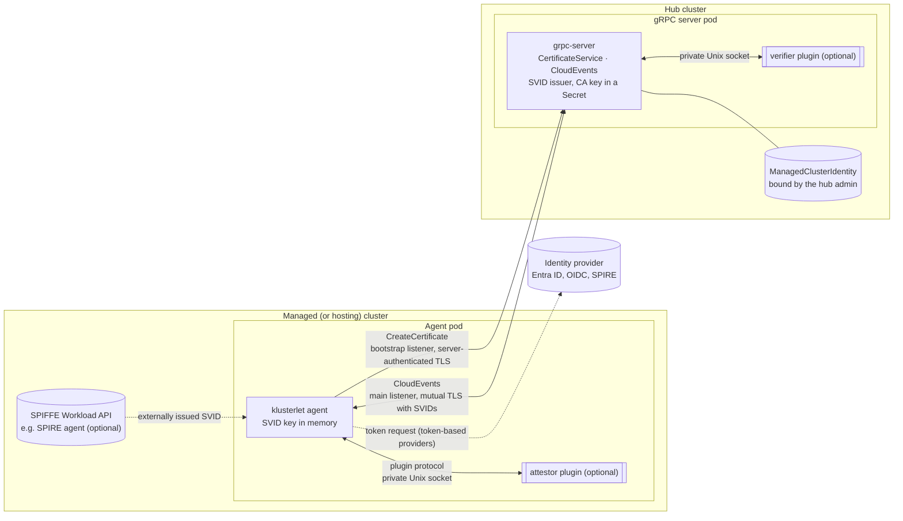

# Pluggable SPIFFE Identity for Hub and Klusterlet Communication

## Release Signoff Checklist

- [ ] Enhancement is `implementable`
- [ ] Design details are appropriately documented from clear requirements
- [ ] Test plan is defined
- [ ] Graduation criteria for dev preview, tech preview, GA
- [ ] User-facing documentation is created in [website](https://github.com/open-cluster-management-io/open-cluster-management-io.github.io/)

## Summary

This enhancement makes the cluster-manager (hub) and the klusterlet (agents) authenticate each
other with [SPIFFE][spiffe] identities: short-lived [X.509-SVIDs][x509-svid] that are presented
in mutual TLS on the gRPC registration transport. No bootstrap token, client certificate, or
private key is stored in a `Secret` on the managed cluster.

The design covers four ways for a cluster to get its identity:

| Use case | How it works | Vendor code in OCM |
|---|---|---|
| **SPIFFE between hub and klusterlet, with no extra server** | The hub issues SVIDs itself. An agent proves who it is with its Kubernetes ServiceAccount token, and the hub returns a short-lived SVID. | None |
| **Identity from SPIRE** (or any SPIFFE issuer) | The agent reads its SVID through the standard [SPIFFE Workload API][workload-api], or from files a helper keeps current. The hub trusts the issuer's bundle. | None |
| **Identity from Entra ID, Okta, Keycloak, Google** (or any OIDC provider) | The agent gets a token from the provider through standard OAuth 2.0 ([RFC 7523][rfc7523], [RFC 8693][rfc8693]). The hub verifies it as a standard OIDC token and issues the SVID. | None |
| **Custom attestation**, such as TPM or cloud instance documents | The organization builds an `Attestor` plugin for the agent and a `Verifier` plugin for the hub. The hub issues the SVID once the plugin's evidence is verified. | None |

In every case, the hub's gRPC server also has an SVID, so each side checks the other's SPIFFE ID.

The design is vendor agnostic. Standard protocols are supported directly, so the first three use
cases need no plugin. Everything else uses one extension mechanism: a **plugin** is a container
image that an organization builds. It implements a small, versioned gRPC protocol and runs next to
the OCM container in the same pod, reached over a private Unix socket. Plugins are not part of OCM:
OCM does not build, ship, or support them, and its code does not depend on them. An organization
integrates its own systems without changing OCM.

The design defines two profiles. The **Development** profile works with no external dependency.
The **Production** profile enforces the controls a production fleet needs, such as pod-bound
tokens and an admission policy on the agent cluster. The operators refuse to run a Production
configuration that does not meet them.

Keeping the hub CA key in an HSM or KMS is out of scope for this proposal. Signing stays behind an
internal interface, so that a follow-up proposal can add it as another plugin kind.

## Motivation

The gRPC registration driver ([141-grpc-based-registration][kep-141]) already makes the hub a
certificate authority for agents. What it stores on the managed cluster is the problem:

- **The bootstrap `Secret`** holds a token that can create `ManagedCluster`s and CSRs on the hub. It
  is usually long-lived and shared by every cluster joined with it.
- **The `hub-kubeconfig-secret`** holds the agent's private key and certificate. Anyone who can
  read it, through RBAC, an etcd backup, or a compromised node, holds the cluster's hub identity
  from anywhere until the certificate expires.
- **The certificate is long-lived.** If it expires while the hub is unreachable, the agent is locked
  out and needs a new bootstrap credential.
- **The hub CA key is a `Secret` on the hub.** Whoever reads it can mint any cluster's identity.

Many organizations must also meet rules that this does not satisfy:

- No long-lived credential may be stored in a cluster.
- Workload identity must come from the organization's identity system (SPIRE, Entra ID, or another
  provider), not from a separate system that each product runs on its own.

Today each identity system needs its own registration driver, such as `awsirsa` or the
[Azure AD driver][kep-195]. Each driver reimplements acceptance and RBAC, and covers one vendor.

### Goals

- Agents and the hub authenticate each other with short-lived X.509-SVIDs over mutual TLS. Each
  side checks the other's SPIFFE ID.
- No hub credential is stored in any `Secret` on the managed cluster, or on the hosting cluster in
  hosted modes.
- Out of the box, the hub issues SVIDs itself, and no external identity infrastructure is needed.
- The hub and the agents can take their identity from an organization's identity provider, either
  as SVIDs from a SPIFFE-native issuer or as tokens from a token-based provider.
- Organizations can add their own attestation, such as TPM, through plugins.
- Every integration point is vendor agnostic. Standard protocols are supported directly, and
  everything else through plugins that organizations build without changing OCM.
- Plugins are isolated and secured to production standards: a private socket, peer
  authentication, the restricted Pod Security Standard, and core checks on every result.
- Acceptance stays a double opt-in. A cluster joins only after the hub administrator binds its
  identity to the cluster.
- Hub RBAC, `CreatePermissions`/`Cleanup`, and SubjectAccessReview authorization keep working
  unchanged.
- All four klusterlet deployment modes are supported: `Default`, `Singleton`, `Hosted`, and
  `SingletonHosted`.
- `clusteradm` can set up a hub, join a cluster, and accept a cluster in this mode.

### Non-Goals

- **Building or shipping vendor plugins.** This proposal defines the plugin protocol, the SDK, and
  the conformance suite. Organizations build the plugins for their own attestation systems. OCM
  ships one sample plugin pair, for its own tests.
- **Holding the hub CA key in an HSM or KMS.** This is deferred to a follow-up proposal. All
  signing goes through an internal `Signer` interface, with one built-in implementation backed by a
  `Secret`. A later proposal can add a `Signer` plugin kind on the same plugin framework, without
  changing the issuance design.
- **The kube-apiserver registration path** (`csr`, `awsirsa`). OCM does not control the hub
  kube-apiserver's client authentication, so this proposal covers the gRPC transport only.
- **Addon credentials.** Addons keep using the existing `token` and `csr` addon drivers.
- **Running a SPIFFE Workload API for other workloads**, or managing SPIFFE federation. OCM consumes
  trust bundles; it does not distribute them to other systems.
- **Changing the existing certificate-based gRPC mode**, which remains the default.

## Proposal

### Terms

| Term | Meaning |
|---|---|
| SVID | A SPIFFE Verifiable Identity Document. This proposal uses X.509-SVIDs: certificates whose only URI SAN is a SPIFFE ID. |
| Trust domain | The SPIFFE trust root that an SVID belongs to, for example `ocm.example.com`. |
| Trust bundle | The CA certificates used to verify SVIDs of a trust domain. |
| Hub-issued | The hub's CA issues the SVID after the agent proves its identity. |
| Externally issued | An external SPIFFE issuer, such as SPIRE, issues the SVID, and the hub trusts that issuer's bundle. |
| Evidence | What an agent presents to get a hub-issued SVID, usually a signed token. |
| Agent role | `registration` or `work`, or `singleton` in the `Singleton` modes. |
| Plugin | A container image built by an organization that implements the plugin protocol. |

### How identity is issued

There are two ways for an agent to get its SVID. The hub administrator chooses one per cluster, and
one hub can serve clusters of both kinds.

**Hub-issued.** The hub is the issuer, so no identity server is needed.

1. The agent generates a key pair in memory.
2. It gets evidence of who it is. By default this is its projected ServiceAccount token. With a
   token-based provider such as Entra ID, it is a token from that provider.
3. It calls `CreateCertificate` on the hub with a CSR and the evidence.
4. The hub verifies the evidence against the identity bound to the cluster, signs an SVID with its
   CA key, and returns it.

The agent renews at half the SVID lifetime. Every renewal generates a new key and presents fresh
evidence.

**Externally issued.** An external SPIFFE issuer is the issuer.

1. The agent reads its SVID from the SPIFFE Workload API (for example a SPIRE agent, through the
   SPIFFE CSI driver), or from files that a helper keeps current.
2. It connects to the hub over mutual TLS with that SVID.
3. The hub verifies the SVID against the external trust domain's bundle and maps its SPIFFE ID to a
   cluster and role through the identity bound to the cluster.

In both cases the hub's gRPC server presents its own SVID. That SVID is issued by the hub's CA, or
by the hub cluster's external issuer. Agents check it against the expected hub SPIFFE ID.

### Architecture



Double-bordered boxes are plugin containers, present only when configured. Dashed lines are
optional integrations.

### Profiles

The `profile` field on the `ClusterManager` and the `Klusterlet` selects one of two profiles. Each
operator validates its own configuration against the profile. If the configuration does not meet
it, the operator reports `Degraded` with the unmet requirement and does not start the component.
There is no silent fallback.

| Requirement | Development | Production |
|---|---|---|
| Hub CA key | A `Secret`, generated by the hub | A `Secret`, readable only by the gRPC server, on a hub with encryption at rest |
| Hub CA | Self-signed | Self-signed, or an intermediate under the organization's root |
| SVID lifetime | 1h to 24h, default 24h | 1h to 24h, default 12h |
| Kubernetes token evidence | ServiceAccount must match | ServiceAccount name **and UID** must match, and the token must be bound to a pod |
| OIDC issuers | Any issuer the admin binds | Only issuers in the hub's `allowedIssuers` list |
| Agent admission policy on the agent cluster | Optional | **Required**, installed by the klusterlet operator |
| Plugin images | Pinned by digest | Pinned by digest |
| Issuance audit events | Logged | Logged, and emitted as Kubernetes Events |
| Status | `DevelopmentProfile=True` condition, warning that it is not for production | — |

The Development profile is what `clusteradm init` and `clusteradm join` set up by default. It is
meant for trying the feature and for test environments.

### User Stories

#### Story 1 - A developer tries SPIFFE identity with no external dependency

```
% clusteradm init --registration-auth=grpc --grpc-identity=spiffe \
    --spiffe-trust-domain=dev.ocm.example --context ${CTX_HUB}
% clusteradm join --registration-auth=grpc --grpc-identity=spiffe \
    --grpc-server=hub-grpc.example.com:443 --spiffe-hub-bundle=hub-bundle.pem \
    --cluster-name=managed-0 --context ${CTX_MANAGED}
% clusteradm accept --clusters managed-0 --spiffe-identity-file managed-0-identity.yaml \
    --context ${CTX_HUB}
```

The hub generates its CA key in a `Secret`. `clusteradm join` reads the
managed cluster's ServiceAccount issuer and its public keys, and writes them, with the agent
ServiceAccounts, to `managed-0-identity.yaml`. The hub administrator reviews that file and accepts
the cluster. The agents then get hub-issued SVIDs, with no `Secret` on the managed cluster.

#### Story 2 - An organization that runs SPIRE everywhere

The hub cluster and every managed cluster run SPIRE agents of the organization's trust domain
`corp.example`. No hub-issued SVIDs are wanted.

```yaml
# ClusterManager
trustDomain: corp.example
serverIdentity:
  source: WorkloadAPI           # the gRPC server gets its SVID from the hub cluster's SPIRE agent
externalTrustDomains:
  - name: corp.example
    bundleSource: {workloadAPI: {}}
---
# Klusterlet
identitySource:
  workloadAPI: {}               # the SPIFFE CSI driver mounts the SPIRE agent socket
hub:
  trustDomain: corp.example
  id: spiffe://corp.example/ns/open-cluster-management-hub/sa/grpc-server
```

On acceptance, the hub admin binds the agents' SPIRE IDs to the cluster:

```yaml
apiVersion: cluster.open-cluster-management.io/v1alpha1
kind: ManagedClusterIdentity
metadata:
  name: prod-eu-1
spec:
  external:
    trustDomain: corp.example
  agents:
    - role: registration
      subject: spiffe://corp.example/cluster/prod-eu-1/ns/open-cluster-management-agent/sa/klusterlet-registration-sa
    - role: work
      subject: spiffe://corp.example/cluster/prod-eu-1/ns/open-cluster-management-agent/sa/klusterlet-work-sa
```

SPIRE's own node and workload attestation, including image digest selectors, decides which
workload receives those IDs. OCM needs no plugin for this.

#### Story 3 - An organization that uses Entra ID for workload identity

The managed clusters run on AKS with Entra Workload ID. The organization wants every agent to be an
Entra identity, so that Entra's conditional access, audit, and lifecycle apply.

In Entra, an app registration represents the hub, for example `api://ocm-hub`. It requires app role
assignment, and each agent's managed identity is assigned its `OCM.Agent` app role. Without the
assignment requirement, Entra would issue tokens for the hub's audience to any identity in the
tenant that asked.

```yaml
# Klusterlet
identitySource:
  hubIssued:
    evidence:
      oauth2:
        tokenEndpoint: https://login.microsoftonline.com/<tenant>/oauth2/v2.0/token
        clientID: <client ID of the agent's managed identity or app>
        scope: api://ocm-hub/.default
        assertion:
          serviceAccountToken: {audience: api://AzureADTokenExchange}
```

The agent sends its projected ServiceAccount token to Entra as a client assertion
([RFC 7523][rfc7523]). This is standard workload identity federation, so OCM runs no Entra code.
The agent receives an Entra access token and presents it as evidence. The hub's built-in `oidc`
verifier checks it against Entra's published keys, together with the tenant and the app role. The
hub admin's binding names the agent's Entra object ID:

```yaml
spec:
  hubIssued:
    evidence:
      oidc:
        issuer: https://login.microsoftonline.com/<tenant>/v2.0
        subjectClaim: oid
        requiredClaims: {tid: <tenant>, roles: OCM.Agent}
  agents:
    - {role: registration, subject: <object ID>}
    - {role: work, subject: <object ID of the work identity>}
```

The same configuration, with a different endpoint and issuer, works for any provider that supports
OAuth 2.0 client assertions or token exchange ([RFC 8693][rfc8693]), such as Okta, Keycloak, or
Google.

#### Story 4 - An organization integrates its own attestation without changing OCM

On-premises clusters must prove their identity with the node's TPM. The organization builds two
plugin images: an `Attestor`, which produces a TPM quote bound to a hub challenge, and a `Verifier`,
which checks it against its device CA. It names them in the `Klusterlet` and `ClusterManager`
configurations, and binds clusters with a `tpm` evidence policy. Signing, acceptance, RBAC, and the
transport do not change.

#### Story 5 - Revoking a cluster

The hub administrator sets `hubAcceptsClient: false`, or deletes the `ManagedClusterIdentity`.
Within seconds, `CreateCertificate` rejects new requests, the authenticator rejects new
connections, and the gRPC server closes the cluster's open streams. The existing cleanup path
removes the cluster's RBAC bindings. SVIDs already issued remain valid until they expire, but they
can no longer be used.

### Risks and Mitigation

| Risk | Mitigation |
|---|---|
| **The hub CA key is stolen.** | The key is a `Secret` that only the gRPC server's ServiceAccount can read, and Production requires encryption at rest on the hub. CA rotation uses an overlap window. Keeping the key in an HSM is left to a follow-up proposal. |
| **A workload on the managed cluster impersonates an agent.** | Evidence binds to the agent's ServiceAccount (name and UID) and, in Production, to a pod. The klusterlet operator's admission policy allows only its own Deployment to run as the agent ServiceAccounts, with no command overrides, no `exec`, and no hand-minted tokens. A cluster administrator of the managed cluster can still act as its agent; no design can prevent that. |
| **One cluster's evidence is used for another cluster.** | The hub uses only the identity bound to the named cluster. The webhook rejects any `ManagedClusterIdentity` whose bindings overlap another cluster's. |
| **One agent role mints another's identity.** | The role comes from the verified subject through the binding, never from the request. |
| **An agent re-binds its own identity.** | `ManagedClusterIdentity` is writable only by hub administrators; agent identities have no access to it. |
| **The unauthenticated `CreateCertificate` endpoint is abused.** | It runs on a separate bootstrap listener: 128 KiB message limit, field limits, per-peer rate limits before a stream opens, and one rejection reason that does not reveal whether a cluster exists. Nothing else is served there. |
| **A stolen agent token.** | Tokens are audience-bound to the hub and expire within one hour. An SVID minted from one expires within the SVID lifetime. Revocation is immediate. Concurrent use by different pods is detected. |
| **A forged or foreign SVID.** | The authenticator requires a chain to a configured bundle, an exact trust domain match, and a binding for the SPIFFE ID. |
| **A man in the middle between agent and hub.** | Agents verify the hub's SVID and its exact SPIFFE ID. TLS must pass through load balancers unterminated. |
| **A faulty or malicious plugin.** | Core code builds certificates, sets identities, and verifies plugin results. A plugin cannot widen what is issued. Plugins run isolated, as described in [Plugin security](#plugin-security). |
| **A silent downgrade.** | Every failure fails closed. A Production configuration that does not meet the profile does not start. |
| **The identity provider is unavailable.** | Agents renew at half the SVID lifetime, so an outage shorter than that has no effect. Cached OIDC keys are used for up to one hour. |
| **Clock skew.** | 60s leeway on token validation, and `NotBefore` backdated by 60s. |
| **Lost audit trail without CSR objects.** | Every issuance is logged and, in Production, recorded as an Event with the subject, pod, and certificate serial. |

## Design Details

### Identity model

**SPIFFE IDs issued by the hub:**

| Workload | SPIFFE ID |
|---|---|
| Agent | `spiffe://<trustDomain>/ocm/cluster/<clusterName>/<agentRole>` |
| Hub gRPC server | `spiffe://<trustDomain>/ocm/hub/grpc-server` |

Externally issued SVIDs keep whatever IDs the external issuer assigns. The `ManagedClusterIdentity`
binding maps them to a cluster and role.

**Kubernetes identity.** The authenticator maps every authenticated agent to the same user and
groups that a certificate-mode agent has today:

- user `system:open-cluster-management:<clusterName>:<agentRole>`;
- groups `system:open-cluster-management:<clusterName>` and
  `system:open-cluster-management:managed-clusters`.

The per-cluster `ClusterRoleBinding`s bind these groups, so RBAC, `CreatePermissions`, `Cleanup`, and
SubjectAccessReview authorization are unchanged.

**`SPIFFEAuthenticator`.** A new authenticator in `sdk-go` runs on the main listener, ahead of the
existing authenticators. It accepts a peer certificate only if:

1. it has exactly one URI SAN, and that SAN is a valid SPIFFE ID;
2. it chains to the bundle of the SAN's trust domain, which must be the hub's trust domain or one of
   `externalTrustDomains`;
3. the SPIFFE ID resolves to a cluster and role:
   - in the hub's trust domain, the path is `/ocm/cluster/<cluster>/<role>`;
   - in an external trust domain, the ID is bound in a `ManagedClusterIdentity`, found through an
     index;
4. that cluster's `ManagedCluster` has `hubAcceptsClient: true`.

The certificate's Subject, if any, is ignored.

### Issuance paths

#### Hub-issued SVIDs

`CertificateService` is a new gRPC service in the gRPC server process. Issuance is synchronous and
creates no Kubernetes CSR objects.

```protobuf
// Served only on the bootstrap listener, without a client certificate.
service CertificateService {
  rpc CreateCertificate(CreateCertificateRequest) returns (CreateCertificateResponse);
  // Challenge returns a single-use nonce for evidence types that need one.
  rpc Challenge(ChallengeRequest) returns (ChallengeResponse);
}

// Served only on the main listener, which requires an authenticated peer.
service TrustService {
  // RotateTrust replaces the cluster's pinned Kubernetes signing keys after a key rotation.
  rpc RotateTrust(RotateTrustRequest) returns (RotateTrustResponse);
  // WatchBundle streams the trust bundles the agent must trust.
  rpc WatchBundle(WatchBundleRequest) returns (stream BundleUpdate);
}

message Evidence {
  string type = 1;       // "kubernetes", "oidc", or a plugin type
  bytes payload = 2;     // for example a JWT; at most 64 KiB
  bytes challenge = 3;   // at most 256 bytes; set only when the type needs one
}

message CreateCertificateRequest {
  string cluster_name = 1;  // at most 253 bytes
  string agent_role = 2;    // "registration", "work", or "singleton"
  bytes csr = 3;            // PEM PKCS#10, at most 8 KiB
  Evidence evidence = 4;
}

message CreateCertificateResponse {
  repeated bytes svid_chain = 1;  // PEM, leaf first
  repeated bytes bundle = 2;      // PEM CA certificates of the hub trust domain
}
```

**Two listeners.** An agent's first call has no client certificate, so the gRPC server serves two
listeners in one process:

- **Bootstrap listener**, port 8091 by default, as a second port of the gRPC `Service`. It serves
  only `CertificateService`, over TLS 1.3 with the server's SVID, and requests no client
  certificate. It sets `MaxRecvMsgSize` to 128 KiB, a low `MaxConcurrentStreams`, and short idle
  and keepalive timeouts. A `grpc.InTapHandle` applies the per-peer rate limit before a stream is
  accepted.
- **Main listener.** It serves CloudEvents and `TrustService` over TLS 1.3 and requires a client
  SVID. Every call must be authenticated; no method is exempt.

**`CreateCertificate` steps**, in order, so that cheap rejections come first:

1. Check field limits, then the per-cluster rate limit.
2. Load the `ManagedCluster` and its `ManagedClusterIdentity`. Both must exist, the cluster must
   have `hubAcceptsClient: true`, and the identity must use `hubIssued`. Otherwise, return
   `ClusterNotReady`. The same reason is used in every case, so an unauthenticated caller cannot
   tell whether a cluster exists.
3. Check that `evidence.type` matches the binding's evidence type and is enabled on the hub.
4. Verify the evidence with the matching verifier, against the binding. The verifier returns the
   verified subject.
5. Look up the subject in the binding's `agents`. It must map to `agent_role`, or the call fails
   with `AgentNotBound`.
6. Check the CSR's public key: ECDSA P-256 or P-384, or RSA with at least 3072 bits. The CSR's
   Subject and extensions are ignored.
7. Build the certificate and sign it through the `Signer`. The certificate has the SPIFFE ID as its
   only URI SAN, `ExtKeyUsage=ClientAuth`, and `IsCA=false`. `NotAfter` is the earlier of
   now + `svidTTL` and the CA's `NotAfter`, and `NotBefore` is now − 60s.
8. Verify the signature against the CA public key, then record the issuance (see
   [Observability and audit](#observability-and-audit)).

Errors returned to the caller carry only a reason code from a fixed list. Details stay in the hub's
logs.

**Agent renewal.** The agent keeps its SVID and key in memory. It renews at 50% of the lifetime,
with jitter, and retries with exponential backoff, including after expiry. Every renewal generates
a new key and presents fresh evidence, so renewing and recovering after a restart use the same code
path.

**The hub's own SVID.** In hub-issued mode, the gRPC server issues its own SVID through the
`Signer`. The key is generated in memory, and the SVID is renewed at half its lifetime. No
attestation is needed, because the server is the issuer.

#### Externally issued SVIDs

The agent's `identitySource` selects where the SVID comes from:

- **`workloadAPI`**: the agent reads its X.509-SVID and bundles from a [SPIFFE Workload
  API][workload-api] socket, using go-spiffe's `X509Source`. This works with any implementation,
  such as SPIRE. The operator mounts the socket through the SPIFFE CSI driver (`csi.spiffe.io`). A
  `hostPath` mount is never used.
- **`files`**: the agent reads `svid.pem`, `svid_key.pem`, and `bundle.pem` from a directory, and
  reloads them when they change. A helper such as `spiffe-helper` or cert-manager's
  `csi-driver-spiffe` keeps the files current, on a memory-backed CSI or `emptyDir` volume.

The hub's `serverIdentity` takes the same sources (`Hub`, `WorkloadAPI`, or `Files`), so the gRPC
server can also hold an SVID from the hub cluster's issuer.

In this mode the agent calls neither `CreateCertificate` nor `RotateTrust`. It connects straight to
the main listener.

### Evidence for hub-issued SVIDs

**On the agent: built-in evidence sources.** All of them are vendor neutral:

| Source | Evidence | Typical use |
|---|---|---|
| `serviceAccountToken` (default) | A projected ServiceAccount token, with the hub's audience and a lifetime of at most 1h | Any Kubernetes cluster |
| `oauth2` | An access token from an OAuth 2.0 token endpoint. The token is requested with a client assertion ([RFC 7523][rfc7523]) or a token exchange ([RFC 8693][rfc8693]), using a projected token as the assertion | Entra ID, Okta, Keycloak, Google, and other providers with workload identity federation |
| `file` | A JWT read from a file that another component keeps current | SPIRE JWT-SVIDs through `spiffe-helper`, Vault Agent, and cloud sidecars |
| `plugin` | Whatever the `Attestor` plugin produces | TPM, or any in-house system |

The agent reads the evidence afresh on every renewal.

**On the hub: built-in verifiers.**

- **`kubernetes`** verifies a ServiceAccount token. It checks:
  - the signature, against the JWKS pinned in the binding, or the issuer's discovery endpoint when
    the binding sets `jwksSource: Discovery`;
  - `iss`, `aud` (the hub's audience), `exp`, and `nbf`, with 60s leeway;
  - the subject, `system:serviceaccount:<ns>:<sa>`;
  - in Production, the ServiceAccount UID in the `kubernetes.io` claims, and that the token is bound
    to a pod.
- **`oidc`** verifies any OIDC JWT. It checks:
  - the signature, using the issuer's discovery document and JWKS, or JWKS pinned in the binding;
  - `alg`, which must be `RS256`, `PS256`, `ES256`, or `ES384`;
  - `iss`, `aud`, `exp`, and `nbf`;
  - the subject, read from the binding's `subjectClaim` (default `sub`);
  - each entry in `requiredClaims`: a string claim must equal the value, and an array claim, such
    as Entra's `roles`, must contain it.

  In Production, the issuer must match the hub's `allowedIssuers`.

Discovery and JWKS fetches use HTTPS only and verify the server certificate. They also:

- check that the discovery document's `issuer` matches;
- refuse redirects to another host, and limit responses to 1 MiB;
- cache keys for 10 minutes, and refresh at most once a minute when an unknown key ID appears;
- keep serving cached keys for up to one hour when the issuer is unreachable, then fail closed.

**Kubernetes signing-key rotation.** For a binding with pinned JWKS, the agent watches its cluster's
JWKS. When the keys change, it calls `RotateTrust` with the new keys and a fresh token, over its
current SVID. The hub accepts the change only if:

- the caller's SVID is for the same cluster;
- the issuer and `agents` are unchanged;
- the token verifies against the new keys;
- the new bindings are unique.

If the SVID has expired first, the hub administrator accepts the cluster again with a new identity
file.

### ManagedClusterIdentity

`ManagedClusterIdentity` is a new cluster-scoped hub resource in
`cluster.open-cluster-management.io/v1alpha1`. It has the same name as its `ManagedCluster`. It
holds what the hub administrator accepted: which identity is allowed to act as each agent of the
cluster. Only hub administrators can write it. Agent identities are given no access.

```go
type ManagedClusterIdentitySpec struct {
	// Exactly one of hubIssued or external is set.
	// +optional
	HubIssued *HubIssuedIdentity `json:"hubIssued,omitempty"`
	// +optional
	External *ExternalIdentity `json:"external,omitempty"`

	// agents binds each agent role to the subject that may act as it.
	// +listType=map
	// +listMapKey=role
	// +kubebuilder:validation:MinItems=1
	Agents []AgentBinding `json:"agents"`
}

type HubIssuedIdentity struct {
	// Exactly one of the following is set.
	Evidence EvidencePolicy `json:"evidence"`
}

type EvidencePolicy struct {
	// +optional
	Kubernetes *KubernetesEvidencePolicy `json:"kubernetes,omitempty"`
	// +optional
	OIDC *OIDCEvidencePolicy `json:"oidc,omitempty"`
	// plugin is passed unchanged to the verifier plugin of the given type.
	// +optional
	Plugin *PluginEvidencePolicy `json:"plugin,omitempty"`
}

type KubernetesEvidencePolicy struct {
	Issuer string `json:"issuer"`
	// +kubebuilder:validation:Enum=Pinned;Discovery
	// +kubebuilder:default:=Pinned
	JWKSSource string `json:"jwksSource,omitempty"`
	// jwks is required when jwksSource is Pinned.
	// +optional
	JWKS *runtime.RawExtension `json:"jwks,omitempty"`
}

type OIDCEvidencePolicy struct {
	Issuer string `json:"issuer"`
	// +kubebuilder:default:=sub
	SubjectClaim string `json:"subjectClaim,omitempty"`
	// +optional
	RequiredClaims map[string]string `json:"requiredClaims,omitempty"`
	// jwks pins the issuer's keys instead of using discovery.
	// +optional
	JWKS *runtime.RawExtension `json:"jwks,omitempty"`
}

type PluginEvidencePolicy struct {
	Type string `json:"type"`
	// +kubebuilder:pruning:PreserveUnknownFields
	Config runtime.RawExtension `json:"config"`
}

type ExternalIdentity struct {
	// trustDomain must be one of the hub's externalTrustDomains.
	TrustDomain string `json:"trustDomain"`
}

type AgentBinding struct {
	// +kubebuilder:validation:Enum=registration;work;singleton
	Role string `json:"role"`
	// subject is the verified subject: a ServiceAccount ("system:serviceaccount:<ns>:<sa>"), the
	// value of the OIDC subjectClaim, a plugin-defined subject, or a SPIFFE ID for external.
	Subject string `json:"subject"`
	// serviceAccountUID is required in the Production profile for kubernetes evidence.
	// +optional
	ServiceAccountUID string `json:"serviceAccountUID,omitempty"`
}
```

**Validation.** A validating webhook on the hub enforces three rules:

- **The policy is valid.** It checks each `ManagedClusterIdentity` against its verifier. Plugin
  policies are checked by the plugin's `ValidatePolicy`.
- **Bindings are unique.** Each binding is a string such as `<issuer>|<JWK thumbprint>|<subject>`
  for pinned Kubernetes keys, `<issuer>|<subject>` for discovery and OIDC, or
  `<trustDomain>|<SPIFFE ID>` for external. No binding may appear on two clusters, so a given piece
  of evidence or SVID can match only one cluster. Hosted klusterlets that share a hosting cluster's
  keys stay distinct, because their ServiceAccounts are in different namespaces.
- **The profile is respected.** For example, in Production a `kubernetes` binding needs
  `serviceAccountUID`, and an OIDC issuer must be in `allowedIssuers`.

**Status.** `status.conditions` reports `Bound`, and, after an issuance with different claims, a
`ClaimsChanged` warning.

### How agents verify the hub

The agent's configuration names the hub's trust domain and SPIFFE ID. They default to
`spiffe://<trustDomain>/ocm/hub/grpc-server`. On both listeners, the agent:

1. verifies that the server's SVID chains to the hub trust domain's bundle;
2. requires the exact hub SPIFFE ID, using go-spiffe's `tlsconfig.AuthorizeID`.

The server's host name is not checked. Load balancers in front of the gRPC server must pass TLS
through without terminating it.

**Bootstrap bundle.** In hub-issued mode, `clusteradm init` writes the hub trust bundle (CA
certificates only) to `hub-bundle.pem`, and `clusteradm join` stores it in a `ConfigMap`. It is
public, so no `Secret` is needed. After joining, the agent keeps the bundle current through
`WatchBundle`, which carries CA rotation.

In externally issued mode, bundles come from the configured source: the Workload API, bundle files,
or a [SPIFFE bundle endpoint][bundle-endpoint].

### Trust bundles and external trust domains

The hub lists every external trust domain it accepts, each with a bundle source:

```yaml
externalTrustDomains:
  - name: corp.example
    bundleSource:
      workloadAPI: {}           # the hub cluster's own SPIFFE issuer provides federated bundles
  - name: partner.example
    bundleSource:
      endpoint:
        url: https://spire.partner.example/bundle
        profile: https_spiffe   # or https_web
        endpointSPIFFEID: spiffe://partner.example/spire/server
  - name: lab.example
    bundleSource:
      configMap: {name: lab-bundle}
```

Bundles are refreshed at the interval the source specifies, or every five minutes. A refresh that
would leave an empty bundle is rejected.

### Hub signing key

**Key storage.** The hub CA key is a `Secret` in the hub's `open-cluster-management-hub` namespace:

- the cluster-manager operator generates it, and only the gRPC server's ServiceAccount can read it;
- in Production, the deployment guide requires encryption at rest on the hub, for example
  through a Kubernetes KMS provider, and restricts who can read Secrets in that namespace.

**The `Signer` interface.** Core code signs through an internal Go interface. The certificate is
always built by core code, and the signature is verified against the CA public key before use:

```go
type Signer interface {
	// Public returns the CA public key for keyID, or the active key when keyID is empty.
	Public(ctx context.Context, keyID string) (crypto.PublicKey, error)
	// Sign signs a digest with the given key.
	Sign(ctx context.Context, keyID string, digest []byte, opts crypto.SignerOpts) ([]byte, error)
}
```

This proposal has one implementation, backed by the `Secret`. Holding the key in an HSM or KMS is
deferred: a follow-up proposal can add a `Signer` plugin kind that implements this interface over
the plugin framework, without changing issuance.

**CA hierarchy.**

- **`SelfSigned`**: the hub creates a root CA certificate for its key.
- **`Intermediate`**: `clusteradm init --spiffe-ca-csr` produces a CSR for the hub's key. The
  organization's root CA signs it, and the chain is stored in a ConfigMap. The bundle then carries
  the organization's root, so other systems that trust that root can verify OCM SVIDs.

**Rotation.** Rotation uses an overlap window:

1. A new key is generated, and its CA certificate is added to the bundle.
2. After one bundle propagation interval (default 1h), signing switches to the new key.
3. The old CA certificate leaves the bundle once every SVID it signed has expired, at most one
   `svidTTL` later. The old key is then deleted.

**Load.** Each agent renews at half its lifetime, so it needs two signatures per lifetime. For
10,000 clusters with two agents each, that is about 0.5 signatures per second at a 24h lifetime,
and about 11 per second at 1h.

### Plugins

**Plugin kinds:**

| Kind | Runs in | Purpose |
|---|---|---|
| `Verifier` | gRPC server pod and webhook pod (hub) | Verifies a custom evidence type, and validates its policy |
| `Attestor` | Agent pods | Produces a custom evidence type |

SPIFFE-native issuers, OIDC providers, and OAuth 2.0 providers need no plugin, because they are
supported through their standards. A `Signer` kind, for holding the hub CA key in an HSM, is left
to a follow-up proposal.

**Protocol.** The plugin protocol is versioned gRPC, in the package `ocm.identity.plugin.v1alpha1`
in `sdk-go`. Every plugin serves `Plugin`, plus the service for its kind:

```protobuf
service Plugin {
  rpc Handshake(HandshakeRequest) returns (HandshakeResponse);
}
message HandshakeRequest {
  repeated string protocol_versions = 1;
  string kind = 2;          // "Verifier", "Attestor"
  string type = 3;          // for Verifier and Attestor, the evidence type
  bytes config = 4;         // the plugin's config, as JSON
}
message HandshakeResponse {
  string protocol_version = 1;
  bool needs_challenge = 2; // Verifier and Attestor
}

service Verifier {
  rpc ValidatePolicy(ValidatePolicyRequest) returns (ValidatePolicyResponse);
  rpc Verify(VerifyRequest) returns (VerifyResponse);
}
message ValidatePolicyRequest { bytes policy = 1; }
message ValidatePolicyResponse { repeated string bindings = 1; }
message VerifyRequest {
  string cluster_name = 1;
  bytes evidence = 2;
  bytes policy = 3;
  string audience = 4;
  bytes challenge = 5;
}
message VerifyResponse {
  string subject = 1;                    // looked up in the binding's agents
  map<string, string> attributes = 2;    // logged only
}

service Attestor {
  rpc GetEvidence(GetEvidenceRequest) returns (GetEvidenceResponse);
}
message GetEvidenceRequest { bytes challenge = 1; }
message GetEvidenceResponse { bytes evidence = 1; }
```

A plugin reports a failure with a gRPC status that carries a `google.rpc.ErrorInfo`, whose reason
comes from a fixed list.

**Deployment.** Plugins are configured in a `plugins` list on the `ClusterManager` or `Klusterlet`:
name, kind, image (pinned by digest), args, env, resources, and volumes. For each plugin, the
operator:

- adds the plugin as a native sidecar container (an init container with `restartPolicy: Always`) to
  every pod that uses it. In hosted modes, agent pods and their plugins run on the hosting cluster.
- gives it a private socket, as described in [Plugin security](#plugin-security);
- waits for its handshake, up to `startupTimeout` (default 60s), before the OCM container serves.

**SDK and conformance.** `sdk-go` provides:

- the generated stubs;
- `plugin.Serve`, which applies every plugin-side security control;
- a conformance suite, as a Go test package and as a container image;
- a sample `Attestor` and `Verifier` pair, based on a test key, for OCM's tests and as a template.
  It is not a supported plugin.

Plugins may be written in any language that has gRPC support, provided they meet the same controls.

#### Plugin security

The plugin channel carries attestation evidence and verification decisions, so it is protected
against:

- other containers in the pod, including other plugins;
- other pods and processes on the node;
- a plugin that tries to do more than its kind allows.

Root on the node, the container runtime, and anyone who can `exec` into the pod are out of scope.
They can already read the OCM container's memory.

The controls are not configurable, and none of them can be turned off:

1. **A private socket per plugin.** Each plugin gets its own `emptyDir` with `medium: Memory`, mounted
   only into that plugin and the OCM container. Because no two plugins share a volume, one plugin
   cannot call another. Access through the volume works as follows:
   - the operator sets a pod `fsGroup`, so each volume is group-owned with mode `2770`;
   - `plugin.Serve` creates the socket with mode `0660`;
   - before dialing, the OCM container checks with `lstat` that the path is a socket, not a symlink,
     owned by the plugin's UID and the `fsGroup` group.
2. **Filesystem sockets only.** Containers in a pod share a network namespace. Plugins therefore
   never listen on TCP, loopback, or abstract sockets, and the conformance suite fails a plugin that
   does.
3. **Peer authentication on both ends.** The operator runs every container under its own non-root UID
   and sets `runAsUser` itself. On each connection, both ends read the peer's UID with `SO_PEERCRED`
   and close the connection unless it is the UID they expect. This check is a gRPC
   `TransportCredentials` in `sdk-go`, and it runs before any call.
4. **No TLS on the socket.** Controls 1 to 3 leave two kernel-authenticated endpoints, and the bytes
   never leave the kernel. TLS would need a key delivered into the pod, which is the kind of stored
   credential this design removes. The Kubernetes KMS v2 plugin and CSI drivers use the same model.
5. **Separate processes and credentials.** The operator sets `shareProcessNamespace: false` and
   `automountServiceAccountToken: false`. The hub-audience token is mounted only into the OCM
   container. A plugin gets only the Secrets and tokens listed in its own entry. CEL validation
   rejects a plugin token whose audience is the hub's. The operator also rejects one that its own
   cluster's `TokenReview` accepts, because that is a Kubernetes API audience.
6. **Restricted containers.** Every container meets the `restricted` Pod Security Standard:
   - non-root, with all capabilities dropped (`drop: [ALL]`, nothing added);
   - no privilege escalation;
   - a read-only root filesystem and the `RuntimeDefault` seccomp profile.

   Plugin volumes may only be `configMap`, `secret`, `projected`, `emptyDir`, or `csi`. TPM
   devices are reached through device plugins. CEL validation rejects anything else.
7. **Bounded calls.** Every call has a deadline: 10s for evidence calls, and `startupTimeout` for
   the handshake. Messages are limited to 64 KiB, and the number of calls in
   flight to each plugin is capped. `plugin.Serve` enforces the same limits and serves no gRPC
   reflection.
8. **Results are checked.**
   - **`Verifier`**: core code uses only the returned subject, as a key into the binding's `agents`.
   - **`Attestor`**: its evidence is checked by the hub like any other evidence.

**Fail closed.** The component reports `Degraded` and does not serve if:

- a plugin is missing or fails its handshake;
- the protocol versions do not overlap;
- the socket fails its ownership check, or the peer check fails.

If a plugin fails later, calls through it fail. The agent keeps its current SVID until it expires.
There is no fallback to a built-in implementation.

### Hardening the agent cluster

In the Production profile, the klusterlet operator installs a `ValidatingAdmissionPolicy` (needs
Kubernetes 1.30+) in the cluster that runs the agents. It allows only the operator's own pods to
act as the agent ServiceAccounts:

| Object that uses an agent ServiceAccount | Only allowed creator |
|---|---|
| `Deployment` | The klusterlet operator's ServiceAccount, with the approved image digest and no command override |
| `ReplicaSet` | `system:serviceaccount:kube-system:deployment-controller`, owned by that Deployment |
| `Pod` | `system:serviceaccount:kube-system:replicaset-controller`, owned by that ReplicaSet |
| `serviceaccounts/token` for an agent ServiceAccount | Kubelets (`system:node:*`) only |
| `pods/exec`, `pods/attach` in the agent namespace | Denied, except to cluster administrators |

Agent pods also run under the `restricted` Pod Security Standard, with a read-only root filesystem.
The SVID key exists only in process memory.

On the hub, the issuance log and the `ClaimsChanged` condition record which pod received each SVID.
If more pods hold live SVIDs for a cluster and role than that agent has replicas, the hub raises a
warning Event.

### Configuration API

`authType` stays `grpc`. A new `identityMode` field selects `SPIFFE`, and a `spiffe` object holds its
settings.

```go
// ClusterManager: spec.registrationConfiguration.registrationDrivers[authType=grpc].grpc
type GRPCHubIdentityConfig struct {
	// +kubebuilder:validation:Enum=Certificate;SPIFFE
	// +kubebuilder:default:=Certificate
	IdentityMode string `json:"identityMode,omitempty"`
	// +optional
	SPIFFE *SPIFFEHubConfig `json:"spiffe,omitempty"`
}

type SPIFFEHubConfig struct {
	// +kubebuilder:validation:Enum=Development;Production
	// +kubebuilder:default:=Development
	Profile string `json:"profile,omitempty"`
	TrustDomain string `json:"trustDomain"`
	// +kubebuilder:default:="open-cluster-management.io/spiffe"
	TokenAudience string `json:"tokenAudience,omitempty"`
	// +optional
	SVIDTTL *metav1.Duration `json:"svidTTL,omitempty"`

	// hubIssuer configures hub-issued SVIDs. When unset, the hub issues none.
	// +optional
	HubIssuer *HubIssuerConfig `json:"hubIssuer,omitempty"`
	// serverIdentity selects where the gRPC server gets its SVID. Default: Hub.
	// +optional
	ServerIdentity IdentitySource `json:"serverIdentity,omitempty"`
	// +optional
	ExternalTrustDomains []ExternalTrustDomain `json:"externalTrustDomains,omitempty"`
	// +optional
	Plugins []PluginSpec `json:"plugins,omitempty"`
}

type HubIssuerConfig struct {
	// +optional
	CA CAConfig `json:"ca,omitempty"`
	// evidence lists the evidence types the hub accepts: kubernetes, oidc, and plugin verifiers.
	// +kubebuilder:default:={{type: kubernetes}}
	Evidence []EvidenceTypeConfig `json:"evidence,omitempty"`
	// allowedIssuers limits the OIDC issuers that bindings may name. Required in Production when
	// oidc is enabled.
	// +optional
	AllowedIssuers []string `json:"allowedIssuers,omitempty"`
}

type CAConfig struct {
	// +kubebuilder:validation:Enum=SelfSigned;Intermediate
	// +kubebuilder:default:=SelfSigned
	Mode string `json:"mode,omitempty"`
	// chainConfigMap holds the intermediate certificate and its chain, for Intermediate.
	// +optional
	ChainConfigMap string `json:"chainConfigMap,omitempty"`
}

// Klusterlet: spec.registrationConfiguration.registrationDriver.grpc
type SPIFFEAgentConfig struct {
	// +kubebuilder:validation:Enum=Development;Production
	// +kubebuilder:default:=Development
	Profile string `json:"profile,omitempty"`
	Hub HubIdentity `json:"hub"`
	IdentitySource AgentIdentitySource `json:"identitySource"`
	// +optional
	Plugins []PluginSpec `json:"plugins,omitempty"`
}

type HubIdentity struct {
	TrustDomain string `json:"trustDomain"`
	// id defaults to spiffe://<trustDomain>/ocm/hub/grpc-server.
	// +optional
	ID string `json:"id,omitempty"`
	// bundleConfigMap holds the hub bundle used before the first SVID (hub-issued mode).
	// +optional
	BundleConfigMap string `json:"bundleConfigMap,omitempty"`
}

// Exactly one field is set.
type AgentIdentitySource struct {
	// +optional
	HubIssued *HubIssuedSource `json:"hubIssued,omitempty"`
	// +optional
	WorkloadAPI *WorkloadAPISource `json:"workloadAPI,omitempty"`
	// +optional
	Files *FilesSource `json:"files,omitempty"`
}

type HubIssuedSource struct {
	// Exactly one field is set. Default: serviceAccountToken.
	Evidence EvidenceSource `json:"evidence,omitempty"`
}

type EvidenceSource struct {
	// +optional
	ServiceAccountToken *ServiceAccountTokenSource `json:"serviceAccountToken,omitempty"`
	// +optional
	OAuth2 *OAuth2Source `json:"oauth2,omitempty"`
	// +optional
	File *FileTokenSource `json:"file,omitempty"`
	// plugin names an Attestor plugin.
	// +optional
	Plugin string `json:"plugin,omitempty"`
}

type OAuth2Source struct {
	TokenEndpoint string `json:"tokenEndpoint"`
	// +kubebuilder:validation:Enum=ClientAssertion;TokenExchange
	// +kubebuilder:default:=ClientAssertion
	Grant    string `json:"grant,omitempty"`
	ClientID string `json:"clientID,omitempty"`
	Scope    string `json:"scope,omitempty"`
	// assertion is the projected ServiceAccount token used as the client assertion or subject token.
	Assertion ServiceAccountTokenSource `json:"assertion"`
}

type PluginSpec struct {
	// +kubebuilder:validation:Pattern=`^[a-z0-9]([-a-z0-9]{0,40}[a-z0-9])?$`
	Name string `json:"name"`
	// +kubebuilder:validation:Enum=Verifier;Attestor
	Kind string `json:"kind"`
	// type is the evidence type, for Verifier and Attestor.
	// +optional
	Type string `json:"type,omitempty"`
	// +kubebuilder:validation:Pattern=`^[^@]+@sha256:[a-f0-9]{64}$`
	Image string `json:"image"`
	// +optional
	Args []string `json:"args,omitempty"`
	// +optional
	Env []corev1.EnvVar `json:"env,omitempty"`
	// +optional
	Resources corev1.ResourceRequirements `json:"resources,omitempty"`
	// volumes are mounted only into this plugin. CEL restricts the volume types.
	// +optional
	Volumes []PluginVolume `json:"volumes,omitempty"`
	// +kubebuilder:pruning:PreserveUnknownFields
	// +optional
	Config *runtime.RawExtension `json:"config,omitempty"`
	// +kubebuilder:default:="60s"
	// +optional
	StartupTimeout *metav1.Duration `json:"startupTimeout,omitempty"`
}
```

The remaining types (`IdentitySource`, `ExternalTrustDomain`, `EvidenceTypeConfig`,
`ServiceAccountTokenSource`, `FileTokenSource`, `WorkloadAPISource`, `FilesSource`, and
`PluginVolume`) follow the YAML shown in the user stories. Profile rules that span several fields
are enforced by CEL where possible, and otherwise by the operator, which reports `Degraded`.

Both sides are gated by a new `SPIFFEIdentity` feature gate, alpha and off by default.

### clusteradm

| Command | New flags |
|---|---|
| `init` | `--grpc-identity=spiffe`, `--spiffe-trust-domain`, `--spiffe-profile`, `--spiffe-config-file` (the full `spiffe` object, for plugins and external trust domains), `--spiffe-ca-csr`. It writes `hub-bundle.pem`. |
| `join` | `--grpc-identity=spiffe`, `--spiffe-hub-bundle`, `--spiffe-identity-source=hub-issued\|workload-api\|files`, `--spiffe-config-file`. It writes `<cluster>-identity.yaml`, a draft `ManagedClusterIdentity`. |
| `accept` | `--spiffe-identity-file`. It creates the `ManagedClusterIdentity` and sets `hubAcceptsClient: true`. |

The identity file holds only public data. The hub administrator should still receive it over a
trusted channel and review it, because it decides who can act as the cluster.

### Observability and audit

- **Reason codes.** Failures carry a code from a fixed list, for example `ClusterNotReady`,
  `EvidenceInvalid`, `AgentNotBound`, `CSRKeyRejected`, `RateLimited`, and `PluginRejectedPeer`. Unknown plugin reasons become `PluginOther`. Only codes are used in metric
  labels and condition reasons. Free-text details are truncated to 256 bytes, sanitized, and logged.
- **Metrics:**
  - `ocm_spiffe_svid_issued_total{evidence}` and `ocm_spiffe_svid_rejected_total{evidence,reason}`;
  - `ocm_spiffe_plugin_up{plugin}`;
  - `ocm_spiffe_bundle_age_seconds{trust_domain}`.

  The `evidence` label takes only the enabled types.
- **Audit.** Every issuance is logged with the cluster, role, evidence type, subject, pod (when
  known), serial number, and expiry. In Production, each issuance is also recorded as an Event on
  the `ManagedClusterIdentity`.

### Workflow summary

**Join, hub-issued:**

1. `clusteradm join` deploys the klusterlet with the hub bundle and writes the identity file.
2. Agents call `CreateCertificate` and get `ClusterNotReady` until acceptance.
3. `clusteradm accept` creates the `ManagedClusterIdentity` and sets `hubAcceptsClient: true`.
4. Agents receive SVIDs and connect to the main listener.

**Join, externally issued:**

1. The organization's issuer gives each agent its SVID.
2. `clusteradm accept` binds those SPIFFE IDs.
3. Agents connect to the main listener.

**Unjoin.** `clusteradm unjoin` removes the klusterlet. Deleting the `ManagedCluster` deletes its
`ManagedClusterIdentity` through an owner reference, and the existing cleanup removes RBAC.
There is no certificate to revoke and no Secret to delete.

### Open Questions

- **API group and placement of `ManagedClusterIdentity`.** Should it be a separate resource, as
  proposed, or a field on `ManagedCluster` protected by the `managedclusters/accept` subresource?
- **Image signature verification.** Should the operators verify plugin image signatures, for example
  with Sigstore, in addition to requiring a digest, or should that be left to cluster-level policy?
- **Default Production SVID lifetime.** Is 12h the right default, balancing exposure against the
  margin for identity-provider outages?
- **Challenge-based evidence.** Is a single-use, HMAC-signed challenge sufficient for TPM attestation
  across gRPC server replicas, or do plugin verifiers need shared state?

### Test Plan

- **Unit tests:**
  - Each verifier rejects a wrong issuer, audience, subject, signature, algorithm, or expiry.
  - The `kubernetes` verifier enforces the ServiceAccount UID and the pod binding in Production.
  - Certificate construction ignores the CSR's identity fields, and builds the SAN, key usage, and
    lifetime correctly.
  - `SPIFFEAuthenticator` rejects:
    - an unknown trust domain;
    - an unbound external SPIFFE ID;
    - a malformed path;
    - an unaccepted cluster.
  - `CreateCertificate` rejects:
    - a role mismatch;
    - an unbound subject;
    - a request over any field limit.

    It returns the same reason for a missing, unaccepted, or unbound cluster.
  - The webhook rejects overlapping bindings and profile violations. It accepts Hosted klusterlets
    that share a hosting cluster's keys.
  - The renewer renews at 50%, retries after expiry, and generates a new key on every renewal.
  - Profile validation: a Production hub without `allowedIssuers` when `oidc` is enabled does not
    start, and a Production klusterlet on a cluster without admission policy support does not
    start.
  - `requiredClaims` matches a string claim exactly and an array claim by membership.
  - Operator rendering:
    - each plugin has its own socket volume;
    - each container has its own UID and the restricted context;
    - `shareProcessNamespace: false` and `automountServiceAccountToken: false` are set;
    - plugins do not mount the hub-audience token.
  - CEL rejects an image not pinned by digest, a disallowed volume type, and a plugin token with
    the hub audience.
  - The peer-credential check rejects an unexpected UID on both ends. Socket checks reject a symlink
    and a wrong owner.
- **Plugin conformance suite**, run against the built-in implementations through the protocol, and
  required for every plugin:
  - a `Verifier` rejects evidence for another cluster, expired evidence, and replayed evidence;
  - the handshake rejects a version mismatch;
  - the plugin rejects an unexpected peer UID, opens no other listener, and enforces message limits.
- **Integration tests:**
  - `CreateCertificate` with a fake Kubernetes issuer, a fake OIDC provider, and a fake OAuth 2.0
    token endpoint.
  - Externally issued SVIDs from a test Workload API server.
  - The bootstrap listener serves only `CertificateService`, and enforces its message limit. The
    main listener rejects every unauthenticated call.
  - CA rotation with overlapping bundles. Kubernetes key rotation through `RotateTrust`.
  - Plugin failure paths: a plugin that exits, hangs, runs as the wrong UID, or returns malformed
    results.
  - Revocation closes open streams.
- **e2e tests on kind**, for each klusterlet mode:
  - Join, accept, and register with hub-issued SVIDs (Development profile).
  - The Production profile with the agent admission policy.
  - The sample `Attestor` and `Verifier` plugin pair.
  - SPIRE as the external issuer for the agents and the hub.
  - An OIDC provider (Dex) through the `oauth2` evidence source.
  - A real `ManifestWork` round trip.
  - Agent restart, revocation, CA rotation, and Kubernetes key rotation.
  - No Secret in the agent namespace contains a key, a certificate, or a hub token.

### Graduation Criteria

- **Alpha:**
  - The `SPIFFEIdentity` feature gate, off by default.
  - Hub-issued SVIDs with `kubernetes` evidence.
  - The hub's own SVID, and agents verifying it.
  - `ManagedClusterIdentity` `v1alpha1`.
  - The Development profile.
  - The plugin framework: the protocol, the SDK, the conformance suite, and the sample
    `Attestor` and `Verifier` pair.
  - `Default` and `Singleton` modes.
- **Beta:**
  - The Production profile, with its enforcement and the agent admission policy.
  - `oidc` evidence, and the `oauth2` and `file` evidence sources.
  - Externally issued SVIDs (Workload API and files) and external trust domains.
  - Hosted modes.
  - CA rotation and `RotateTrust`.
  - `clusteradm` support.
  - e2e coverage for every mode and source.
  - Plugin protocol `v1beta1`, with no incompatible changes afterwards.
- **GA:**
  - Two releases at beta with no API changes.
  - Plugin protocol `v1`.
  - Website documentation, including a production deployment guide.
  - An independent security review.

### Upgrade / Downgrade Strategy

- **Existing clusters** are unaffected. Certificate mode remains the default.
- **Migrating a cluster:**
  1. The hub administrator creates the cluster's `ManagedClusterIdentity` while the cluster is
     still connected in certificate mode.
  2. The klusterlet switches to `identityMode: SPIFFE`, and the agents obtain SVIDs.
  3. Once the agents report `HubConnectionDegraded=False`, the operator deletes the unused
     `hub-kubeconfig-secret` and bootstrap Secret.
- **Development to Production.** The administrator meets the Production requirements, such as
  `allowedIssuers`, ServiceAccount UIDs in the bindings, and the agent admission policy, then sets
  `profile: Production`. The operator refuses the switch until every requirement is met.
- **Downgrade.** Switching a cluster back to certificate mode needs a bootstrap Secret, as for a
  fresh join.

### Version Skew Strategy

- **A newer agent and an older hub.** An agent in SPIFFE mode that gets `Unimplemented` reports
  `HubConnectionDegraded` with the message `hub does not support SPIFFE identity`.
- **An older agent** never selects SPIFFE mode, so it is unaffected.
- **Plugins.** The handshake negotiates the protocol version. A plugin image can support several
  versions, so one image works across OCM releases. With no common version, the component fails
  closed.

## Implementation History

- 2026-10-24: Provisional KEP opened.
- 2026-10-24: Rewritten around hub-issued SVIDs, external identity providers through open
  standards, plugins for custom attestation, and two profiles. HSM support deferred.

## Drawbacks

- **A new pre-authentication endpoint.** The bootstrap listener is narrow and rate-limited, but it
  is a surface that does not exist today.
- **The plugin protocol is a public API**, and must stay compatible once it reaches beta.
- **More configuration.** Two issuance paths, several evidence sources, and two profiles are more to
  learn than one fixed mechanism. The defaults keep the simple case to three `clusteradm` commands.
- **Extra containers.** Each plugin adds a container to the affected pods, and changing a plugin
  restarts them.
- **No CSR objects.** Issuance is not visible as Kubernetes CSRs. Audit relies on logs, metrics, and
  Events.

## Alternatives

- **A separate `spiffe` `authType`.** The transport, RBAC, and acceptance are those of the gRPC
  driver, so SPIFFE is an identity mode of it rather than a new driver.
- **One driver per vendor** (`awsirsa`, [Azure AD][kep-195]). Each driver reimplements acceptance and
  RBAC, and none helps mixed or on-premises fleets. Here, vendors integrate through standards or
  plugins.
- **SPIRE only.** This gives the richest attestation, but every fleet would have to run SPIRE, and
  organizations using other providers would be left out. SPIRE is fully supported through the
  Workload API.
- **Vendor SDKs compiled into OCM.** This is simpler to operate, but every cloud or in-house
  system would need an OCM change and release, and OCM would carry each vendor's dependencies and
  licenses.
- **In-process plugins** (`hashicorp/go-plugin` binaries mounted into the OCM container). The binary
  must match OCM's image, and cannot bring its own libraries or devices. A container image is the
  unit organizations already build, sign, and scan.
- **Plugins as a separate Deployment reached over the network.** Evidence and verification
  results would cross the network, and the channel would need its own credentials. On the agent,
  those credentials would depend on the identity the plugin helps obtain. A pod-local socket needs
  neither.
- **Plugins as OCM addons.** Addons are delivered through ManifestWork, which needs the cluster's hub
  identity, so an attestor addon could not take part in the first join. A broken addon update could
  also leave the agent unable to renew its SVID, and then unable to receive the fix. Addons remain a
  good way to distribute surrounding infrastructure, such as SPIRE agents or the SPIFFE CSI
  driver.
- **mTLS on the plugin socket.** It would need certificates delivered into the pod, which brings back
  stored credentials, and it adds nothing beyond private volumes and peer UID checks.
- **Exchanging external SVIDs for hub-issued SVIDs.** An organization that wants hub-issued SVIDs
  while authenticating with SPIRE can do so without this. It uses the `file` evidence source with
  SPIRE JWT-SVIDs and the `oidc` verifier, through SPIRE's OIDC discovery provider.
- **Hub-side allow-lists of image digests or pod labels.** The hub cannot observe these. A caller
  would report them itself, so they would prove nothing. Workload attributes are enforced by
  admission on the agent cluster, or by an external issuer that observes them, such as SPIRE.
- **Validating managed-cluster tokens at the hub kube-apiserver.** This would need hub apiserver
  configuration for every issuer, which managed hubs often forbid, and the credential would stay a
  bearer token on every call.
- **Kubernetes Pod Certificates (`PodCertificateRequest`).** They issue identities within one cluster.
  The hub cannot act as a signer for pods on another cluster's apiserver.

## References

- SPIFFE: https://spiffe.io/docs/latest/spiffe-about/overview/
- X.509-SVID: https://github.com/spiffe/spiffe/blob/main/standards/X509-SVID.md
- SPIFFE Workload API: https://github.com/spiffe/spiffe/blob/main/standards/SPIFFE_Workload_API.md
- SPIFFE trust domain and bundle: https://github.com/spiffe/spiffe/blob/main/standards/SPIFFE_Trust_Domain_and_Bundle.md
- go-spiffe: https://github.com/spiffe/go-spiffe
- SPIFFE CSI driver: https://github.com/spiffe/spiffe-csi
- RFC 7523, JWT profile for OAuth 2.0 client authentication: https://www.rfc-editor.org/rfc/rfc7523
- RFC 8693, OAuth 2.0 token exchange: https://www.rfc-editor.org/rfc/rfc8693
- Microsoft Entra Workload ID: https://learn.microsoft.com/en-us/entra/workload-id/workload-identity-federation
- Kubernetes ServiceAccount token projection: https://kubernetes.io/docs/tasks/configure-pod-container/configure-service-account/#serviceaccount-token-volume-projection
- Kubernetes sidecar containers: https://kubernetes.io/docs/concepts/workloads/pods/sidecar-containers/
- Kubernetes ValidatingAdmissionPolicy: https://kubernetes.io/docs/reference/access-authn-authz/validating-admission-policy/
- gRPC based registration: [141-grpc-based-registration][kep-141]

[spiffe]: https://spiffe.io/
[x509-svid]: https://github.com/spiffe/spiffe/blob/main/standards/X509-SVID.md
[workload-api]: https://github.com/spiffe/spiffe/blob/main/standards/SPIFFE_Workload_API.md
[bundle-endpoint]: https://github.com/spiffe/spiffe/blob/main/standards/SPIFFE_Trust_Domain_and_Bundle.md
[rfc7523]: https://www.rfc-editor.org/rfc/rfc7523
[rfc8693]: https://www.rfc-editor.org/rfc/rfc8693
[kep-141]: ../141-grpc-based-registration/README.md
[kep-195]: https://github.com/ssijbabu/enhancements/tree/azure-ad-registration-driver-kep/enhancements/sig-architecture/195-azure-ad-registration-driver
