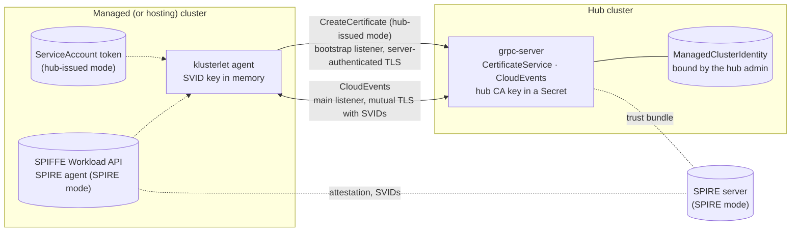

# SPIFFE Identity for Hub and Klusterlet Communication

## Release Signoff Checklist

- [ ] Enhancement is `implementable`
- [ ] Design details are appropriately documented from clear requirements
- [ ] Test plan is defined
- [ ] Graduation criteria for dev preview, tech preview, GA
- [ ] User-facing documentation is created in [website](https://github.com/open-cluster-management-io/open-cluster-management-io.github.io/)

## Summary

This enhancement makes the cluster-manager (hub) and the klusterlet (agents) authenticate each
other with [SPIFFE][spiffe] identities: short-lived [X.509-SVIDs][x509-svid] that are presented in
mutual TLS on the gRPC registration transport. No bootstrap token, client certificate, or private
key is stored in a `Secret` on the managed cluster.

There are two ways to get the identities:

| Mode | Who issues the SVIDs | What it needs |
|---|---|---|
| **SPIFFE without an extra server** | The hub. An agent proves who it is with its Kubernetes ServiceAccount token, and the hub returns a short-lived SVID. | Nothing beyond OCM |
| **SPIFFE with SPIRE** | [SPIRE][spire], or any SPIFFE-conformant issuer. Agents read their SVIDs through the [SPIFFE Workload API][workload-api], and the hub trusts the issuer's bundle. | A SPIRE deployment |

In both modes, the hub's gRPC server also has an SVID, so each side checks the other's SPIFFE ID.
Hub RBAC and the acceptance model do not change.

Every integration point is an open standard:
- SPIFFE IDs, X.509-SVIDs, the Workload API, and trust bundles;
- Kubernetes projected ServiceAccount tokens, verified as signed JWTs;
- X.509 and TLS 1.3.

See [Standards used](#standards-used).

The design defines two profiles. The **Development** profile is the simplest setup. The
**Production** profile enforces controls such as pod-bound tokens and an admission policy on the
agent cluster. The operators refuse to run a Production configuration that does not meet them.

## Motivation

The gRPC registration driver ([141-grpc-based-registration][kep-141]) already makes the hub a
certificate authority for agents. What it stores on the managed cluster is the problem:

- **The bootstrap `Secret`** holds a token that can create `ManagedCluster`s and CSRs on the hub. It
  is usually long-lived and shared by every cluster joined with it.
- **The `hub-kubeconfig-secret`** holds the agent's private key and certificate. Anyone who can read
  it, through RBAC, an etcd backup, or a compromised node, holds the cluster's hub identity from
  anywhere until the certificate expires.
- **The certificate is long-lived.** If it expires while the hub is unreachable, the agent is locked
  out and needs a new bootstrap credential.

Many fleets must also meet two rules: no long-lived credential may be stored in a cluster, and
workload identity must come from the identity system already in place, such as SPIRE.

### Goals

- Agents and the hub authenticate each other with short-lived X.509-SVIDs over mutual TLS. Each
  side checks the other's SPIFFE ID.
- No hub credential is stored in any `Secret` on the managed cluster, or on the hosting cluster in
  hosted modes.
- Out of the box, the hub issues SVIDs itself, and no external identity infrastructure is needed.
- Fleets that run SPIRE, or another SPIFFE-conformant issuer, can use it for both the hub and the
  agents.
- Every integration point is an open standard.
- Acceptance stays a double opt-in. A cluster joins only after the hub administrator binds its
  identity to the cluster.
- Hub RBAC, `CreatePermissions`/`Cleanup`, and SubjectAccessReview authorization keep working
  unchanged.
- All four klusterlet deployment modes are supported: `Default`, `Singleton`, `Hosted`, and
  `SingletonHosted`.
- `clusteradm` can set up a hub, join a cluster, and accept a cluster in this mode.

### Non-Goals

- **Other identity systems and attestation methods.** Only the two modes above are in scope.
- **Holding the hub CA key in an HSM.** Signing goes through an internal interface, so a follow-up
  proposal can add this.
- **The kube-apiserver registration path.** OCM does not control the hub kube-apiserver's client
  authentication, so this proposal covers the gRPC transport only.
- **Addon credentials.** Addons keep using the existing `token` and `csr` addon drivers.
- **Running a SPIFFE Workload API for other workloads**, or managing SPIFFE federation. OCM consumes
  trust bundles; it does not distribute them.
- **Changing the existing certificate-based gRPC mode**, which remains the default.

## Proposal

### Terms

| Term | Meaning |
|---|---|
| SVID | A SPIFFE Verifiable Identity Document. This proposal uses X.509-SVIDs: certificates whose only URI SAN is a SPIFFE ID. |
| Trust domain | The SPIFFE trust root that an SVID belongs to, for example `ocm.example.com`. |
| Trust bundle | The CA certificates used to verify SVIDs of a trust domain. |
| Hub-issued | The hub's CA issues the SVID after verifying the agent's ServiceAccount token. |
| SPIRE-issued | SPIRE, or another SPIFFE-conformant issuer, issues the SVID, and the hub trusts its bundle. |
| Agent role | `registration` or `work`, or `singleton` in the `Singleton` modes. |

### How identity is issued

The hub administrator chooses a mode per cluster, and one hub can serve clusters of both kinds.

**SPIFFE without an extra server (hub-issued):**

1. The agent generates a key pair in memory.
2. It reads its projected ServiceAccount token, which carries the hub's audience.
3. It calls `CreateCertificate` on the hub with a CSR and the token.
4. The hub verifies the token against the keys pinned for the cluster, signs an SVID with its CA
   key, and returns it.

The agent renews at half the SVID lifetime. Every renewal uses a new key and a fresh token.

**SPIFFE with SPIRE (SPIRE-issued):**

1. A SPIRE agent attests the node and the klusterlet pod, and the SPIRE server signs the pod's SVID.
2. The klusterlet reads the SVID from the SPIFFE Workload API, or from files that a helper keeps
   current.
3. It connects to the hub over mutual TLS with that SVID.
4. The hub verifies the SVID against SPIRE's bundle, and maps its SPIFFE ID to a cluster and role
   through the identity bound to the cluster.

SPIRE is the CA in this mode. The OCM hub CA is not used for agents.

In both modes, the hub's gRPC server presents its own SVID, issued by the hub CA or by the hub
cluster's SPIRE agent. Agents check it against the expected hub SPIFFE ID.

### Architecture



Dashed lines are used only in the mode named next to them.

### Profiles

The `profile` field on the `ClusterManager` and the `Klusterlet` selects one of two profiles. Each
operator validates its configuration against the profile. If the configuration does not meet it,
the operator reports `Degraded` with the unmet requirement and does not start the component.

| Requirement | Development | Production |
|---|---|---|
| Hub CA key | A `Secret`, generated by the hub | A `Secret`, readable only by the gRPC server, on a hub with encryption at rest |
| Hub CA | Self-signed | Self-signed, or an intermediate under an existing root CA |
| SVID lifetime (hub-issued) | 1h to 24h, default 24h | 1h to 24h, default 12h |
| ServiceAccount token evidence | ServiceAccount must match | ServiceAccount name **and UID** must match, and the token must be bound to a pod |
| Agent admission policy on the agent cluster | Optional | **Required**, installed by the klusterlet operator |
| Issuance audit events | Logged | Logged, and emitted as Kubernetes Events |
| Status | `DevelopmentProfile=True` condition, warning that it is not for production | — |

### User Stories

#### Story 1 - A developer tries SPIFFE identity with no extra server

```
% clusteradm init --registration-auth=grpc --grpc-identity=spiffe \
    --spiffe-trust-domain=dev.ocm.example --context ${CTX_HUB}
% clusteradm join --registration-auth=grpc --grpc-identity=spiffe \
    --grpc-server=hub-grpc.example.com:443 --spiffe-hub-bundle=hub-bundle.pem \
    --cluster-name=managed-0 --context ${CTX_MANAGED}
% clusteradm accept --clusters managed-0 --spiffe-identity-file managed-0-identity.yaml \
    --context ${CTX_HUB}
```

1. `clusteradm init` generates the hub CA and writes its public bundle to `hub-bundle.pem`.
2. `clusteradm join` reads the managed cluster's ServiceAccount issuer and its public keys, and
   writes them, with the agent ServiceAccounts, to `managed-0-identity.yaml`.
3. The hub administrator reviews that file and accepts the cluster.

The agents then get hub-issued SVIDs, with no `Secret` on the managed cluster.

#### Story 2 - A platform team runs hub-issued identity in production

The platform team sets `profile: Production` on the `ClusterManager` and every `Klusterlet`.

- **On the hub:** the hub CA key is readable only by the gRPC server, and the hub has encryption at
  rest. The CA is an intermediate under an existing root CA:
  1. `clusteradm init --spiffe-ca-csr` produces a CSR for the hub CA key.
  2. The root CA signs it.
  3. The resulting chain goes into a ConfigMap.
- **On each managed cluster:** the klusterlet operator installs the admission policy, so that only
  its own Deployment can run as the agent ServiceAccounts.
- **On acceptance:** `clusteradm accept` records the agent ServiceAccounts' UIDs, and the hub then
  accepts only pod-bound tokens from those exact ServiceAccounts.

#### Story 3 - A fleet that runs SPIRE everywhere

The hub cluster and every managed cluster run SPIRE agents of the trust domain `corp.example`.

```yaml
# ClusterManager: spec.registrationConfiguration.registrationDrivers[authType=grpc].grpc.spiffe
trustDomain: corp.example
serverIdentity:
  source: WorkloadAPI           # the gRPC server gets its SVID from the hub cluster's SPIRE agent
externalTrustDomains:
  - name: corp.example
    bundleSource: {workloadAPI: {}}
---
# Klusterlet: spec.registrationConfiguration.registrationDriver.grpc.spiffe
identitySource:
  workloadAPI: {}               # the SPIFFE CSI driver mounts the SPIRE agent socket
hub:
  trustDomain: corp.example
  id: spiffe://corp.example/ns/open-cluster-management-hub/sa/grpc-server
```

On acceptance, the hub admin binds the agents' SPIRE IDs to the cluster:

```yaml
apiVersion: cluster.open-cluster-management.io/v1alpha1
kind: ManagedClusterIdentity
metadata:
  name: prod-eu-1
spec:
  spire:
    trustDomain: corp.example
  agents:
    - role: registration
      subject: spiffe://corp.example/cluster/prod-eu-1/ns/open-cluster-management-agent/sa/klusterlet-registration-sa
    - role: work
      subject: spiffe://corp.example/cluster/prod-eu-1/ns/open-cluster-management-agent/sa/klusterlet-work-sa
```

SPIRE's node and workload attestation decides which workload receives those IDs. Its workload
selectors can include the namespace, the ServiceAccount, and the image digest. Where the SPIRE CA
key is held, and whether it chains to an existing root CA, is part of SPIRE's own configuration.

#### Story 4 - Revoking a cluster

The hub administrator sets `hubAcceptsClient: false`, or deletes the `ManagedClusterIdentity`.
Within seconds:

- `CreateCertificate` rejects new requests;
- the authenticator rejects new connections;
- the gRPC server closes the cluster's open streams.

The existing cleanup removes the cluster's RBAC bindings. SVIDs already issued remain valid until
they expire, but they can no longer be used.

### Risks and Mitigation

| Risk | Mitigation |
|---|---|
| **The hub CA key is stolen.** | The key is a `Secret` that only the gRPC server's ServiceAccount can read, and Production requires encryption at rest on the hub. CA rotation uses an overlap window. In SPIRE mode, the hub CA does not sign agent SVIDs. |
| **A workload on the managed cluster impersonates an agent.** | Hub-issued: the token binds to the agent's ServiceAccount (name and UID) and, in Production, to a pod. The klusterlet operator's admission policy allows only its own Deployment to run as the agent ServiceAccounts. SPIRE: SPIRE's workload attestation decides which pod gets the agent's ID. In both modes, a cluster administrator of the managed cluster can still act as its agent. |
| **One cluster's identity is used for another cluster.** | The hub uses only the identity bound to the named cluster. The webhook rejects any `ManagedClusterIdentity` whose bindings overlap another cluster's. |
| **One agent role mints another's identity.** | The role comes from the verified ServiceAccount or SPIFFE ID through the binding, never from the request. |
| **An agent re-binds its own identity.** | `ManagedClusterIdentity` is writable only by hub administrators; agent identities have no access to it. |
| **The unauthenticated `CreateCertificate` endpoint is abused.** | It runs on a separate bootstrap listener, with a 128 KiB message limit, field limits, and per-peer rate limits applied before a stream opens. All rejections return one reason, which does not reveal whether a cluster exists. Nothing else is served there. |
| **A stolen agent token.** | Tokens are audience-bound to the hub and expire within one hour. An SVID minted from one expires within the SVID lifetime. Revocation is immediate. Concurrent use by different pods is detected. |
| **A forged or foreign SVID.** | The authenticator requires a chain to a configured bundle, an exact trust domain match, and a binding for the SPIFFE ID. |
| **A man in the middle between agent and hub.** | Agents verify the hub's SVID and its exact SPIFFE ID. TLS must pass through load balancers unterminated. |
| **SPIRE is unavailable.** | SPIRE agents cache SVIDs and renew them ahead of expiry, so a short SPIRE server outage has no effect. A longer outage stops renewal, as it would for any SPIRE workload. |
| **A silent downgrade.** | Every failure fails closed. A Production configuration that does not meet the profile does not start. |
| **Clock skew.** | 60s leeway on token validation, and `NotBefore` backdated by 60s. |
| **Lost audit trail without CSR objects.** | Every hub issuance is logged and, in Production, recorded as an Event with the ServiceAccount, pod, and certificate serial. |

## Design Details

### Standards used

Every point where OCM meets another system is an open standard. Any implementation that conforms to
the standard works without a change to OCM.

| Integration point | Standard | Used for |
|---|---|---|
| Identity documents | [SPIFFE ID][spiffe-id] and [X.509-SVID][x509-svid] | Every agent and hub identity, in both modes |
| Getting SVIDs from an issuer | [SPIFFE Workload API][workload-api] | SPIRE mode, through go-spiffe's `X509Source` |
| Trust bundles | [SPIFFE trust domain and bundle][bundle], including the bundle endpoint profiles `https_spiffe` and `https_web` | Trusting SPIRE trust domains, and federation |
| Agent proof of identity | Kubernetes projected ServiceAccount tokens: JWTs ([RFC 7519][rfc7519]) signed with keys published as a JWK Set ([RFC 7517][rfc7517]) | Hub-issued mode |
| Issuer key discovery | Kubernetes ServiceAccount issuer discovery (an OIDC discovery document and JWKS) | Hub-issued mode, with `jwksSource: Discovery` |
| Key binding | JWK thumbprints ([RFC 7638][rfc7638]) | Unique bindings across clusters |
| Certificate requests and certificates | PKCS#10 ([RFC 2986][rfc2986]) and X.509 ([RFC 5280][rfc5280]) | Hub-issued mode |
| Transport | TLS 1.3 ([RFC 8446][rfc8446]) with mutual authentication | Every connection between agent and hub |

### Identity model

**SPIFFE IDs issued by the hub:**

| Workload | SPIFFE ID |
|---|---|
| Agent | `spiffe://<trustDomain>/ocm/cluster/<clusterName>/<agentRole>` |
| Hub gRPC server | `spiffe://<trustDomain>/ocm/hub/grpc-server` |

SPIRE-issued SVIDs keep the IDs that SPIRE's registration entries assign. The
`ManagedClusterIdentity` binding maps them to a cluster and role.

**Kubernetes identity.** The authenticator maps every authenticated agent to the same user and
groups that a certificate-mode agent has today:

- user `system:open-cluster-management:<clusterName>:<agentRole>`;
- groups `system:open-cluster-management:<clusterName>` and
  `system:open-cluster-management:managed-clusters`.

The per-cluster `ClusterRoleBinding`s bind these groups, so RBAC, `CreatePermissions`, `Cleanup`,
and SubjectAccessReview authorization are unchanged.

**`SPIFFEAuthenticator`.** A new authenticator in `sdk-go` runs on the main listener, ahead of the
existing authenticators. It accepts a peer certificate only if:

1. it has exactly one URI SAN, and that SAN is a valid SPIFFE ID;
2. it chains to the bundle of the SAN's trust domain, which must be the hub's trust domain or one of
   `externalTrustDomains`;
3. the SPIFFE ID resolves to a cluster and role:
   - in the hub's trust domain, the path is `/ocm/cluster/<cluster>/<role>`;
   - in an external trust domain, the ID is bound in a `ManagedClusterIdentity`, found through an
     index;
4. that cluster's `ManagedCluster` has `hubAcceptsClient: true`.

The certificate's Subject, if any, is ignored.

### Hub-issued SVIDs

`CertificateService` is a new gRPC service in the gRPC server process. Issuance is synchronous and
creates no Kubernetes CSR objects.

```protobuf
// Served only on the bootstrap listener, without a client certificate.
service CertificateService {
  rpc CreateCertificate(CreateCertificateRequest) returns (CreateCertificateResponse);
}

// Served only on the main listener, which requires an authenticated peer.
service TrustService {
  // RotateTrust replaces the cluster's pinned ServiceAccount signing keys after a key rotation.
  rpc RotateTrust(RotateTrustRequest) returns (RotateTrustResponse);
  // WatchBundle streams the trust bundles the agent must trust.
  rpc WatchBundle(WatchBundleRequest) returns (stream BundleUpdate);
}

message CreateCertificateRequest {
  string cluster_name = 1;  // at most 253 bytes
  string agent_role = 2;    // "registration", "work", or "singleton"
  bytes csr = 3;            // PEM PKCS#10, at most 8 KiB
  bytes token = 4;          // the projected ServiceAccount token, at most 64 KiB
}

message CreateCertificateResponse {
  repeated bytes svid_chain = 1;  // PEM, leaf first
  repeated bytes bundle = 2;      // PEM CA certificates of the hub trust domain
}
```

**Two listeners.** An agent's first call has no client certificate, so the gRPC server serves two
listeners in one process:

- **Bootstrap listener**, port 8091 by default, as a second port of the gRPC `Service`:
  - it serves only `CertificateService`, over TLS 1.3 with the server's SVID, and requests no
    client certificate;
  - it sets `MaxRecvMsgSize` to 128 KiB, a low `MaxConcurrentStreams`, and short idle and keepalive
    timeouts;
  - a `grpc.InTapHandle` applies the per-peer rate limit before a stream is accepted.
- **Main listener.** It serves CloudEvents and `TrustService` over TLS 1.3, and requires a client
  SVID. Every call must be authenticated; no method is exempt.

**`CreateCertificate` steps**, in order, so that cheap rejections come first:

1. Check field limits, then the per-cluster rate limit.
2. Load the `ManagedCluster` and its `ManagedClusterIdentity`. Return `ClusterNotReady` unless all
   of these hold:
   - both exist;
   - the cluster has `hubAcceptsClient: true`;
   - the identity uses `hubIssued`.

   The same reason is used in every case, so an unauthenticated caller cannot tell whether a
   cluster exists.
3. Verify the token against the binding (see [ServiceAccount token verification](#serviceaccount-token-verification)).
4. Look up the token's ServiceAccount in the binding's `agents`. It must map to `agent_role`, or the
   call fails with `AgentNotBound`.
5. Check the CSR's public key: ECDSA P-256 or P-384, or RSA with at least 3072 bits. The CSR's
   Subject and extensions are ignored.
6. Build and sign the certificate:
   - the SPIFFE ID is its only URI SAN;
   - `ExtKeyUsage=ClientAuth` and `IsCA=false`;
   - `NotAfter` is the earlier of now + `svidTTL` and the CA's `NotAfter`;
   - `NotBefore` is now − 60s.
7. Verify the signature against the CA public key, then record the issuance (see
   [Observability and audit](#observability-and-audit)).

Errors returned to the caller carry only a reason code from a fixed list. Details stay in the hub's
logs.

**Agent renewal.** The agent keeps its SVID and key in memory. It renews at 50% of the lifetime,
with jitter, and retries with exponential backoff, including after expiry. Every renewal generates
a new key and reads a fresh token, so renewing and recovering after a restart use the same code
path.

**The hub's own SVID.** In hub-issued mode, the gRPC server issues its own SVID with the hub CA key.
The key is generated in memory, and the SVID is renewed at half its lifetime.

### ServiceAccount token verification

The operator adds a projected `serviceAccountToken` volume to each agent pod, with the hub's
audience and `expirationSeconds: 3600`. The agent reads the token afresh on every renewal.

The hub verifies:

- the signature, against the JWKS pinned in the binding, or the issuer's discovery endpoint when the
  binding sets `jwksSource: Discovery`;
- `iss`, `aud` (the hub's audience), `exp`, and `nbf`, with 60s leeway;
- the subject, `system:serviceaccount:<ns>:<sa>`;
- in Production, the ServiceAccount UID in the `kubernetes.io` claims, and that the token is bound
  to a pod.

**Discovery mode** fetches use HTTPS only and verify the server certificate. They also:

- check that the discovery document's `issuer` matches;
- refuse redirects to another host, and limit responses to 1 MiB;
- cache keys for 10 minutes, and refresh at most once a minute when an unknown key ID appears;
- keep serving cached keys for up to one hour when the issuer is unreachable, then fail closed.

Discovery needs the hub to reach the issuer. Pinned mode needs no connection from the hub.

**Signing-key rotation.** For a binding with pinned JWKS, the agent watches its cluster's JWKS. When
the keys change, it calls `RotateTrust` with the new keys and a fresh token, over its current SVID.
The hub accepts the change only if:

- the caller's SVID is for the same cluster;
- the issuer and `agents` are unchanged;
- the token verifies against the new keys;
- the new bindings are unique.

If the SVID has expired first, the hub administrator accepts the cluster again with a new identity
file.

### SPIRE-issued SVIDs

The agent's `identitySource` selects where the SVID comes from:

- **`workloadAPI`**: the agent reads its X.509-SVID and bundles from a [SPIFFE Workload
  API][workload-api] socket, using go-spiffe's `X509Source`. The operator mounts the socket through
  the SPIFFE CSI driver (`csi.spiffe.io`). A `hostPath` mount is never used.
- **`files`**: the agent reads `svid.pem`, `svid_key.pem`, and `bundle.pem` from a directory, and
  reloads them when they change. A helper such as `spiffe-helper` keeps the files current, on a
  memory-backed volume.

The hub's `serverIdentity` takes the same sources (`Hub`, `WorkloadAPI`, or `Files`), so the gRPC
server can hold an SVID from the hub cluster's SPIRE agent.

In this mode the agent calls neither `CreateCertificate` nor `RotateTrust`. It connects straight to
the main listener.

**SPIRE layouts.** All of these work, because OCM only consumes SVIDs and bundles:

| Layout | Configuration on the hub |
|---|---|
| One SPIRE server for the hub cluster and all managed clusters | One entry in `externalTrustDomains` |
| Nested SPIRE: a root server, with downstream servers per region or cluster, all in one trust domain | One entry in `externalTrustDomains` |
| Federated SPIRE: separate trust domains per environment | One entry per trust domain, with bundles from federation or a bundle endpoint |

### ManagedClusterIdentity

`ManagedClusterIdentity` is a new cluster-scoped hub resource in
`cluster.open-cluster-management.io/v1alpha1`. It has the same name as its `ManagedCluster`. It
holds what the hub administrator accepted: which identity may act as each agent of the cluster.
Only hub administrators can write it. Agent identities are given no access.

```go
type ManagedClusterIdentitySpec struct {
	// Exactly one of hubIssued or spire is set.
	// +optional
	HubIssued *HubIssuedIdentity `json:"hubIssued,omitempty"`
	// +optional
	SPIRE *SPIREIdentity `json:"spire,omitempty"`

	// agents binds each agent role to the identity that may act as it.
	// +listType=map
	// +listMapKey=role
	// +kubebuilder:validation:MinItems=1
	Agents []AgentBinding `json:"agents"`
}

type HubIssuedIdentity struct {
	// issuer is the managed (or hosting) cluster's ServiceAccount issuer.
	Issuer string `json:"issuer"`
	// +kubebuilder:validation:Enum=Pinned;Discovery
	// +kubebuilder:default:=Pinned
	JWKSSource string `json:"jwksSource,omitempty"`
	// jwks is required when jwksSource is Pinned.
	// +optional
	JWKS *runtime.RawExtension `json:"jwks,omitempty"`
}

type SPIREIdentity struct {
	// trustDomain must be one of the hub's externalTrustDomains.
	TrustDomain string `json:"trustDomain"`
}

type AgentBinding struct {
	// +kubebuilder:validation:Enum=registration;work;singleton
	Role string `json:"role"`
	// subject is a ServiceAccount ("system:serviceaccount:<ns>:<sa>") for hubIssued, or a SPIFFE ID
	// for spire.
	Subject string `json:"subject"`
	// serviceAccountUID is required in the Production profile for hubIssued.
	// +optional
	ServiceAccountUID string `json:"serviceAccountUID,omitempty"`
}
```

**Validation.** A validating webhook on the hub enforces three rules:

- **The binding is valid.** The JWKS parses, the issuer is an `https` URL, the subjects match their
  mode, and roles are not repeated.
- **Bindings are unique.** Each binding is a string: `<issuer>|<JWK thumbprint>|<subject>` for
  pinned keys, `<issuer>|<subject>` for discovery, or `<trustDomain>|<SPIFFE ID>` for SPIRE. No
  binding may appear on two clusters, so a token or SVID can match only one cluster. Hosted
  klusterlets that share a hosting cluster's keys stay distinct, because their ServiceAccounts are
  in different namespaces.
- **The profile is respected.** In Production, `hubIssued` bindings need `serviceAccountUID`.

**Status.** `status.conditions` reports `Bound`. If a new issuance's claims, such as the pod, differ
unexpectedly from earlier ones, it reports a `ClaimsChanged` warning.

### How agents verify the hub

The agent's configuration names the hub's trust domain and SPIFFE ID. The ID defaults to
`spiffe://<trustDomain>/ocm/hub/grpc-server`. On both listeners, the agent:

1. verifies that the server's SVID chains to the hub trust domain's bundle;
2. requires the exact hub SPIFFE ID, using go-spiffe's `tlsconfig.AuthorizeID`.

The server's host name is not checked. Load balancers in front of the gRPC server must pass TLS
through without terminating it.

**Bootstrap bundle.**
- **Hub-issued mode:** `clusteradm init` writes the hub trust bundle (CA certificates only) to
  `hub-bundle.pem`, and `clusteradm join` stores it in a `ConfigMap`. It is public, so no `Secret`
  is needed. After joining, the agent keeps it current through `WatchBundle`, which carries CA
  rotation.
- **SPIRE mode:** the agent gets bundles from the Workload API, or from bundle files.

### Trust bundles and external trust domains

The hub lists every SPIRE trust domain it accepts, each with a bundle source:

```yaml
externalTrustDomains:
  - name: corp.example
    bundleSource:
      workloadAPI: {}           # the hub cluster's own SPIRE agent provides federated bundles
  - name: lab.example
    bundleSource:
      endpoint:
        url: https://spire.lab.example/bundle
        profile: https_spiffe   # or https_web
        endpointSPIFFEID: spiffe://lab.example/spire/server
  - name: test.example
    bundleSource:
      configMap: {name: test-bundle}
```

Bundles are refreshed at the interval the source specifies, or every five minutes. A refresh that
would leave an empty bundle is rejected.

### Hub signing key

- **Storage.** The hub CA key is a `Secret` in the hub's `open-cluster-management-hub` namespace,
  generated by the cluster-manager operator. Only the gRPC server's ServiceAccount can read it. In
  Production, the deployment guide requires encryption at rest on the hub.
- **Signing interface.** Core code signs through an internal `Signer` interface. This proposal has
  one implementation, backed by the `Secret`. A follow-up proposal can add HSM support behind the
  same interface.
- **CA hierarchy.**
  - **`SelfSigned`**: the hub creates a root CA certificate for its key.
  - **`Intermediate`**: `clusteradm init --spiffe-ca-csr` produces a CSR for the hub's key. An
    existing root CA signs it, and the chain is stored in a ConfigMap.
- **Rotation.** Rotation uses an overlap window:
  1. A new key is generated, and its CA certificate is added to the bundle.
  2. After one bundle propagation interval (default 1h), signing switches to the new key.
  3. The old CA certificate leaves the bundle once every SVID it signed has expired, at most one
     `svidTTL` later. The old key is then deleted.
- **Load.** Each agent renews at half its lifetime, so it needs two signatures per lifetime. For
  10,000 clusters with two agents each, that is about 0.5 signatures per second at a 24h lifetime.

In SPIRE mode, SPIRE is the CA for agents. Where its key is held is part of SPIRE's configuration.

### Hardening the agent cluster

In the Production profile, the klusterlet operator installs a `ValidatingAdmissionPolicy` (needs
Kubernetes 1.30+) in the cluster that runs the agents. It allows only the operator's own pods to
act as the agent ServiceAccounts:

| Object that uses an agent ServiceAccount | Only allowed creator |
|---|---|
| `Deployment` | The klusterlet operator's ServiceAccount, with the approved image digest and no command override |
| `ReplicaSet` | `system:serviceaccount:kube-system:deployment-controller`, owned by that Deployment |
| `Pod` | `system:serviceaccount:kube-system:replicaset-controller`, owned by that ReplicaSet |
| `serviceaccounts/token` for an agent ServiceAccount | Kubelets (`system:node:*`) only |
| `pods/exec`, `pods/attach` in the agent namespace | Denied, except to cluster administrators |

Agent pods also run under the `restricted` Pod Security Standard, with a read-only root filesystem.
The SVID key exists only in process memory.

On the hub, the issuance log and the `ClaimsChanged` condition record which pod received each SVID.
If more pods hold live SVIDs for a cluster and role than that agent has replicas, the hub raises a
warning Event.

### Configuration API

`authType` stays `grpc`. A new `identityMode` field selects `SPIFFE`, and a `spiffe` object holds its
settings.

```go
// ClusterManager: spec.registrationConfiguration.registrationDrivers[authType=grpc].grpc
type GRPCHubIdentityConfig struct {
	// +kubebuilder:validation:Enum=Certificate;SPIFFE
	// +kubebuilder:default:=Certificate
	IdentityMode string `json:"identityMode,omitempty"`
	// +optional
	SPIFFE *SPIFFEHubConfig `json:"spiffe,omitempty"`
}

type SPIFFEHubConfig struct {
	// +kubebuilder:validation:Enum=Development;Production
	// +kubebuilder:default:=Development
	Profile     string `json:"profile,omitempty"`
	TrustDomain string `json:"trustDomain"`
	// +kubebuilder:default:="open-cluster-management.io/spiffe"
	TokenAudience string `json:"tokenAudience,omitempty"`
	// +optional
	SVIDTTL *metav1.Duration `json:"svidTTL,omitempty"`

	// hubIssuer enables hub-issued SVIDs. When unset, the hub issues none.
	// +optional
	HubIssuer *HubIssuerConfig `json:"hubIssuer,omitempty"`
	// serverIdentity selects where the gRPC server gets its SVID. Default: Hub.
	// +optional
	ServerIdentity IdentitySource `json:"serverIdentity,omitempty"`
	// externalTrustDomains lists the SPIRE trust domains the hub accepts.
	// +optional
	ExternalTrustDomains []ExternalTrustDomain `json:"externalTrustDomains,omitempty"`
}

type HubIssuerConfig struct {
	// +optional
	CA CAConfig `json:"ca,omitempty"`
}

type CAConfig struct {
	// +kubebuilder:validation:Enum=SelfSigned;Intermediate
	// +kubebuilder:default:=SelfSigned
	Mode string `json:"mode,omitempty"`
	// chainConfigMap holds the intermediate certificate and its chain, for Intermediate.
	// +optional
	ChainConfigMap string `json:"chainConfigMap,omitempty"`
}

// Klusterlet: spec.registrationConfiguration.registrationDriver.grpc
type SPIFFEAgentConfig struct {
	// +kubebuilder:validation:Enum=Development;Production
	// +kubebuilder:default:=Development
	Profile        string              `json:"profile,omitempty"`
	Hub            HubIdentity         `json:"hub"`
	IdentitySource AgentIdentitySource `json:"identitySource"`
}

type HubIdentity struct {
	TrustDomain string `json:"trustDomain"`
	// id defaults to spiffe://<trustDomain>/ocm/hub/grpc-server.
	// +optional
	ID string `json:"id,omitempty"`
	// bundleConfigMap holds the hub bundle used before the first SVID (hub-issued mode).
	// +optional
	BundleConfigMap string `json:"bundleConfigMap,omitempty"`
}

// Exactly one field is set. Default: hubIssued.
type AgentIdentitySource struct {
	// hubIssued uses a projected ServiceAccount token to get hub-issued SVIDs.
	// +optional
	HubIssued *HubIssuedSource `json:"hubIssued,omitempty"`
	// +optional
	WorkloadAPI *WorkloadAPISource `json:"workloadAPI,omitempty"`
	// +optional
	Files *FilesSource `json:"files,omitempty"`
}
```

The remaining types (`IdentitySource`, `ExternalTrustDomain`, `HubIssuedSource`,
`WorkloadAPISource`, and `FilesSource`) follow the YAML shown in the user stories. Profile rules that
span several fields are enforced by CEL where possible, and otherwise by the operator, which reports
`Degraded`.

Both sides are gated by a new `SPIFFEIdentity` feature gate, alpha and off by default.

### clusteradm

| Command | New flags |
|---|---|
| `init` | `--grpc-identity=spiffe`, `--spiffe-trust-domain`, `--spiffe-profile`, `--spiffe-config-file` (the full `spiffe` object, for SPIRE trust domains), `--spiffe-ca-csr`. It writes `hub-bundle.pem`. |
| `join` | `--grpc-identity=spiffe`, `--spiffe-hub-bundle`, `--spiffe-identity-source=hub-issued\|workload-api\|files`, `--spiffe-config-file`. It writes `<cluster>-identity.yaml`, a draft `ManagedClusterIdentity`. |
| `accept` | `--spiffe-identity-file`. It creates the `ManagedClusterIdentity` and sets `hubAcceptsClient: true`. |

The identity file holds only public data. The hub administrator should still receive it over a
trusted channel and review it, because it decides who can act as the cluster.

### Observability and audit

- **Reason codes.** Failures carry a code from a fixed list, for example `ClusterNotReady`,
  `TokenInvalid`, `AgentNotBound`, `CSRKeyRejected`, `RateLimited`, `BundleUnavailable`, and
  `SPIFFEIDNotBound`. Only codes are used in metric labels and condition reasons. Free-text details
  are truncated to 256 bytes, sanitized, and logged.
- **Metrics:**
  - `ocm_spiffe_svid_issued_total`, and `ocm_spiffe_svid_rejected_total{reason}`;
  - `ocm_spiffe_authn_rejected_total{reason}`;
  - `ocm_spiffe_bundle_age_seconds{trust_domain}`.
- **Audit.** Every hub issuance is logged with the cluster, role, ServiceAccount, pod, serial
  number, and expiry. In Production, each issuance is also recorded as an Event on the
  `ManagedClusterIdentity`.

### Workflow summary

**Join, hub-issued:**

1. `clusteradm join` deploys the klusterlet with the hub bundle and writes the identity file.
2. Agents call `CreateCertificate` and get `ClusterNotReady` until acceptance.
3. `clusteradm accept` creates the `ManagedClusterIdentity` and sets `hubAcceptsClient: true`.
4. Agents receive SVIDs and connect to the main listener.

**Join, SPIRE:**

1. SPIRE registration entries give each agent its SVID.
2. `clusteradm accept` binds those SPIFFE IDs.
3. Agents connect to the main listener.

**Unjoin.**
- `clusteradm unjoin` removes the klusterlet.
- Deleting the `ManagedCluster` deletes its `ManagedClusterIdentity` through an owner reference.
- The existing cleanup removes RBAC.

There is no certificate to revoke and no Secret to delete.

### Open Questions

- **API group and placement of `ManagedClusterIdentity`.** Should it be a separate resource, as
  proposed, or a field on `ManagedCluster` protected by the `managedclusters/accept` subresource?
- **Default Production SVID lifetime.** Is 12h the right default?
- **SPIRE ID conventions.** Should OCM document a recommended SPIRE registration entry template for
  agent IDs, for example one that includes the cluster name?

### Test Plan

- **Unit tests:**
  - Token verification rejects a wrong issuer, audience, subject, signature, or expiry.
  - Token verification enforces the ServiceAccount UID and the pod binding in Production.
  - Certificate construction ignores the CSR's identity fields, and builds the SAN, key usage, and
    lifetime correctly.
  - `SPIFFEAuthenticator` rejects:
    - an unknown trust domain;
    - an unbound SPIRE SPIFFE ID;
    - a malformed path;
    - an unaccepted cluster.
  - `CreateCertificate` rejects:
    - a role mismatch;
    - an unbound ServiceAccount;
    - a request over any field limit.

    It returns the same reason for a missing, unaccepted, or unbound cluster.
  - The webhook rejects overlapping bindings and profile violations. It accepts Hosted klusterlets
    that share a hosting cluster's keys.
  - The renewer renews at 50%, retries after expiry, and generates a new key on every renewal.
  - Profile validation: a Production klusterlet on a cluster without admission policy support does
    not start.
- **Integration tests:**
  - `CreateCertificate` with a fake ServiceAccount issuer.
  - SPIRE-issued SVIDs from a test Workload API server.
  - The bootstrap listener serves only `CertificateService`, and enforces its message limit.
  - The main listener rejects every unauthenticated call.
  - CA rotation with overlapping bundles.
  - ServiceAccount key rotation through `RotateTrust`.
  - Revocation closes open streams.
- **e2e tests on kind**, for each klusterlet mode:
  - Join, accept, and register with hub-issued SVIDs, in the Development and Production profiles.
  - SPIRE as the issuer for the agents and the hub.
  - A real `ManifestWork` round trip.
  - Agent restart, revocation, CA rotation, and ServiceAccount key rotation.
  - No Secret in the agent namespace contains a key, a certificate, or a hub token.

### Graduation Criteria

- **Alpha:**
  - The `SPIFFEIdentity` feature gate, off by default.
  - Hub-issued SVIDs.
  - The hub's own SVID, and agents verifying it.
  - `ManagedClusterIdentity` `v1alpha1`.
  - The Development profile.
  - `Default` and `Singleton` modes.
- **Beta:**
  - SPIRE-issued SVIDs (Workload API and files) and external trust domains.
  - The Production profile, with its enforcement and the agent admission policy.
  - Hosted modes.
  - CA rotation and `RotateTrust`.
  - `clusteradm` support.
  - e2e coverage for both modes.
- **GA:**
  - Two releases at beta with no API changes.
  - Website documentation, including a production deployment guide.
  - An independent security review.

### Upgrade / Downgrade Strategy

- **Existing clusters** are unaffected. Certificate mode remains the default.
- **Migrating a cluster:**
  1. The hub administrator creates the cluster's `ManagedClusterIdentity` while the cluster is still
     connected in certificate mode.
  2. The klusterlet switches to `identityMode: SPIFFE`, and the agents obtain SVIDs.
  3. Once the agents report `HubConnectionDegraded=False`, the operator deletes the unused
     `hub-kubeconfig-secret` and bootstrap Secret.
- **Between modes.** A cluster moves from hub-issued to SPIRE, or back, by changing its
  `ManagedClusterIdentity` and the klusterlet's `identitySource` together.
- **Development to Production.** The administrator meets the Production requirements, then sets
  `profile: Production`. The requirements are ServiceAccount UIDs in the bindings, encryption at
  rest on the hub, and the agent admission policy. The operator refuses the switch until every
  requirement is met.
- **Downgrade.** Switching a cluster back to certificate mode needs a bootstrap Secret, as for a
  fresh join.

### Version Skew Strategy

- **A newer agent and an older hub.** An agent in SPIFFE mode that gets `Unimplemented` reports
  `HubConnectionDegraded` with the message `hub does not support SPIFFE identity`.
- **An older agent** never selects SPIFFE mode, so it is unaffected.

## Implementation History

- 2026-10-24: Provisional KEP opened.
- 2026-10-25: Scoped to two modes: SPIFFE without an extra server, and SPIFFE with SPIRE.

## Drawbacks

- **A new pre-authentication endpoint.** The bootstrap listener is narrow and rate-limited, but it
  is a surface that does not exist today.
- **Two modes to understand.** The defaults keep the simple case to three `clusteradm` commands.
- **No CSR objects.** Issuance is not visible as Kubernetes CSRs. Audit relies on logs, metrics, and
  Events.

## Alternatives

- **A separate `spiffe` `authType`.** The transport, RBAC, and acceptance are those of the gRPC
  driver, so SPIFFE is an identity mode of it rather than a new driver.
- **SPIRE only.** Every fleet, including test and small ones, would have to run SPIRE. Hub-issued
  mode gives the same transport security with nothing to deploy.
- **Hub-issued only.** Fleets that already run SPIRE would have to run a second identity system for
  OCM.
- **Exchanging SPIRE SVIDs for hub-issued SVIDs.** This would add a step and keep the hub CA in the
  path. Trusting SPIRE's bundle directly is simpler, and keeps SPIRE's attestation decisions in
  force.
- **Hub-side allow-lists of image digests or pod labels.** The hub cannot observe these. A caller
  would report them itself, so they would prove nothing. Workload attributes are enforced by
  admission on the agent cluster, or by SPIRE's workload attestation.
- **Validating managed-cluster tokens at the hub kube-apiserver.** This would need hub apiserver
  configuration for every managed cluster's issuer, and the credential would stay a bearer token on
  every call.
- **Kubernetes Pod Certificates (`PodCertificateRequest`).** They issue identities within one
  cluster. The hub cannot act as a signer for pods on another cluster's apiserver.

## References

- SPIFFE: https://spiffe.io/docs/latest/spiffe-about/overview/
- SPIFFE ID: https://github.com/spiffe/spiffe/blob/main/standards/SPIFFE-ID.md
- X.509-SVID: https://github.com/spiffe/spiffe/blob/main/standards/X509-SVID.md
- SPIFFE Workload API: https://github.com/spiffe/spiffe/blob/main/standards/SPIFFE_Workload_API.md
- SPIFFE trust domain and bundle: https://github.com/spiffe/spiffe/blob/main/standards/SPIFFE_Trust_Domain_and_Bundle.md
- SPIRE: https://spiffe.io/docs/latest/spire-about/
- go-spiffe: https://github.com/spiffe/go-spiffe
- SPIFFE CSI driver: https://github.com/spiffe/spiffe-csi
- Kubernetes ServiceAccount token projection: https://kubernetes.io/docs/tasks/configure-pod-container/configure-service-account/#serviceaccount-token-volume-projection
- Kubernetes ServiceAccount issuer discovery: https://kubernetes.io/docs/tasks/configure-pod-container/configure-service-account/#service-account-issuer-discovery
- Kubernetes ValidatingAdmissionPolicy: https://kubernetes.io/docs/reference/access-authn-authz/validating-admission-policy/
- gRPC based registration: [141-grpc-based-registration][kep-141]

[spiffe]: https://spiffe.io/
[spire]: https://spiffe.io/docs/latest/spire-about/
[spiffe-id]: https://github.com/spiffe/spiffe/blob/main/standards/SPIFFE-ID.md
[x509-svid]: https://github.com/spiffe/spiffe/blob/main/standards/X509-SVID.md
[workload-api]: https://github.com/spiffe/spiffe/blob/main/standards/SPIFFE_Workload_API.md
[bundle]: https://github.com/spiffe/spiffe/blob/main/standards/SPIFFE_Trust_Domain_and_Bundle.md
[rfc2986]: https://www.rfc-editor.org/rfc/rfc2986
[rfc5280]: https://www.rfc-editor.org/rfc/rfc5280
[rfc7517]: https://www.rfc-editor.org/rfc/rfc7517
[rfc7519]: https://www.rfc-editor.org/rfc/rfc7519
[rfc7638]: https://www.rfc-editor.org/rfc/rfc7638
[rfc8446]: https://www.rfc-editor.org/rfc/rfc8446
[kep-141]: ../141-grpc-based-registration/README.md
