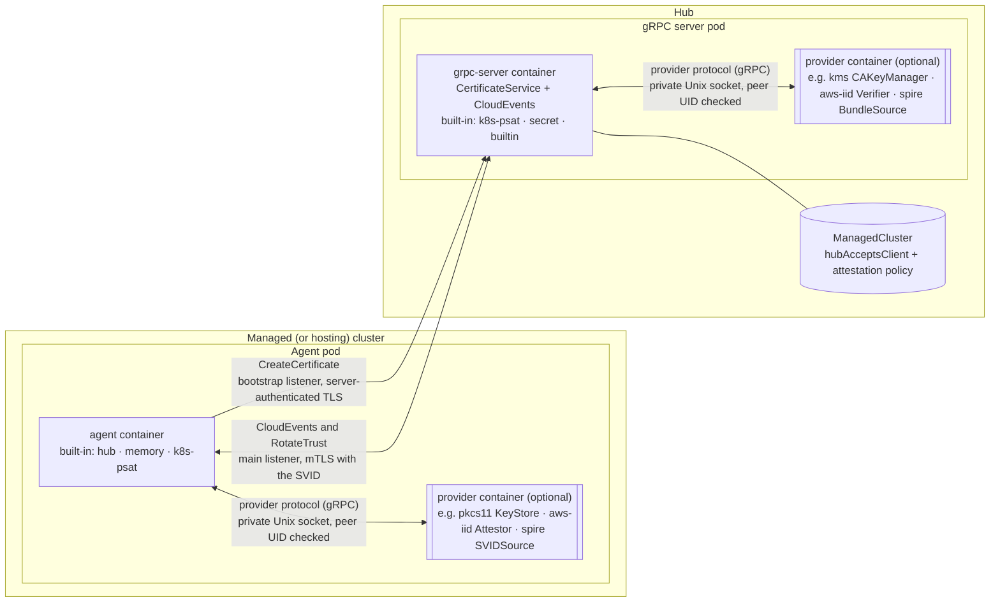
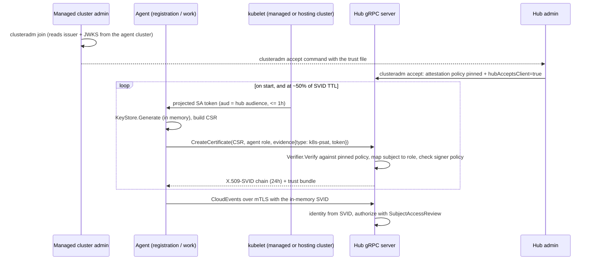

# Pluggable SPIFFE Identity for Cluster Registration

## Release Signoff Checklist

- [ ] Enhancement is `implementable`
- [ ] Design details are appropriately documented from clear requirements
- [ ] Test plan is defined
- [ ] Graduation criteria for dev preview, tech preview, GA
- [ ] User-facing documentation is created in [website](https://github.com/open-cluster-management-io/open-cluster-management-io.github.io/)

## Summary

OCM's gRPC registration driver authenticates the klusterlet with an X.509 client certificate. The
private key for that certificate is stored in the `hub-kubeconfig-secret` on the managed cluster,
and the certificate is bootstrapped with a shared token kept in the bootstrap Secret. This
enhancement adds a `SPIFFE` identity mode to the gRPC driver. It follows the way Istio ambient's
ztunnel gets workload certificates from istiod:

1. The agent generates its private key in memory.
2. It proves who it is with its own projected ServiceAccount token.
3. It receives a short-lived [X.509-SVID][x509-svid] (a SPIFFE certificate) from the hub's gRPC
   server through a synchronous `CreateCertificate` RPC.

No hub credential (bootstrap token, client certificate, or private key) is ever written to a
Kubernetes `Secret` on the managed cluster, and no SPIRE server or agent is required.

The external dependencies of this mode sit behind four provider interfaces: where the agent key
lives, where the hub CA key lives, how a cluster proves its identity, and who issues the SVID. Each
interface has one built-in provider, compiled into OCM. Every other provider is an **external
provider**: a container image that implements a versioned gRPC provider protocol and runs as an
additional container in the OCM component's pod, reached over a pod-local Unix socket.

External providers work like addons. An organization builds its own provider image, for example an
attestor for its own hardware or a client for its own HSM, and names it in the `Klusterlet` or
`ClusterManager` configuration. The operator adds the container to the pod. No change to OCM is
needed.

| Mode | Provider slot | Decides | In this proposal |
|---|---|---|---|
| **1. Memory** | Built-in: `KeyStore: memory`, `Attestor: k8s-psat`, `SVIDSource: hub`, `CAKeyManager: secret`, `BundleSource: builtin` | The agent key exists only in process memory, and the agent attests with a projected ServiceAccount token | **Implemented** |
| **2. External HSM** | External `KeyStore` / `CAKeyManager`, for example `pkcs11`, `tpm`, `kmip`, `kms` | The agent key or the hub CA key is held in an HSM or KMS | Interface defined; providers built later |
| **3. Cloud attestor** | External `Attestor` + `Verifier`, for example `aws-iid`, `gcp-iit`, `azure-imds`, `oidc-federation`, `tpm-devid` | The cluster proves its identity with a document signed by its cloud provider or its TPM | Interface defined; providers built later |
| **4. SPIRE** | External `SVIDSource` / `BundleSource`, for example `spire` | SPIRE issues the identities, using SPIRE's own node attestors | Interface defined; providers built later |

This proposal implements Mode 1 and the external provider mechanism: the provider protocol, the
sidecar container injection, a Go SDK, and a conformance suite. Providers for Modes 2 to 4 are built
later as provider images.

Every SVID also carries a Kubernetes subject in today's form: CN
`system:open-cluster-management:<cluster>:<agent-role>`, with O set to the cluster's groups. Hub
RBAC binds those groups, so the hub-side `CreatePermissions`/`Cleanup` path and the gRPC server's
SubjectAccessReview authorization keep working unchanged.

## Motivation

The gRPC driver ([141-grpc-based-registration](../141-grpc-based-registration/README.md)) already
makes the hub its own certificate authority: the hub signs agent CSRs with the
`open-cluster-management.io/grpc` signer and serves agents over mTLS. The problem is what it stores
on the managed cluster:

- **The bootstrap Secret** holds a token that can create `ManagedCluster`s and CSRs on the hub. One
  token is shared by every cluster joined with it, and it is usually long-lived.
- **The `hub-kubeconfig-secret`** holds `tls.key` and `tls.crt`. Anyone who can read that Secret
  holds the cluster's hub identity, from any network location, until the certificate expires. They
  can get it through RBAC on the managed cluster, an etcd backup, or a compromised node.
- **The certificate is long-lived** and is renewed through a CSR loop. If it expires while the hub
  is unreachable, the agent is locked out and needs a new bootstrap credential.

Some operators must meet a compliance rule that forbids storing any long-lived credential in a
cluster. Beyond that, fleets differ in what they need:

- **Key placement is a deployment decision.** Some fleets require FIPS 140-2/140-3 key storage for
  the hub CA or for the agents.
- **Attestation is a deployment decision.** Clusters on AWS, GCP, or Azure can prove their identity
  with a document signed by the cloud provider. On-premises clusters may have TPMs.
- **Some organizations already run SPIRE** and want OCM to accept its identities instead of
  running a second issuer.

Today each of these needs a new driver, as with `awsirsa` and the
[Azure AD driver][kep-195]. This proposal delivers a cloud-neutral baseline that uses only
primitives every conformant Kubernetes cluster already has: projected ServiceAccount tokens and an
OIDC-style issuer with a published JWKS. It also defines the extension points, so each later need
becomes a provider rather than a driver.

### Goals

- No hub credential is persisted in any `Secret` on the managed cluster (or on the hosting cluster
  in hosted modes): no bootstrap token, no client certificate, no private key.
- The agent's private key is generated in memory and never leaves the agent process.
- Agent certificates are short-lived (24h by default) and re-minted automatically. An agent that
  restarts, or was offline past expiry, recovers without operator action.
- The agent proves its identity with a projected ServiceAccount token. The token's audience is the
  hub, and it expires within one hour.
- No external identity infrastructure: no SPIRE, no cloud IAM, no service mesh.
- Reuse the existing gRPC transport, per-cluster RBAC, the gRPC server's SubjectAccessReview
  authorization, and the existing acceptance model (`hubAcceptsClient`).
- Define the `KeyStore`, `CAKeyManager`, `Attestor`/`Verifier`, and `SVIDSource`/`BundleSource`
  interfaces, the provider selection API, and the contract that a Mode 2, 3, or 4 provider must
  meet. Core code never calls a cloud, HSM, or SPIRE API directly.
- Run external providers as additional containers in the OCM component's pod, speaking a versioned
  gRPC protocol over a pod-local Unix socket. An organization can build, deploy, and select its own
  provider image without any change to OCM.
- Fail closed: an unknown type, a missing or unhealthy provider container, or a failed handshake
  stops the component from starting. The component never falls back to a built-in or weaker
  provider.
- Work across all four klusterlet deployment shapes: `Default`, `Singleton`, `Hosted`, and
  `SingletonHosted`.
- `clusteradm` can initialize a hub, join a cluster, and accept a cluster in this mode.

### Non-Goals

- **Building the providers for Modes 2, 3, and 4.** This proposal defines their interfaces, their
  contracts, and the external provider mechanism that runs them. The providers themselves are built
  later, as provider images, by OCM or by any organization.
- **The kube-apiserver registration path** (`csr`, `awsirsa`). OCM does not control the hub
  kube-apiserver's client CA configuration, so this proposal is scoped to the gRPC server.
- **Addon credentials.** Addons keep using the existing `token` and `csr` addon drivers. Serving
  SVIDs to addons over a node-local socket, the way ztunnel serves pods, is a possible follow-up.
- **A general SPIFFE Workload API or federation.** This proposal does not provide a SPIFFE Workload
  API for arbitrary workloads on the managed cluster, or SPIFFE federation with other trust
  domains.
- **Publishing the trust bundle to external consumers** such as object storage or AWS IAM Roles
  Anywhere.
- **Interface changes.** The `RegisterDriver` and `HubDriver` interfaces do not change.
- **Changing the existing certificate-based gRPC identity mode**, which remains the default.

## Proposal

### How Istio ambient does it, and what each part becomes in OCM

| Istio ambient | This proposal |
|---|---|
| istiod's CA, `IstioCertificateService/CreateCertificate` | Hub gRPC server, new `CertificateService/CreateCertificate` |
| ztunnel generates the key in memory and sends a CSR | Registration and work agents generate keys in the `memory` `KeyStore` |
| ztunnel authenticates with its projected SA token, and istiod validates it with a TokenReview | The agent authenticates with its projected SA token (`k8s-psat` `Attestor`). The hub validates it as a JWT against the JWKS pinned for the agent's cluster (`k8s-psat` `Verifier`) |
| SPIFFE ID `spiffe://<td>/ns/<ns>/sa/<sa>` | `spiffe://<td>/cluster/<cluster>/agent/<agent-role>`, where the role is mapped from the verified ServiceAccount |
| Short-lived certificates, rotated at about half their lifetime | Same |
| CA key in `cacerts`, or a plugged-in external CA | CA key behind `CAKeyManager`: a Secret now, an HSM or KMS in Mode 2 |

There is one structural difference. istiod and ztunnel share a kube-apiserver, so istiod can call
TokenReview. The OCM hub cannot call TokenReview against a managed cluster's apiserver. Instead,
the hub verifies the token's signature itself, against the issuer and JWKS that were **pinned** for
that cluster when the hub administrator accepted it. Pinning takes the place of the shared bootstrap
credential as the root of trust for joining.

### Architecture



Each provider slot is filled either by a built-in provider inside the OCM container, or by an
external provider container in the same pod. Double-bordered boxes are external provider
containers, which are present only when the configuration names one. Each external provider gets
its own socket, which only it and the OCM container can reach, and both ends check who is on the
other side (see [Securing the provider channel](#securing-the-provider-channel)).

### Flow



### User Stories

#### Story 1 - Hub administrator enables SPIFFE identity for gRPC registration

```
% clusteradm init \
     --wait \
     --registration-auth=grpc \
     --grpc-identity=spiffe \
     --spiffe-trust-domain=hub-0.example.com \
     --context ${CTX_HUB_CLUSTER}
```

This enables SPIFFE mode for the whole hub with the built-in providers: the `secret` CA key
manager, the `k8s-psat` verifier, and the `builtin` bundle source. It does not name any managed
cluster. Certificate-mode gRPC clusters keep working on the same hub.

To use an external provider instead, for example a CA key manager backed by the organization's
KMS, the administrator lists the provider image in `externalProviders` and points the slot at it
(see [Story 6](#story-6---an-organization-plugs-in-its-own-provider)).

#### Story 2 - Managed cluster administrator joins a cluster without any hub credential

```
% clusteradm join \
     --registration-auth=grpc \
     --grpc-identity=spiffe \
     --grpc-server=hub-0-grpc.example.com:443 \
     --grpc-server-ca-file=hub-grpc-ca.crt \
     --cluster-name=managed-0
```

There is no `--hub-token`. The agent receives only the gRPC server address and the server CA
certificate. Both are public, so they are stored in a `ConfigMap`. The agent calls
`CreateCertificate` on the hub's bootstrap listener, which is on the same host, port 8091 by
default. `--grpc-certificate-server` overrides that address.

`clusteradm join` uses its kube context on the cluster that will run the agent. That is the managed
cluster in `Default` and `Singleton` modes, and the hosting cluster in `Hosted` and
`SingletonHosted` modes. From that cluster it reads:

- the ServiceAccount issuer, from `/.well-known/openid-configuration`;
- the issuer's keys, from `/openid/v1/jwks`.

It writes both to `managed-0-spiffe-trust.json` and prints the command the hub administrator runs
next.

The `memory` key store, the `k8s-psat` attestor, and the `hub` SVID source are the defaults, so no
flags are needed for them. To use external providers, `clusteradm join --spiffe-providers-file`
takes a file with the `spiffe` section of the `Klusterlet` spec, including `externalProviders`.

Until the hub accepts the cluster, `CreateCertificate` rejects the agent's calls with
`FailedPrecondition`, and the agent retries with backoff. The klusterlet reports a
`HubConnectionDegraded` condition whose message names the cluster and says it is awaiting
acceptance.

#### Story 3 - Hub administrator accepts and pins a managed cluster

```
% clusteradm accept \
     --clusters managed-0 \
     --spiffe-trust-file managed-0-spiffe-trust.json
```

This command:

1. creates the `ManagedCluster` if it does not exist;
2. writes the attestation policy to the `ManagedCluster`: the attestor type, the issuer, the JWKS,
   and the map from each agent ServiceAccount to its agent role;
3. sets `hubAcceptsClient: true`.

The trust file is not secret, because it holds only public keys. The hub administrator should still
get it from the managed cluster administrator over a channel they trust, because it decides which
cluster's tokens the hub accepts.

Without `clusteradm`, the administrator sets the annotation described in
[Attestation policy on ManagedCluster](#attestation-policy-on-managedcluster) and
`spec.hubAcceptsClient: true` directly. Automatic approval through `ManagedClusterAutoApproval` is
not supported in this mode (see [Open Questions](#open-questions)).

#### Story 4 - Revoking a cluster

The administrator sets `spec.hubAcceptsClient: false` or deletes the `ManagedCluster`. The existing
hub cleanup path removes the cluster's RBAC bindings, and `CreateCertificate` rejects further
requests. SVIDs that were already issued stay cryptographically valid until they expire. Access
still ends immediately, because the gRPC server authorizes every request with a
SubjectAccessReview and the bindings are gone.

#### Story 5 - Managed cluster permission isolation on hub

The SVID carries the same groups that a certificate-mode agent gets today, and a user in the same
form:

- user `system:open-cluster-management:<cluster>:<agent-role>`;
- groups `system:open-cluster-management:<cluster>` and
  `system:open-cluster-management:managed-clusters`.

The per-cluster `ClusterRoleBinding`s bind the groups, not the user, so per-cluster RBAC and
isolation are unchanged. The hub issues an SVID only for the cluster whose pinned policy verified
the evidence, and only for the agent role that policy maps the verified ServiceAccount to. A
cluster's token therefore cannot mint another cluster's identity, and one agent's token cannot mint
another agent's identity (see [Binding the request to the evidence](#binding-the-request-to-the-evidence)).

#### Story 6 - An organization plugs in its own provider

An organization runs on-premises clusters with a hardware root of trust, and wants agents to attest
with it (Mode 3). Its platform team:

1. implements the `Attestor` and `Verifier` services of the provider protocol, using the Go SDK in
   `sdk-go` or any gRPC language;
2. runs the provider conformance suite against both images;
3. publishes the images to its own registry;
4. names them in the configuration, the same way an addon is enabled by name:

```yaml
# ClusterManager: spec.registrationConfiguration.registrationDrivers[authType=grpc].grpc.spiffe
verifiers:
  - type: k8s-psat
  - type: acme-devid
    external: acme-verifier
externalProviders:
  - name: acme-verifier
    image: registry.acme.example/ocm/acme-verifier@sha256:4e1243bd...
---
# Klusterlet: spec.registrationConfiguration.registrationDriver.grpc.spiffe
attestor:
  type: acme-devid
  external: acme-attestor
externalProviders:
  - name: acme-attestor
    image: registry.acme.example/ocm/acme-attestor@sha256:9b74c989...
    volumes:
      - name: acme-attestor-config
        configMap: { name: acme-attestor-config }
        mountPath: /etc/acme
```

The cluster-manager operator adds `acme-verifier` to the gRPC server and webhook pods. The
klusterlet operator adds `acme-attestor` to each agent pod. The hub admin pins the cluster with an
`acme-devid` attestation policy. The rest of the driver (signing, policy, RBAC, transport) does not
change.

### Implementation Details/Notes/Constraints

#### Identity

- **SPIFFE ID:** `spiffe://<trustDomain>/cluster/<clusterName>/agent/<agentRole>`.
- **Agent roles.** The role is `registration` or `work` in `Default` and `Hosted` modes, and
  `singleton` in `Singleton` and `SingletonHosted` modes. Unlike the generated agent name of
  certificate mode, a role does not change when the klusterlet is reinstalled. SPIRE registration
  entries (Mode 4) can therefore be written once.
- **The hub sets every identity field.** It ignores the subject and extensions in the agent's CSR
  and uses the CSR only for its public key. It takes the agent role from the attestation policy, as
  described in [Binding the request to the evidence](#binding-the-request-to-the-evidence), never
  from the request alone.
- **SAN and Subject.** The SVID carries the SPIFFE ID as its only URI SAN, as the X.509-SVID
  specification requires. It also carries a Subject in today's form:
  `CN=system:open-cluster-management:<cluster>:<agentRole>` and `O=` the two groups above. This
  keeps the existing `MtlsAuthenticator` and every SubjectAccessReview working unchanged.
- **`SpiffeAuthenticator`.** A new authenticator in `sdk-go` is registered ahead of
  `MtlsAuthenticator`. It accepts a peer certificate only if all of these hold:
  - the certificate chains to a CA from the `BundleSource`;
  - it has exactly one URI SAN;
  - the SAN's trust domain equals the configured `trustDomain` exactly;
  - the SAN's path has the form `/cluster/<cluster>/agent/<agentRole>`, with a valid cluster name
    and a known role.

  It then derives the user and groups from the SAN. If the certificate has a Subject, the Subject
  must agree with the SAN, or the certificate is rejected. SPIRE-issued SVIDs (Mode 4) may have no
  Subject at all.

#### Provider interfaces

The interfaces live in `pkg/registration/register/grpc/spiffe/provider`. The SPIFFE code in the
driver depends only on these types. Each interface has one built-in provider, which implements it
in-process. For an external provider, core code uses a client adapter that implements the same
interface over the [provider protocol](#external-providers). The rest of the driver cannot tell the
two apart.

```go
// KeyAlg is the key algorithm requested from a KeyStore or CAKeyManager.
type KeyAlg string

const (
	KeyAlgECDSAP256 KeyAlg = "ECDSA-P256"
	KeyAlgECDSAP384 KeyAlg = "ECDSA-P384"
	KeyAlgRSA2048   KeyAlg = "RSA-2048"
)

// SVID is an X.509-SVID chain, leaf first, with the key it was issued for.
type SVID struct {
	ID     spiffeid.ID
	Chain  []*x509.Certificate
	Signer crypto.Signer
}
```

**Agent side.**

```go
// SVIDSource produces the agent's SVID and the bundle it uses to verify the hub.
// The gRPC client's GetClientCertificate and VerifyPeerCertificate callbacks read from it.
//
// Built-in: "hub", which composes a KeyStore, an Attestor, and the hub's CertificateService.
// External: for example "spire" (Mode 4), which reads the Workload API of a local SPIRE agent.
type SVIDSource interface {
	// Run keeps the SVID current until ctx is done. It renews at 50% of the lifetime with jitter,
	// retries with exponential backoff, and keeps retrying after expiry.
	Run(ctx context.Context) error
	// Current returns the current SVID, or ErrNoSVID before the first successful mint.
	Current() (*SVID, error)
	// Bundle returns the CA certificates that the hub's serving certificate must chain to.
	Bundle() []*x509.Certificate
}

// KeyStore holds the agent's private key.
//
// Built-in: "memory".
// External: for example "pkcs11", "tpm", "kmip" (Mode 2).
type KeyStore interface {
	// Generate creates a new key pair and makes it the current key. The private key never leaves
	// the store; only a crypto.Signer is returned.
	Generate(ctx context.Context, alg KeyAlg) (crypto.Signer, error)
	// DestroyRetired removes every key previously returned by Generate except the current one.
	DestroyRetired(ctx context.Context) error
}

// Attestor produces evidence that proves which cluster and agent is asking for an SVID.
//
// Built-in: "k8s-psat".
// External: for example "aws-iid", "gcp-iit", "azure-imds", "oidc-federation", "tpm-devid" (Mode 3).
type Attestor interface {
	Type() string
	// Evidence returns fresh evidence. challenge is nil unless the matching Verifier declares
	// NeedsChallenge; when set, the evidence must be cryptographically bound to it.
	Evidence(ctx context.Context, challenge []byte) (*Evidence, error)
}

type Evidence struct {
	// Type must equal the Attestor's and Verifier's Type.
	Type string
	// Payload is opaque to core code, for example a JWT or a signed cloud identity document.
	Payload []byte
}
```

**Hub side.**

```go
// Verifier checks evidence against the attestation policy pinned on the ManagedCluster.
// Every Attestor type has a matching Verifier.
type Verifier interface {
	Type() string
	// NeedsChallenge reports whether evidence must be bound to a hub-issued challenge.
	// False for k8s-psat, whose token is bound to the hub audience and expires within an hour.
	NeedsChallenge() bool
	// ValidatePolicy rejects a malformed policy. The ManagedCluster webhook calls it at write time.
	// It returns the policy's bindings: one opaque string for each combination of trust material and
	// subject that the policy accepts. Two different evidence sources must never produce the same
	// binding. For k8s-psat, each binding is "<issuer>|<JWK thumbprint (RFC 7638)>|<subject>".
	ValidatePolicy(policy []byte) (bindings []string, err error)
	// Verify returns the verified claims, or an error with a ReasonCode.
	Verify(ctx context.Context, req VerifyRequest) (*Claims, error)
}

type VerifyRequest struct {
	ClusterName string
	AgentRole   string
	Evidence    *Evidence
	// Policy is the raw attestation policy from the ManagedCluster, already checked by ValidatePolicy.
	Policy []byte
	// Audience is the hub's configured audience.
	Audience string
	// Challenge is set only when NeedsChallenge is true.
	Challenge []byte
}

// Claims are the verified result. Subject is the verified subject of the evidence, for example the
// ServiceAccount of a k8s-psat token. Core code looks Subject up in the policy's agents map to get
// the agent role, and issues nothing if it is missing or differs from the requested role.
// Attributes are only logged and recorded with each issuance.
type Claims struct {
	Subject    string
	Attributes map[string]string
}

// ReasonCode is the fixed, bounded set of reasons a Verifier or any other provider reports a
// failure with. Core code uses only the code in metrics labels, conditions' reasons, and the
// status returned to the agent.
type ReasonCode string

// PolicyRotator is optionally implemented by a Verifier whose pinned material can rotate, such as
// a ServiceAccount JWKS. Core code calls it from the RotateTrust RPC.
type PolicyRotator interface {
	// Rotate returns nil only if proposed is a legitimate successor of current, as proven by ev.
	Rotate(ctx context.Context, current, proposed []byte, ev *Evidence) error
}

// CAKeyManager holds the hub CA's signing keys. Core code creates the CA certificates, stores them
// in a ConfigMap, and enforces the signer policy; the CAKeyManager only signs.
//
// Built-in: "secret", which reuses the existing gRPC signer CA Secret.
// External: for example "kms" (go.step.sm/crypto/kms URIs: AWS KMS, Google Cloud KMS,
//           Azure Key Vault), "pkcs11", "kmip" (Mode 2).
type CAKeyManager interface {
	// Signer returns the key with the given ID. An empty ID means the active key.
	Signer(ctx context.Context, keyID string) (crypto.Signer, error)
	// CreateKey creates a new, non-exportable key for CA rotation and returns its ID.
	CreateKey(ctx context.Context, alg KeyAlg) (keyID string, err error)
}

// BundleSource returns the CA certificates that SpiffeAuthenticator trusts for the trust domain.
//
// Built-in: "builtin", which returns the hub's own CA certificates, including any in a rotation
//           overlap.
// External: for example "spire" (Mode 4), which fetches the bundle from a SPIRE bundle endpoint.
type BundleSource interface {
	Bundle(ctx context.Context) ([]*x509.Certificate, error)
	// Issues reports whether the hub signs SVIDs for this trust domain. CertificateService is
	// served only when it is true.
	Issues() bool
}
```

**Responsibilities that stay in core code.** Providers cannot change any of the following:

- **Signer policy.** Each SVID gets exactly one URI SAN for the requesting cluster and agent,
  `ExtKeyUsage=ClientAuth`, and `IsCA=false`. The hub never issues wildcards or `ServerAuth`.
  `NotAfter` is `min(now + svidTTL, CA NotAfter)`, and `NotBefore` is backdated by 60s.
- **Acceptance.** The `ManagedCluster` must exist with `hubAcceptsClient: true` and a policy whose
  `type` is one of the hub's enabled verifiers.
- **CSR key checks.** The key must be ECDSA P-256/P-384 or RSA with at least 2048 bits.
- **Rate limits, metrics, and audit logging.**

As a result, a provider cannot widen what is issued. The worst a faulty or malicious provider can
do depends on its slot:

- a `Verifier` can accept evidence it should have rejected, for any accepted cluster whose policy
  names its type;
- a `KeyStore` or `SVIDSource` can disclose or misuse the key of the agent it serves;
- a `CAKeyManager` can sign whatever it is asked to, which is why it is the provider to choose most
  carefully.

#### Changes required on the hub

**`CertificateService`** is a new unary gRPC service in the existing gRPC server process. It is
deliberately not a CloudEvents resource type. Issuance is synchronous and creates no Kubernetes
`CertificateSigningRequest` object, so no CSR approval loop is involved.

```protobuf
// Served on the bootstrap listener, without a client certificate.
service CertificateService {
  rpc CreateCertificate(CreateCertificateRequest) returns (CreateCertificateResponse);
  // Challenge returns a nonce for verifiers with NeedsChallenge. It returns FailedPrecondition
  // when the cluster's policy names a verifier that does not need one.
  rpc Challenge(ChallengeRequest) returns (ChallengeResponse);
}

// Served on the main listener, which requires an authenticated peer.
service TrustService {
  // RotateTrust replaces the cluster's pinned attestation policy. The caller must present its
  // current SVID over mTLS. Served only for verifiers that implement PolicyRotator.
  rpc RotateTrust(RotateTrustRequest) returns (RotateTrustResponse);
}

message Evidence {
  string type = 1;      // for example "k8s-psat"
  bytes payload = 2;    // opaque to core code
  bytes challenge = 3;  // empty unless the verifier needs a challenge
}

// Field limits, enforced by the handler before any other work: cluster_name at most 253 bytes,
// agent_role one of the known roles, csr at most 8 KiB, evidence.payload at most 64 KiB,
// evidence.challenge at most 256 bytes, proposed_policy at most 64 KiB.
message CreateCertificateRequest {
  string cluster_name = 1;
  string agent_role = 2;           // "registration", "work", or "singleton"; must match the policy
  bytes csr = 3;                   // PEM, PKCS#10
  Evidence evidence = 4;
}

message CreateCertificateResponse {
  repeated bytes cert_chain = 1;   // PEM, leaf first
  repeated bytes trust_bundle = 2; // PEM CA certificates for the trust domain
}

message RotateTrustRequest {
  string cluster_name = 1;
  bytes proposed_policy = 2;
  Evidence evidence = 3;           // fresh evidence that verifies against proposed_policy
}

message RotateTrustResponse {}

message ChallengeRequest { string cluster_name = 1; }
message ChallengeResponse { bytes challenge = 1; }
```

**Two listeners.** The first `CreateCertificate` call has no client certificate, because the agent
holds only the server CA. The gRPC server therefore serves two listeners in the same process:

- **The bootstrap listener** (port 8091 by default, a second port on the existing gRPC `Service`)
  serves only `CertificateService`. It uses server-authenticated TLS 1.3 and requests no client
  certificate. It sets `MaxRecvMsgSize` to 128 KiB, so an unauthenticated client cannot make the
  server receive or parse a larger message. It also sets a low `MaxConcurrentStreams` and short
  keepalive and idle timeouts. A `grpc.InTapHandle` applies the per-peer rate limit before a
  stream is accepted. No CloudEvents or other service is registered on it.
- **The main listener** keeps today's configuration and serves CloudEvents and `TrustService`. Its
  authentication interceptor accepts no call without an authenticated peer. No method on it is
  exempt, and `CertificateService` is not registered on it.

`CreateCertificate` does its own authentication rather than using the server's global authenticator
chain. The existing `TokenAuthenticator` would send the token to the hub kube-apiserver's
TokenReview, which cannot validate a managed cluster's token. The handler runs these steps in
order, so that cheap rejections happen first:

1. Check the field limits in `CreateCertificateRequest`, then rate-limit per cluster name.
2. Load the `ManagedCluster` named in the request. It must exist with `hubAcceptsClient: true` and a
   policy. Otherwise, return `FailedPrecondition` with reason `ClusterNotReady`. The same reason is
   used in all three cases, so an unauthenticated caller cannot tell whether a cluster exists.
3. Check that `evidence.type` equals the policy's `type` and is one of the hub's enabled verifiers.
   Otherwise, return `PermissionDenied` with reason `AttestorTypeNotEnabled`.
4. Call `Verifier.Verify`. On error, return `PermissionDenied` with the verifier's reason code, for
   example `EvidenceIssuerMismatch`.
5. Look up `Claims.Subject` in the policy's `agents` map. If it is missing, or maps to a role other
   than `agent_role`, return `PermissionDenied` with reason `AgentNotBound`.
6. Check the CSR's public key.
7. Sign through `CAKeyManager.Signer` under the signer policy.
8. Record the outcome in metrics (`ocm_spiffe_svid_issued_total{attestor}`,
   `ocm_spiffe_svid_rejected_total{attestor,reason}`). Log it with `klog`, including the cluster,
   agent role, claims subject, certificate serial, and, on failure, the detail described in
   [Reason codes](#reason-codes).

The status returned to the caller carries only the reason code and a fixed message for that code.
Details such as the pinned issuer go only to the hub's logs, because the caller is not yet
authenticated.

<a id="binding-the-request-to-the-evidence"></a>**Binding the request to the evidence.** The cluster
and the agent role in the request are only claims. The hub issues an SVID for them only when
verified evidence binds to both:

- **Agent.** The policy maps each accepted subject to exactly one agent role (step 5). A valid token
  for the work agent's ServiceAccount can therefore mint only the `work` identity, never the
  `registration` identity.
- **Cluster.** A policy's bindings, as returned by `Verifier.ValidatePolicy`, must be unique across
  all `ManagedCluster`s. The webhook rejects a policy that shares a binding with another cluster's
  policy. Evidence that verifies against one cluster's policy therefore cannot verify against
  another's.

  For `k8s-psat`, a binding is the issuer, a JWK thumbprint, and a subject. Two ordinary clusters
  never share a signing key, so they never collide, even when both use the default issuer
  URL. Clusters that do share a key, such as several klusterlets on one hosting cluster in
  `Hosted` mode, stay distinct because their ServiceAccounts are in different namespaces. A policy
  with `"jwksSource": "discovery"` binds the issuer URL itself, so two such policies cannot use the
  same issuer.

Challenges are stateless: each is an HMAC-signed `(cluster, expiry, random)` tuple, so they work
across gRPC server replicas. A short-lived replay cache enforces single use. The built-in
`k8s-psat` verifier does not use them, but an external verifier may.

**SPIFFE CA trust.** The main listener's client CA bundle includes the certificates from the
`BundleSource`, alongside the existing gRPC signer CA.

**Hub driver.** `GRPCHubDriver` gains the SPIFFE settings. `CreatePermissions` and `Cleanup` are
unchanged: they bind the same groups as today, and the bindings name groups, not users. The CA rotation controller runs in the gRPC
server, with leader election, so the `CAKeyManager` is needed only in that pod.

**ManagedCluster webhook.** The validating webhook protects every annotation with the
`spiffe.open-cluster-management.io/` prefix, the same way it protects `hubAcceptsClient`: changing
them requires `update` on the `managedclusters/accept` subresource. It also calls the verifier's
`ValidatePolicy`, so the operator adds external verifier containers to the webhook pod as well. It
rejects a policy whose bindings overlap another `ManagedCluster`'s, using an index of bindings kept
by the webhook's informer. It also rejects an `agents` map that names an unknown role or maps two
roles to one subject. As a result, the agent's own hub identity cannot re-pin its cluster to a
different issuer, and no admin can accidentally pin two clusters to the same evidence.

#### Attestation policy on ManagedCluster

The policy is a single JSON annotation. Core code reads only `type` and `agents`, and the matching
verifier interprets the rest. This keeps Mode 3 policies out of the API. `agents` maps each subject
that the verifier can return in `Claims.Subject` to an agent role.

```yaml
apiVersion: cluster.open-cluster-management.io/v1
kind: ManagedCluster
metadata:
  name: managed-0
  annotations:
    spiffe.open-cluster-management.io/attestation-policy: |
      {
        "type": "k8s-psat",
        "issuer": "https://kubernetes.default.svc.cluster.local",
        "jwks": {"keys": [ ... ]},
        "agents": {
          "system:serviceaccount:open-cluster-management-agent:klusterlet-registration-sa": "registration",
          "system:serviceaccount:open-cluster-management-agent:klusterlet-work-sa": "work"
        }
      }
spec:
  hubAcceptsClient: true
```

The `k8s-psat` verifier:

- checks the JWT signature against `jwks`;
- checks that `iss` equals `issuer`, that `aud` contains the hub's token audience, and that `exp`
  and `nbf` hold, with 60s leeway;
- checks that `sub` is a key of `agents`, and returns it as `Claims.Subject`.

In `Singleton` and `SingletonHosted` modes there is a single agent ServiceAccount
(`<klusterlet-name>-work-sa`), mapped to the `singleton` role. In `Hosted` and `SingletonHosted` modes, the issuer, JWKS, and
namespace are the **hosting** cluster's, because the agent pod and its token come from there.

**JWKS rotation.** Kubernetes distributions, including managed services, can rotate the
ServiceAccount signing key. `k8s-psat` implements `PolicyRotator` to handle this:

- **Detecting rotation.** The agent watches its own cluster's JWKS. When the key set changes, it
  calls `RotateTrust` with the new policy and a fresh token. The call is authenticated with its
  current, valid SVID over mTLS.
- **Accepting the update.** The hub accepts the new policy only if four things hold:
  - the caller's SVID belongs to the same cluster;
  - the issuer and `agents` are unchanged;
  - the fresh token verifies against the new JWKS;
  - the new bindings do not overlap another cluster's.
- **Fallback.** If the SVID expires before the rotation is pushed, the hub administrator re-runs
  `clusteradm accept` with a fresh trust file.

A hub administrator can instead set `"jwksSource": "discovery"` in the policy. The hub then fetches
the JWKS from the issuer's discovery endpoint. This works only when that endpoint is reachable from
the hub.

#### Hub signing key

The built-in `secret` `CAKeyManager` reuses the existing gRPC signer CA Secret, so trying the
feature needs no new key material. Keeping the hub CA key in an HSM or KMS is Mode 2 (see
[Mode 2](#mode-2-external-hsm-or-kms-later)).

CA rotation uses an overlap window:

1. Call `CAKeyManager.CreateKey` to create a new key.
2. Add the new CA certificate to the trust bundle and to the server's client CA bundle, next to the
   old one.
3. After one bundle-propagation interval, switch signing to the new key.
4. Retire the old CA once every SVID issued under it has expired, which takes at most one
   `svidTTL`.

#### Changes required on the managed cluster

**The `hub` SVID source.** A new `spiffe` package under `pkg/registration/register/grpc/` holds:

- the current SVID, with its key in the `memory` `KeyStore`;
- a renewer that re-mints at 50% of the SVID lifetime with jitter, retries with exponential backoff,
  and keeps retrying after expiry, since a fresh token is always available;
- the `k8s-psat` attestor, which reads the projected token from disk on every mint, because the
  kubelet refreshes it.

Every mint generates a new key and runs a fresh attestation. There is no separate renew path, so
renewal and recovery after a restart follow the same code path.

**gRPC client.** In SPIFFE mode, the driver builds `GRPCDialer.TLSConfig` with:

- `GetClientCertificate` returning `SVIDSource.Current()`;
- `RootCAs` from the server CA in the bootstrap `ConfigMap`, later replaced by
  `SVIDSource.Bundle()`.

This needs a small `sdk-go` change: today `BuildGRPCOptionsFromFlags` loads client certificates only
from files, through `cert.AutoLoadTLSConfig`.

**No `hub-kubeconfig-secret`.** In SPIFFE mode, `Process` creates no CSR and writes no Secret.
`IsHubKubeConfigValid` reports whether the in-memory SVID is valid. `BuildKubeConfigFromTemplate`
is not used, because the gRPC config holds no credential paths.

**Each agent mints its own SVID.** In `Default` and `Hosted` modes, the work agent runs in a
separate pod and can no longer read the registration agent's Secret. It runs the same SVID source
with its own ServiceAccount token. Each agent receives the user for its own role
(`...:registration` or `...:work`), and both receive the same groups. Hub RBAC binds the groups, so
it is unchanged.

**Projected token.** The operator adds a projected `serviceAccountToken` volume to each agent
Deployment, with `audience` set to the hub's token audience and `expirationSeconds: 3600`.

**Agent hardening.** Because the key lives only in process memory, the operator sets the following
in the agent `Deployment`:

- non-root;
- a read-only root filesystem;
- no privilege escalation.

The documentation recommends disabling core dumps and swap on nodes.

**Addons.** Addons are unchanged. The `token` addon driver already requests tokens over the gRPC
connection (`grpcTokenControl`), and the SVID now authenticates that connection.

#### Config surface

The klusterlet's `RegistrationDriver` gets a `grpc` sub-object, and the hub's existing
`GRPCRegistrationConfig` gets a `spiffe` sub-object. `authType` stays `grpc`, because the transport
does not change. Each provider slot is a `SPIFFEProvider`, which names a built-in provider or an
entry in `externalProviders`. Later modes therefore need no API change.

```go
// Klusterlet: spec.registrationConfiguration.registrationDriver.grpc
type GRPCAgentRegistrationConfig struct {
	// identityMode selects how the agent obtains its hub identity.
	// Certificate is today's behavior: a CSR-issued certificate stored in hub-kubeconfig-secret.
	// SPIFFE mints short-lived SVIDs in memory.
	// +kubebuilder:validation:Enum=Certificate;SPIFFE
	// +kubebuilder:default:=Certificate
	// +optional
	IdentityMode string `json:"identityMode,omitempty"`

	// spiffe configures SPIFFE mode. Ignored unless identityMode is SPIFFE.
	// +optional
	SPIFFE *SPIFFEAgentConfig `json:"spiffe,omitempty"`
}

// +kubebuilder:validation:XValidation:rule="[self.svidSource, self.keyStore, self.attestor].all(p, !has(p.external) || self.externalProviders.exists(e, e.name == p.external))",message="a slot references an external provider that is not listed in externalProviders"
// +kubebuilder:validation:XValidation:rule="!has(self.externalProviders) || self.externalProviders.all(e, !has(e.volumes) || e.volumes.all(v, !has(v.projected) || v.projected.sources.all(s, !has(s.serviceAccountToken) || s.serviceAccountToken.audience != self.tokenAudience)))",message="a provider must not be given a token with the hub audience"
type SPIFFEAgentConfig struct {
	// tokenAudience is the audience requested for the projected token used by the k8s-psat
	// attestor. It must equal the hub's spiffe.tokenAudience.
	// +kubebuilder:default:="open-cluster-management.io/spiffe"
	// +optional
	TokenAudience string `json:"tokenAudience,omitempty"`

	// svidSource selects who issues the agent's SVID. Built-in: hub. External: for example spire (Mode 4).
	// +kubebuilder:validation:XValidation:rule="has(self.external) || self.type == 'hub'",message="svidSource type is not built in (built-in: hub); set external to the provider that serves it"
	// +kubebuilder:default:={type: hub}
	// +optional
	SVIDSource SPIFFEProvider `json:"svidSource,omitempty"`

	// keyStore selects where the agent key lives. Built-in: memory. External: for example pkcs11,
	// tpm, kmip (Mode 2). Ignored when svidSource is external.
	// +kubebuilder:validation:XValidation:rule="has(self.external) || self.type == 'memory'",message="keyStore type is not built in (built-in: memory); set external to the provider that serves it"
	// +kubebuilder:default:={type: memory}
	// +optional
	KeyStore SPIFFEProvider `json:"keyStore,omitempty"`

	// attestor selects how the agent proves its identity. Built-in: k8s-psat. External: for example
	// aws-iid, gcp-iit, azure-imds, oidc-federation, tpm-devid (Mode 3). Ignored when svidSource
	// is external.
	// +kubebuilder:validation:XValidation:rule="has(self.external) || self.type == 'k8s-psat'",message="attestor type is not built in (built-in: k8s-psat); set external to the provider that serves it"
	// +kubebuilder:default:={type: k8s-psat}
	// +optional
	Attestor SPIFFEProvider `json:"attestor,omitempty"`

	// externalProviders are added as containers to each agent pod.
	// +listType=map
	// +listMapKey=name
	// +optional
	ExternalProviders []SPIFFEExternalProvider `json:"externalProviders,omitempty"`
}

// ClusterManager: spec.registrationConfiguration.registrationDrivers[authType=grpc].grpc.spiffe
// +kubebuilder:validation:XValidation:rule="([self.caKeyManager, self.bundleSource] + self.verifiers).all(p, !has(p.external) || self.externalProviders.exists(e, e.name == p.external))",message="a slot references an external provider that is not listed in externalProviders"
// +kubebuilder:validation:XValidation:rule="!has(self.externalProviders) || self.externalProviders.all(e, !has(e.volumes) || e.volumes.all(v, !has(v.projected) || v.projected.sources.all(s, !has(s.serviceAccountToken) || s.serviceAccountToken.audience != self.tokenAudience)))",message="a provider must not be given a token with the hub audience"
type SPIFFEHubConfig struct {
	// trustDomain is the SPIFFE trust domain of SVIDs this hub issues or accepts.
	// +required
	TrustDomain string `json:"trustDomain"`

	// tokenAudience is the audience that agents' k8s-psat tokens must carry.
	// +kubebuilder:default:="open-cluster-management.io/spiffe"
	// +optional
	TokenAudience string `json:"tokenAudience,omitempty"`

	// svidTTL is the lifetime of issued SVIDs.
	// +kubebuilder:validation:XValidation:rule="duration(self) >= duration('1h') && duration(self) <= duration('168h')"
	// +kubebuilder:default:="24h"
	// +optional
	SVIDTTL *metav1.Duration `json:"svidTTL,omitempty"`

	// caKeyManager selects where the CA key lives. Built-in: secret. External: for example kms,
	// pkcs11, kmip (Mode 2). Ignored when the bundleSource does not issue.
	// +kubebuilder:validation:XValidation:rule="has(self.external) || self.type == 'secret'",message="caKeyManager type is not built in (built-in: secret); set external to the provider that serves it"
	// +kubebuilder:default:={type: secret}
	// +optional
	CAKeyManager SPIFFEProvider `json:"caKeyManager,omitempty"`

	// verifiers lists the attestation types the hub accepts. Several may be enabled at once.
	// Built-in: k8s-psat. External: for example aws-iid, gcp-iit, azure-imds, oidc-federation,
	// tpm-devid (Mode 3).
	// +kubebuilder:validation:XValidation:rule="self.all(v, has(v.external) || v.type == 'k8s-psat')",message="verifier type is not built in (built-in: k8s-psat); set external to the provider that serves it"
	// +kubebuilder:default:={{type: k8s-psat}}
	// +listType=map
	// +listMapKey=type
	// +optional
	Verifiers []SPIFFEProvider `json:"verifiers,omitempty"`

	// bundleSource selects which CA certificates the hub trusts. Built-in: builtin. External: for
	// example spire (Mode 4).
	// +kubebuilder:validation:XValidation:rule="has(self.external) || self.type == 'builtin'",message="bundleSource type is not built in (built-in: builtin); set external to the provider that serves it"
	// +kubebuilder:default:={type: builtin}
	// +optional
	BundleSource SPIFFEProvider `json:"bundleSource,omitempty"`

	// externalProviders are added as containers to the gRPC server pod, and verifiers also to the
	// webhook pod.
	// +listType=map
	// +listMapKey=name
	// +optional
	ExternalProviders []SPIFFEExternalProvider `json:"externalProviders,omitempty"`
}

// SPIFFEProvider fills one provider slot with a built-in provider or an external one.
type SPIFFEProvider struct {
	// type is the provider type. Without external, it selects a built-in provider. With external,
	// the provider must report this type during the handshake.
	// +required
	Type string `json:"type"`

	// external names the entry in externalProviders that serves this slot.
	// +optional
	External string `json:"external,omitempty"`

	// config is opaque to OCM and passed to the provider during the handshake.
	// Secrets must not appear here; give them to the provider container through env or volumes.
	// +kubebuilder:pruning:PreserveUnknownFields
	// +optional
	Config *runtime.RawExtension `json:"config,omitempty"`
}

// SPIFFEExternalProvider is a container that serves the provider protocol on a Unix socket.
// The operator adds it to every pod that uses one of the slots it serves.
type SPIFFEExternalProvider struct {
	// name is referenced from a slot's external field, and names the container and its socket.
	// +kubebuilder:validation:Pattern=`^[a-z0-9]([-a-z0-9]{0,40}[a-z0-9])?$`
	// +required
	Name string `json:"name"`

	// image must be pinned by digest.
	// +kubebuilder:validation:Pattern=`^[^@]+@sha256:[a-f0-9]{64}$`
	// +required
	Image string `json:"image"`

	// +optional
	Args []string `json:"args,omitempty"`

	// env may reference Secrets, for example for an HSM PIN or cloud credentials.
	// +optional
	Env []corev1.EnvVar `json:"env,omitempty"`

	// +optional
	Resources corev1.ResourceRequirements `json:"resources,omitempty"`

	// volumes are added to the pod and mounted only into this container, for example an HSM client
	// configuration or the SPIRE agent socket. Only configMap, secret, projected, emptyDir, and csi
	// volumes are allowed. A projected serviceAccountToken must set an explicit audience.
	// +kubebuilder:validation:XValidation:rule="self.all(v, [has(v.configMap), has(v.secret), has(v.projected), has(v.emptyDir), has(v.csi)].exists(b, b))",message="provider volumes may only be configMap, secret, projected, emptyDir, or csi"
	// +kubebuilder:validation:XValidation:rule="self.all(v, !has(v.projected) || v.projected.sources.all(s, !has(s.serviceAccountToken) || (has(s.serviceAccountToken.audience) && size(s.serviceAccountToken.audience) > 0)))",message="a projected serviceAccountToken in a provider volume must set an explicit audience"
	// +optional
	Volumes []SPIFFEProviderVolume `json:"volumes,omitempty"`

	// securityContext is merged onto the restricted default. It may not leave the restricted Pod
	// Security Standard, and may not set runAsUser, which the operator chooses. HSM and TPM devices
	// are reached through a device plugin in resources, not through privileged access.
	// +kubebuilder:validation:XValidation:rule="!has(self.runAsUser) && (!has(self.runAsNonRoot) || self.runAsNonRoot) && (!has(self.privileged) || !self.privileged) && (!has(self.allowPrivilegeEscalation) || !self.allowPrivilegeEscalation) && (!has(self.capabilities) || !has(self.capabilities.add) || size(self.capabilities.add) == 0) && (!has(self.capabilities) || !has(self.capabilities.drop) || self.capabilities.drop.exists(c, c == 'ALL')) && (!has(self.readOnlyRootFilesystem) || self.readOnlyRootFilesystem) && (!has(self.seccompProfile) || self.seccompProfile.type != 'Unconfined')",message="securityContext must stay within the restricted Pod Security Standard (capabilities.drop must include ALL) and must not set runAsUser"
	// +optional
	SecurityContext *corev1.SecurityContext `json:"securityContext,omitempty"`

	// startupTimeout bounds how long the component waits for the provider's handshake before it
	// fails closed.
	// +kubebuilder:default:="60s"
	// +optional
	StartupTimeout *metav1.Duration `json:"startupTimeout,omitempty"`
}

type SPIFFEProviderVolume struct {
	corev1.Volume `json:",inline"`

	// +required
	MountPath string `json:"mountPath"`

	// +optional
	ReadOnly bool `json:"readOnly,omitempty"`
}
```

Both sides are gated by a new `SPIFFEIdentity` feature gate, alpha and off by default, in both the
hub registration and klusterlet feature gate sets.

#### External providers

An external provider is a container image that serves the provider protocol. It is packaged and
selected the way an addon is: the organization that needs it builds it, and the configuration names
it.

**Pod layout.** For every entry in `externalProviders` that a slot references, the operator:

- adds the container to each pod that uses the slot:
  - agent slots go to the registration and work agent pods in `Default` and `Hosted` modes, and to
    the single agent pod in `Singleton` and `SingletonHosted` modes;
  - in hosted modes these pods, and therefore the provider containers, run on the hosting cluster;
  - `CAKeyManager`, `Verifier`, and `BundleSource` go to the gRPC server pod, and `Verifier` also
    goes to the webhook pod;
- adds it as a native sidecar container (an init container with `restartPolicy: Always`), so it
  starts before the OCM container and stops after it;
- creates one `emptyDir` volume for that provider alone, and mounts it into the provider at
  `/var/run/ocm/provider` and into the OCM container at `/var/run/ocm/providers/<name>`. The
  provider listens on `provider.sock` in that directory, and the path is passed in
  `OCM_PROVIDER_SOCKET`;
- applies the security settings in [Securing the provider channel](#securing-the-provider-channel).

One container may serve several slots, for example a `tpm` `KeyStore` and a `tpm-devid`
`Attestor`. Two slots that name the same entry share one container and one socket, and each slot
gets its own handshake.

<a id="securing-the-provider-channel"></a>**Securing the provider channel.** The provider channel carries the most sensitive calls in the
design: signatures by the hub CA key, signatures by the agent key, and, in Mode 4, the agent's
private key. The channel is secured against three things:

- other containers in the same pod, including other providers;
- other pods and processes on the same node;
- a provider that tries to do more than its slot allows.

The node itself is out of scope. That covers root on the node, the container runtime, and anyone
who can `exec` into the pod. Each of them can already read the OCM container's memory, so no
channel protection could stop them.

The operator and the `sdk-go` provider runtime apply these controls, so provider authors do not
implement them. They are not configurable, and none of them can be turned off:

1. **One private socket per provider.** Each provider's `emptyDir` is mounted only into that
   provider and the OCM container. Because no two providers share a volume, an external
   `Verifier` cannot connect to the `CAKeyManager`'s socket and ask for a signature. The volume uses
   `medium: Memory` with a 1Mi `sizeLimit`, so it never reaches the node's disk. Nothing is ever
   placed under a `hostPath`.

   The containers run under different UIDs (control 3), so they share access through a group. The
   operator sets a pod-level `fsGroup` and `fsGroupChangePolicy: OnRootMismatch`. The kubelet then
   gives each `emptyDir` group ownership by `fsGroup`, with mode `2770`, where the setgid bit makes
   new files inherit the group. Both containers have `fsGroup` as a supplementary group. After
   binding, `provider.Serve` sets the socket to mode `0660`, so the socket is owned by the
   provider's UID and the `fsGroup` group. Only the provider and the OCM container can traverse the
   directory and connect, and only because the volume is mounted into them. `fsGroup` is shared by
   the whole pod, so isolation between providers comes from the mounts, not from the group.
2. **Filesystem sockets only.** All containers in a pod share one network namespace. Anything
   listening on TCP, on loopback, or on an abstract-namespace Unix socket can therefore be reached
   by every container in the pod. `provider.Serve` listens only on the socket path. The OCM
   container dials only that path. Before dialing, it uses `lstat` to confirm the path is a socket,
   not a symlink, owned by the provider's UID and the `fsGroup` group. The conformance suite fails a
   provider that opens any other listener.
3. **Both ends check the peer's identity.** The operator runs the OCM container and every provider
   container under different non-root UIDs, which it chooses itself. It sets `runAsUser` and
   `runAsGroup` explicitly and never relies on the image. On each new connection, both ends read
   the peer's UID from the kernel (`SO_PEERCRED`) and close the connection unless it is the UID they
   expect. The expected UIDs are passed in `OCM_PROVIDER_PEER_UID`. The check is a gRPC
   `TransportCredentials` in `sdk-go`, used by both the client adapters and `provider.Serve`. It runs
   before any RPC, the handshake included.
4. **No TLS on the socket.** Controls 1 to 3 leave exactly two kernel-authenticated endpoints, and
   the bytes never leave the kernel. TLS would add a key that has to be delivered into the pod, which
   is the kind of stored credential this design removes. The Kubernetes KMS v2 plugin, CSI drivers,
   and the SPIFFE Workload API use the same model for the same kinds of secrets.
5. **No shared process namespace.** The operator sets `shareProcessNamespace: false` explicitly.
   This stops a provider from reading the agent key or the SVID out of the OCM container's memory
   through `/proc`, and stops OCM from reading a provider's memory.
6. **Each container gets only its own credentials.** The operator sets
   `automountServiceAccountToken: false` on the pod. It mounts the hub-audience projected token and
   the Kubernetes API token only into the OCM container. A provider gets no ServiceAccount token
   unless its `volumes` declare a projected one. In that case, CEL validation on both
   `SPIFFEAgentConfig` and `SPIFFEHubConfig` requires an explicit `audience` that differs from
   `tokenAudience`.

   CEL cannot know which audiences the cluster's own kube-apiserver accepts, so the operator checks
   that at reconcile time. For each provider token audience, it requests a short-lived token for its
   own ServiceAccount with that audience and submits it to its own cluster's `TokenReview`. If the
   apiserver authenticates the token, the audience is an API audience. The operator then sets
   `Degraded` with reason `ProviderTokenAudienceRejected` and does not render the pod.

   Together these rules stop a provider from holding the agent's hub identity or its Kubernetes
   permissions. Each Secret named in a provider's `env` or `volumes` is mounted only into that
   provider.
7. **A restricted container.** Provider containers meet the Kubernetes `restricted` Pod Security
   Standard:
   - non-root, with the operator-chosen UID;
   - all capabilities dropped and no privilege escalation;
   - a read-only root filesystem;
   - the `RuntimeDefault` seccomp profile.

   The OCM container gets the same settings. `securityContext` on an entry is merged onto these
   defaults field by field, with fixed rules:
   - `capabilities.drop` is always `[ALL]`, whatever the entry sets;
   - `capabilities.add` must be empty;
   - `runAsUser` comes from the operator and cannot be set;
   - any other field the entry sets replaces the default only if the value stays within the
     `restricted` profile.

   CEL validation rejects an entry that sets `runAsUser`, adds capabilities, sets a `drop` list
   without `ALL`, or leaves the profile in any other way. Provider `volumes` may only be `configMap`, `secret`, `projected`, `emptyDir`, or
   `csi` volumes (`csi`, for example, for the SPIFFE CSI driver). HSM and TPM devices are reached
   through a device plugin, requested in `resources`. A privileged container or a `hostPath` volume
   is never used.
8. **Bounded calls on both ends.** Every call from the OCM container has a deadline:
   - `Sign`: 2s;
   - `GetEvidence`, `Verify`, `ValidatePolicy`, and `Rotate`: 10s;
   - `Handshake`: `startupTimeout`.

   Messages are limited to 64KiB, except the `WatchX509SVID` and `WatchBundle` streams, which allow
   4MiB. The OCM container also caps how many calls are in flight to each provider. On the provider
   side, `provider.Serve` applies the same message limits, serves no gRPC reflection, and serves
   `grpc.health.v1` only on the socket. The kubelet probes it there through a small `exec` probe in
   the SDK.
9. **The OCM container checks every result before using it.**
   - **`KeyStore`**: the public key from `Generate` must use the requested algorithm. The CSR's
     signature must verify against that key.
   - **`CAKeyManager`**: core code builds the full `TBSCertificate`, and the provider returns only a
     signature over its digest. Core code verifies that signature against the CA public key in the
     CA `ConfigMap` before it returns a certificate. A provider can therefore not change a
     certificate's contents.
   - **`SVIDSource`**: the leaf's URI SAN must equal the expected SPIFFE ID, the chain must verify to
     the bundle, and the private key must match the leaf. The key is kept only in memory and is
     never logged.
   - **`BundleSource`**: an empty bundle is rejected, and so is an update that removes the CA of the
     hub's current serving certificate.
   - **`Verifier`**: `Claims.Subject` is used only as a key into the pinned policy's `agents` map.
     A subject that is not in the map issues nothing (see
     [Binding the request to the evidence](#binding-the-request-to-the-evidence)). `Attributes` are
     only logged.

A rejected peer or a failed result check counts as a provider failure. Like every other provider
failure, it fails closed (see below), and it is counted in
`ocm_spiffe_provider_rejected_total{provider,slot,reason}`.

**Provider protocol.** The protocol is the Go interfaces above mapped onto gRPC, in the versioned
package `ocm.spiffe.provider.v1alpha1` in `sdk-go`. A provider serves `Provider` plus the services
for the slots it implements. `Evidence` is the same message that `CertificateService` carries.

```protobuf
service Provider {
  // Handshake is the first call on every connection, once per slot.
  rpc Handshake(HandshakeRequest) returns (HandshakeResponse);
}

message HandshakeRequest {
  repeated string protocol_versions = 1; // versions the OCM component supports, for example "v1alpha1"
  string slot = 2;                       // "KeyStore", "CAKeyManager", "Attestor", "Verifier", "SVIDSource", "BundleSource"
  string type = 3;                       // SPIFFEProvider.type
  bytes config = 4;                      // SPIFFEProvider.config, as JSON
  string cluster_name = 5;               // set on the agent side only
}

message HandshakeResponse {
  string protocol_version = 1;           // one of the requested versions
  string type = 2;                       // must equal the requested type
  bool needs_challenge = 3;              // Attestor and Verifier
  bool rotates_policy = 4;               // Verifier
  bool issues = 5;                       // BundleSource
}

service KeyStore {
  rpc Generate(GenerateRequest) returns (PublicKey);  // the new key becomes current
  rpc Sign(SignRequest) returns (SignResponse);
  rpc DestroyRetired(DestroyRetiredRequest) returns (DestroyRetiredResponse);
}

service CAKeyManager {
  rpc GetPublicKey(GetPublicKeyRequest) returns (PublicKey);  // empty key_id means the active key
  rpc CreateKey(CreateKeyRequest) returns (PublicKey);
  rpc Sign(SignRequest) returns (SignResponse);
}

message GenerateRequest { string key_alg = 1; }
message CreateKeyRequest { string key_alg = 1; }
message GetPublicKeyRequest { string key_id = 1; }
message PublicKey { string key_id = 1; bytes pkix_der = 2; }
message SignRequest {
  string key_id = 1;
  bytes digest = 2;
  string hash = 3;                       // for example "SHA-256"
  int32 pss_salt_length = 4;             // set only for RSA-PSS
}
message SignResponse { bytes signature = 1; }
message DestroyRetiredRequest {}
message DestroyRetiredResponse {}

service Attestor {
  rpc GetEvidence(GetEvidenceRequest) returns (Evidence);
}
message GetEvidenceRequest { bytes challenge = 1; }

service Verifier {
  rpc ValidatePolicy(ValidatePolicyRequest) returns (ValidatePolicyResponse);
  rpc Verify(VerifyRequest) returns (Claims);
  // Rotate is called only when the handshake reported rotates_policy.
  rpc Rotate(RotateRequest) returns (RotateResponse);
}
message ValidatePolicyRequest { bytes policy = 1; }
message ValidatePolicyResponse { repeated string bindings = 1; }
message VerifyRequest {
  string cluster_name = 1;
  string agent_role = 2;
  Evidence evidence = 3;
  bytes policy = 4;
  string audience = 5;
  bytes challenge = 6;
}
message Claims { string subject = 1; map<string, string> attributes = 2; }
message RotateRequest { bytes current_policy = 1; bytes proposed_policy = 2; Evidence evidence = 3; }
message RotateResponse {}

service SVIDSource {
  // WatchX509SVID sends the current SVID, then every rotation.
  rpc WatchX509SVID(WatchX509SVIDRequest) returns (stream X509SVIDUpdate);
}
message WatchX509SVIDRequest {}
message X509SVIDUpdate {
  repeated bytes cert_chain = 1;         // DER, leaf first
  bytes private_key = 2;                 // PKCS#8 DER; held in memory by the agent
  repeated bytes bundle = 3;             // DER CA certificates used to verify the hub
}

service BundleSource {
  rpc WatchBundle(WatchBundleRequest) returns (stream BundleUpdate);
}
message WatchBundleRequest {}
message BundleUpdate { repeated bytes ca_certificates = 1; }
```

<a id="reason-codes"></a>**Reason codes.** A provider rejects a request with a gRPC status that carries a
`google.rpc.ErrorInfo` detail. The detail's `reason` is taken from a fixed list defined in the
protocol package. For example:

- `EvidenceSignatureInvalid`, `EvidenceIssuerMismatch`, `EvidenceAudienceMismatch`,
  `EvidenceExpired`, and `EvidenceReplayed`;
- `PolicyInvalid`;
- `KeyNotFound` and `KeyAlgorithmUnsupported`;
- `BackendUnavailable`.

Core code has codes of its own as well, for example:

- `ClusterNotReady`, `AttestorTypeNotEnabled`, `AgentNotBound`, `CSRKeyRejected`, and `RateLimited`;
- `ProviderUnavailable`, `ProviderPeerRejected`, `ProviderResultInvalid`, `ProviderHandshakeFailed`,
  and `ProviderDeadlineExceeded`.

A reason that is not on the list is recorded as `ProviderOther`. Only reason codes are used as
metric label values and as condition reasons, so the number of label values is bounded. The
`attestor` label is also bounded: it takes only the hub's enabled verifier types, and any other
value from a request becomes `other`.

The status message is free text controlled by the provider. Core code truncates it to 256 bytes
and strips it of control and non-printable characters. It then appears only in hub or agent logs
and in a condition's message, never in a metric label. For `CreateCertificate`, it is never
returned to the caller.

**Writing a provider.** `sdk-go` provides:

- the generated protocol stubs;
- a `provider.Serve` helper that takes implementations of the Go interfaces and serves them on
  `OCM_PROVIDER_SOCKET`;
- the conformance suite, as a test package and as a container image that runs against any provider
  socket;
- a sample provider, a SoftHSM-backed `KeyStore` and `CAKeyManager`, to use as a template.

Providers may be written in any language with gRPC support.

**Fail closed.** The component reports `Degraded` on the `Klusterlet` or `ClusterManager` and does
not serve, with a message that names the provider and the cause, in any of these cases:

- a slot names a type that is not built in and has no `external`;
- the provider socket does not appear within `startupTimeout`;
- the handshake fails, there is no common protocol version, or the provider reports a different
  type;
- the provider does not serve the service for its slot;
- the socket is not a socket owned by the provider's UID, or the peer UID check fails.

If a provider container exits later, calls through it fail until it restarts. The agent keeps its
current SVID until expiry and retries with backoff. It never falls back to a built-in provider.

#### Mode 2: External HSM or KMS (later)

**Slots:** an external `KeyStore` (for example `pkcs11`, `tpm`, `kmip`) on the agent, and an external
`CAKeyManager` (for example `kms`, `pkcs11`, `kmip`) on the hub. The provider container carries the
HSM client library and any device or configuration mounts. The OCM container never loads them.

A provider must guarantee that:

- no call returns private key bytes: only public keys and signatures cross the socket;
- keys are created non-extractable (for PKCS#11, `CKA_EXTRACTABLE=false` and `CKA_SENSITIVE=true`);
- it supports ECDSA P-256 at minimum;
- `CreateKey` creates a new key object, and old objects are destroyed by `DestroyRetired`, or once
  the overlap window has passed;
- login secrets such as a PIN come from Secrets mounted into the provider container through `env`
  or `volumes`, never from `config`;
- the hub's KMS credentials come from the hub's own workload identity, and the provider needs only
  sign permission, never export.

The hub CA key is where an HSM adds the most value. A `kms` `CAKeyManager` built on
[`go.step.sm/crypto/kms`][step-kms] covers PKCS#11 HSMs, AWS KMS, Google Cloud KMS, Azure Key
Vault, and TPM behind one key URI, for example `awskms:key-id=...` or
`pkcs11:token=...;object=...`. It is the expected first Mode 2 provider.

An agent-side HSM or TPM key survives restarts, but the SVID stays in memory. A restarted agent
therefore still attests again: Mode 2 protects the key, not the bootstrap.

#### Mode 3: Cloud attestor (later)

**Slots:** an external `Attestor` on the agent and an external `Verifier` on the hub, with matching
`type`. They are usually two images from the same project, as in
[Story 6](#story-6---an-organization-plugs-in-its-own-provider).

| Provider | Evidence | Hub verifies |
|---|---|---|
| `aws-iid` | Instance Identity Document and its signature | The AWS public certificate; the account is in the policy (optionally within an AWS Organization); region; instance ID |
| `gcp-iit` | Instance Identity Token (JWT) | Google signing keys; `aud` equals the hub audience; the project is in the policy; instance ID; zone |
| `azure-imds` | Attested data from IMDS | The Azure signing certificate; tenant and subscription are in the policy; VM ID |
| `oidc-federation` | A pod workload identity token (IRSA, GKE Workload Identity, Azure Workload Identity) | The cloud's OIDC issuer and the ServiceAccount subject |
| `tpm-devid` | A TPM quote bound to the challenge | The DevID CA and the endorsement key in the policy |

A provider must guarantee that:

- **Verification is offline.** The verifier checks evidence with public certificates or JWKS only
  and never calls a cloud API with hub credentials.
- **Re-attestation works.** Every mint attests again, because the key and SVID are in memory. An
  attestor whose evidence is single-use cannot be supported.
- **Replay is bounded.** Evidence must be bound to the hub audience (`gcp-iit`, `oidc-federation`)
  or to a challenge (`NeedsChallenge`, `tpm-devid`), or the verifier must reject reuse in another
  way. A static AWS Instance Identity Document does not meet this on its own (see
  [Open Questions](#open-questions)).
- **The policy binds a cluster.** A valid cloud document proves only that a request came from some
  machine in an account. `ValidatePolicy` must require a field that ties the document to one
  cluster, for example a tag such as `ocm-cluster=<name>` or an instance ID.

The policy uses the same annotation, for example:

```json
{"type": "gcp-iit", "projects": ["prod-123"], "zones": ["europe-north1-a"], "labels": {"ocm-cluster": "prod-eu-1"}}
```

On EKS, GKE, and AKS, `oidc-federation` is preferred over the node identity attestors. It
identifies the agent pod rather than whatever else runs on the node.

#### Mode 4: SPIRE (later)

**Slots:** an external `SVIDSource` (for example `spire`) on the agent and an external
`BundleSource` (for example `spire`) on the hub.

- **Agent.** A SPIRE agent runs on each managed cluster. The `spire` provider container mounts the
  SPIRE agent's Workload API socket, for example through the SPIFFE CSI driver, and reads the SVID
  with go-spiffe's `workloadapi.X509Source`. It streams the SVID to the OCM container through
  `WatchX509SVID`. The private key crosses only the pod-local socket, as it does with the Workload
  API itself. `KeyStore` and `Attestor` are not used, because SPIRE's own node attestors and key
  managers do that work.
- **Hub.** The hub does not issue SVIDs. The `spire` bundle source reports `issues: false`, so
  `CertificateService` is not served. The provider fetches the bundle from the configured SPIRE
  bundle endpoint (`https_spiffe` profile) and streams it through `WatchBundle`.
- **Authorization.** SPIRE registration entries must map each cluster's agents to
  `spiffe://<td>/cluster/<cluster>/agent/<agent-role>`. `SpiffeAuthenticator` derives the user from the
  URI SAN. The hub still requires the `ManagedCluster` to exist with `hubAcceptsClient: true`, and
  every request still passes a SubjectAccessReview.

A hub uses a single trust domain and a single bundle source. A fleet that mixes hub-issued and
SPIRE-issued SVIDs on one hub is out of scope.

### Workflow Details

Actors:
1. Cluster admin on the managed cluster (and on the hosting cluster in hosted modes)
2. Cluster admin on the hub cluster
3. Hub registration controller and gRPC server
4. Agents on the managed or hosting cluster

#### Managed cluster prerequisites

- **Kubernetes version.** Kubernetes 1.21 or newer, for ServiceAccount token volume projection and
  for the `/.well-known/openid-configuration` and `/openid/v1/jwks` endpoints.
- **Reading issuer metadata.** The identity that runs `clusteradm join` can read those endpoints.
  The `system:service-account-issuer-discovery` role allows this and is bound by default.
- **Hub connectivity.** The agent cluster can reach the hub gRPC endpoint. The hub never connects
  back to the agent cluster, unless an administrator opts into `"jwksSource": "discovery"`.
- **External providers.** Kubernetes 1.29 or newer is needed for native sidecar containers. On
  older clusters the operator adds the provider as a regular container, and the OCM container waits
  for the socket.

#### Hub cluster prerequisites

- **gRPC server.** The gRPC server is deployed, as for today's gRPC driver.
- **External providers.** The same Kubernetes version requirement applies to the hub cluster when
  hub slots use external providers.

No hub kube-apiserver configuration changes are needed.

#### Cluster join

1. The managed cluster admin runs `clusteradm join` (Story 2). The klusterlet is deployed with
   `authType: grpc`, `grpc.identityMode: SPIFFE`, and a bootstrap `ConfigMap` that holds only the
   gRPC address and server CA.
2. Each agent calls `CreateCertificate` and receives `FailedPrecondition` until step 3.
3. The hub admin runs `clusteradm accept` with the trust file (Story 3).
4. The next `CreateCertificate` call succeeds. The registration agent connects over mTLS, updates
   the `ManagedCluster` status, and starts its lease. The work agent does the same with its own
   SVID.

#### Un-join and cleanup

`clusteradm unjoin` removes the klusterlet. Deleting the `ManagedCluster`, or setting
`hubAcceptsClient: false`, removes the RBAC bindings through the existing path. There is no
certificate to revoke and no Secret to delete on the managed cluster.

### Risks and Mitigation

| Risk | Mitigation |
|---|---|
| **A stolen projected token is used to mint an SVID.** | The token's audience is the hub, so it is useless against the managed cluster's own apiserver or any other service. It expires in 1h, and an SVID minted from it expires within `svidTTL`. Revocation is immediate through RBAC (Story 4). Compared with a stolen `tls.key` today, the exposure window falls from the certificate lifetime to at most 1h plus `svidTTL`. |
| **The agent re-pins its cluster to an attacker-controlled issuer.** | Changing the policy annotation requires `managedclusters/accept`, which agents never have. `RotateTrust` cannot change the issuer or `agents`. |
| **A token for one agent is used to mint another agent's or another cluster's identity.** | The hub takes the agent role from the verified subject through the pinned `agents` map, not from the request. The webhook rejects a policy whose bindings (issuer, key thumbprint, subject) overlap any other cluster's, so a piece of evidence verifies for at most one cluster. |
| **A forged SVID from another trust domain.** | `SpiffeAuthenticator` requires an exact match on the configured trust domain and a well-formed path, in addition to a chain to the `BundleSource`. |
| **A compromised managed-cluster apiserver mints tokens for the agent ServiceAccount.** | Out of scope: whoever controls that apiserver already controls the agent pod and could read today's Secret. The compromise does not reach other clusters, because each cluster's JWKS is pinned separately. |
| **The unauthenticated `CreateCertificate` endpoint is abused.** | It is served on its own bootstrap listener: 128 KiB receive limit, field limits, low stream limits, and a per-peer rate limit applied before a stream is accepted. That listener serves nothing else, and the main listener has no unauthenticated methods. Unaccepted clusters and clusters without a policy are rejected before any signature work, with one reason that does not reveal whether the cluster exists. The endpoint never creates hub objects. |
| **Unbounded metric cardinality or log injection from provider messages.** | Metrics and condition reasons use only the fixed reason codes. Provider messages are truncated, sanitized, and kept out of metric labels and out of responses to unauthenticated callers. |
| **A faulty or malicious external provider.** | Signer policy, acceptance, and the SPIFFE ID are enforced in core code, so a provider cannot widen what is issued. The image comes from a registry the administrator chooses and is pinned by digest. It runs in its own container under its own UID, with the `restricted` security context enforced, and it shares neither the OCM container's filesystem, nor its process namespace, nor its tokens. Every result it returns is checked (see [Securing the provider channel](#securing-the-provider-channel)). |
| **Another workload reaches a provider socket.** | Each provider's socket is in its own memory-backed `emptyDir`, never a `hostPath`, mounted only into that provider and the OCM container. Providers never listen on TCP, loopback, or abstract sockets, which every container in the pod could reach. |
| **One provider calls another, for example a `Verifier` asking the `CAKeyManager` to sign.** | No two providers share a socket volume. Even if a socket were reachable, both ends check the peer's UID with `SO_PEERCRED`, and every container runs under its own operator-chosen UID. |
| **Something other than the intended provider listens on the socket.** | Only the provider container has the socket's volume mounted. Before dialing, the OCM container confirms that the socket is owned by the provider's UID, and it then checks the peer UID on the connection. |
| **A provider reads the agent key, the SVID, or the hub token from the OCM container.** | `shareProcessNamespace: false`, so `/proc` of the OCM container is not visible. `automountServiceAccountToken: false`, and the hub-audience token is mounted only into the OCM container. CEL validation rejects a provider token with the hub audience. |
| **A provider returns a tampered result.** | Core code verifies every CA signature against the CA public key and every CSR signature against the key's public key. It checks an `SVIDSource`'s SAN, chain, and key match, and it rejects empty bundles. A tampered result fails closed. |
| **A provider escalates to the node.** | The `restricted` Pod Security Standard is enforced by CEL validation, and it cannot be overridden. There are no privileged containers and no `hostPath` volumes. Devices are reached through device plugins. |
| **A silent downgrade to a weaker mode.** | Every provider failure is fail-closed, and the code has no fallback path. A slot that names an external provider never falls back to a built-in one. |
| **Restart storms, since every restart attests again.** | Per-cluster and per-IP rate limits. A warning event on the `ManagedCluster`, and `ocm_spiffe_reattestation_total{cluster,changed_claims}`, when the claims differ from the previous issuance. |
| **The hub CA key is compromised.** | Rotation with an overlap window. Mode 2 moves the key into a non-exportable KMS or HSM. |
| **The managed cluster's signing key rotates and the agent misses the push.** | The agent pushes new keys while its SVID is valid. After that, the `HubConnectionDegraded` condition names the cause and the fix (`clusteradm accept --spiffe-trust-file`). |
| **The hub is unreachable for longer than `svidTTL`.** | The agent cannot reach the hub in that case anyway. When the hub returns, the agent mints again with a fresh token, with no operator action. This removes today's expired-certificate lockout. |
| **Clock skew between clusters.** | 60s leeway on JWT validation. SVID `NotBefore` is backdated by 60s. |
| **The audit trail is lost without CSR objects.** | Issuance metrics and structured logs for every mint, including the attestor type, claims subject, and certificate serial. |

**Ownership and maintenance.** The baseline is cloud-neutral and lives in the existing gRPC driver
and `sdk-go` packages. The only new dependency in core is `go-spiffe`, for ID and SVID helpers.
Cloud, HSM, and SPIRE dependencies live only in provider images, so they never enter OCM's own
images or dependency tree. The provider protocol in `sdk-go` is the one new public surface to
maintain.

### Test Plan

- Unit tests:
  - `k8s-psat` verification fails for a wrong issuer, audience, subject, signature, or expiry, and
    for an unaccepted cluster or one with no policy.
  - Certificate construction: the hub sets the URI SAN, Subject, and EKU, and ignores any identity
    the CSR supplies.
  - `SpiffeAuthenticator` rejects:
    - a URI SAN that disagrees with the Subject;
    - a SAN from another trust domain, even when it chains to a trusted CA;
    - a malformed path or an unknown role.

    It accepts an SVID with no Subject.
  - `CreateCertificate` rejects a request whose `agent_role` differs from the role mapped from the
    verified subject, and a subject missing from `agents`. It rejects a request that exceeds any
    field limit. It returns the same `ClusterNotReady` status for a missing, unaccepted, and
    unpinned cluster.
  - The webhook rejects a policy whose bindings overlap another cluster's. It accepts two Hosted
    klusterlets on one hosting cluster, which share keys but have different subjects.
  - Provider failures map to the fixed reason codes, and an unknown reason maps to `ProviderOther`.
    Provider messages are truncated and sanitized, and never appear in metric labels or in a
    `CreateCertificate` response.
  - The renewer renews at 50%, keeps retrying after expiry, reads a fresh token on every mint, and
    generates a new key on every mint.
  - `RotateTrust` rejects an `issuer` or `agents` change, a token that does not verify against the
    new JWKS, and new bindings that overlap another cluster's.
  - CEL validation rejects a type that is not built in without `external`, an `external` name with
    no matching `externalProviders` entry, and an image that is not pinned by digest.
  - The operator renders provider containers into the right pods for each slot and each klusterlet
    mode. Each provider has its own socket volume, and no two providers share one. Every container
    has its own UID and the restricted security context, the pod sets
    `shareProcessNamespace: false` and `automountServiceAccountToken: false`, and no provider
    container mounts the hub-audience token.
  - The pod sets an `fsGroup`, and the provider socket has mode `0660` with the `fsGroup` group, so
    the OCM container and the provider can connect despite having different UIDs. The operator
    always renders `capabilities.drop: [ALL]`.
  - CEL validation, on both the agent and hub configs, rejects:
    - a `securityContext` that leaves the `restricted` profile, sets `runAsUser`, adds
      capabilities, or has a `drop` list without `ALL`;
    - a `hostPath` volume;
    - a provider token with no audience or with the hub audience.
  - The operator sets `Degraded` when a provider token's audience is accepted by its own cluster's
    `TokenReview`.
  - The peer-credential `TransportCredentials` rejects a connection from an unexpected UID on both
    ends, and the OCM side refuses a socket path that is a symlink or has the wrong owner.
  - Result checks reject a bad CA signature, a CSR signature that does not match, an SVID with the
    wrong SAN or a mismatched key, and an empty bundle.
- Provider conformance suite in `sdk-go`, run against every built-in provider through the protocol
  adapter, and required for every external provider:
  - `KeyStore` never exposes key bytes and generates a distinct key each time.
  - A `Verifier` rejects evidence for another cluster, expired evidence, and replayed evidence.
  - A `CAKeyManager` signs with the requested key ID.
  - The handshake rejects a type mismatch and a protocol version with no overlap.
  - The provider rejects a peer with an unexpected UID, and opens no TCP, loopback, or
    abstract-namespace listener.
  - The provider enforces the message size limits and serves no gRPC reflection.
- Integration tests:
  - `CreateCertificate` against an in-process gRPC server, with a fake issuer that signs tokens
    with test keys, and a fake verifier that exercises the provider error paths.
  - The bootstrap listener serves only `CertificateService` and rejects a message over its receive
    limit. The main listener rejects every call without an authenticated peer and does not serve
    `CertificateService`.
  - The webhook blocks agent identities from changing the policy annotation and rejects malformed
    policies.
  - CA rotation with overlapping bundles.
  - The client adapters against a fake provider serving each protocol service, including a provider
    that exits, hangs, returns errors, runs under the wrong UID, or returns a tampered signature or
    SVID.
- e2e tests on kind, for each of `Default`, `Singleton`, `Hosted`, and `SingletonHosted`:
  - Join, accept, and register.
  - Each agent role is authorized for its own calls through the group bindings, and a token for
    one role cannot mint another role's SVID.
  - A real `ManifestWork` applied on the managed cluster.
  - An agent restart mints again.
  - `hubAcceptsClient: false` revokes access.
  - A forced ServiceAccount signing-key rotation is pushed.
  - No Secret in the agent namespace contains `tls.key`, `tls.crt`, or a hub token.
  - The sample SoftHSM provider runs as an external `KeyStore` and `CAKeyManager`, and a test
    attestor and verifier pair runs as external providers.

### Graduation Criteria

- **Alpha:**
  - `SPIFFEIdentity` feature gate, off by default.
  - The `memory`, `k8s-psat`, `hub`, `secret`, and `builtin` providers.
  - The external provider mechanism: protocol `v1alpha1`, sidecar container injection, the Go SDK,
    the conformance suite, and the sample provider.
  - `Default` and `Singleton` modes.
  - Unit, conformance, and integration tests.
- **Beta:**
  - Gate on by default (the mode itself is still opt-in through `identityMode`).
  - Hosted modes.
  - `RotateTrust`.
  - CA rotation.
  - e2e coverage across all four modes.
  - `clusteradm` support.
  - Provider protocol `v1beta1`, with no incompatible changes afterwards.
- **GA:**
  - At least two releases at beta with no API changes.
  - Documentation on the website.
  - The CA rotation procedure verified in e2e.
  - Provider protocol `v1`.
  - Security review completed.

Modes 2, 3, and 4 need no change to OCM: each is delivered as provider images that pass the
conformance suite. Providers that OCM itself maintains, such as a `kms` `CAKeyManager`, will be
proposed separately.

### Upgrade / Downgrade Strategy

- **Existing clusters.** Certificate-mode gRPC clusters and every other driver are unaffected.
- **Migrating a cluster.**
  1. The hub admin pins the cluster with `clusteradm accept --spiffe-trust-file` while it is still
     connected in certificate mode.
  2. The klusterlet is switched to `identityMode: SPIFFE`, and the agent mints an SVID.
  3. Once the agent reports `HubConnectionDegraded=False`, the operator deletes the unused
     `hub-kubeconfig-secret` and bootstrap Secret.
- **Downgrade.** Switching back to `Certificate` mode needs a bootstrap Secret again, as for a
  fresh join.
- **Enabling a later mode.** Selecting a Mode 2, 3, or 4 provider means adding it to
  `externalProviders` and pointing the slot at it. The operator rolls the affected pods with the
  new container. It does not change `authType` or `identityMode`. For a new attestor, the hub admin
  first adds its verifier to `verifiers` and updates the cluster's policy, then the agent switches
  its `attestor`.

### Version Skew Strategy

- **Agent newer than the hub.** A SPIFFE-mode agent that talks to a hub without
  `CertificateService` receives `Unimplemented`. It sets `HubConnectionDegraded` with the message
  `hub does not support SPIFFE identity`.
- **Hub newer than the agent.** An older agent never selects SPIFFE mode, so it is unaffected.
- **Provider names.** An agent that selects a provider type the hub has not enabled is rejected
  with `PermissionDenied`, and the message names the hub's enabled verifiers.
- **Provider protocol.** The protocol is versioned. During the handshake, the OCM component sends
  the versions it supports, and the provider picks one. With no common version the component fails
  closed. A provider image can serve several versions, so the same image works across OCM releases.

## Implementation History

- 2026-10-23: Design document "OCM Registration with SPIFFE: Pluggable Design".
- 2026-10-24: Provisional KEP opened.

## Drawbacks

- **The hub's gRPC endpoint gains a pre-authentication surface.** It is narrow and rate-limited,
  but today every gRPC call carries a hub-issued credential.
- **Extra hub work.** Every agent restart and every half TTL costs one mint. At a 24h TTL with two
  agents per cluster, that is about four signatures per cluster per day.
- **The provider protocol is a public API.** Once it reaches beta, it must stay compatible across
  OCM releases. Its interfaces are defined before most of their implementations exist, so the
  alpha protocol may need revision when Modes 2 to 4 are built.
- **Cost of an extra container.** Each external provider adds a container to the affected pods.
  Changing a provider restarts those pods. With an external `KeyStore`, every TLS handshake makes a
  `Sign` call over the Unix socket.
- **The issuance model differs from the CSR path.** Unlike the kube-apiserver path, it creates no
  CSR objects, so there are two issuance models to understand.

## Alternatives

- **A separate `spiffe` `authType`.** A new top-level driver would duplicate the gRPC transport,
  RBAC, and acceptance logic. The transport is unchanged, so SPIFFE is an identity mode of the
  `grpc` driver.
- **In-process plugins** (`hashicorp/go-plugin` binaries mounted into the OCM container, as SPIRE
  does). These avoid an extra container, but the binary must run inside OCM's image (same libc and
  architecture) and needs a mount mechanism plus checksum pinning. It also cannot bring its own
  libraries, devices, or volumes. A container image is the unit organizations already build, sign,
  and scan.
- **Providers as a separate Deployment reached over the network.** This is closer to how an addon
  runs, but signing requests and, in Mode 4, SVID private keys would cross the network, and the
  channel would need its own authentication. A pod-local socket needs neither.
- **mTLS on the provider socket.** This would authenticate the two ends with certificates instead
  of kernel peer credentials. However, the certificates and keys would have to be issued and
  delivered into the pod, either as Secrets or through a bootstrap channel of their own. That
  reintroduces the stored credentials this design removes. It adds nothing against the node, which
  is out of scope, and nothing beyond private volumes and `SO_PEERCRED` against other containers.
- **Compiling every provider into OCM.** This is simpler to operate, but every HSM, cloud, or
  in-house attestor would need a change to OCM and an OCM release, and OCM's dependencies would
  grow with each one.
- **SPIRE only (Mode 4 as the only mode).** This offers the richest attestation, but every fleet
  would have to run SPIRE servers and agents, and OCM would be tied to SPIRE's release cycle. Here
  it remains an option behind `SVIDSource`.
- **Validate managed cluster tokens at the hub kube-apiserver.** The hub kube-apiserver could trust
  each managed cluster's issuer through structured `AuthenticationConfiguration`, so the existing
  `TokenAuthenticator` would work unchanged. This was rejected because:
  - it needs hub apiserver configuration for every managed cluster;
  - managed hubs limit or forbid custom issuers;
  - the credential stays a bearer token on every call, instead of proof of key possession.
- **One driver per cloud** (`awsirsa`, [Azure AD][kep-195]). Each driver is self-contained, but they
  work only on the kube-apiserver path, duplicate RBAC and acceptance logic, and do not help mixed
  or on-premises fleets. In this design they become Mode 3 attestors.
- **Kubernetes Pod Certificates (`PodCertificateRequest`) and `ClusterTrustBundle`.** These issue
  identities within one cluster. The hub cannot act as a signer for pods on another cluster's
  apiserver, so they do not solve cross-cluster registration.

## Open Questions

- **Auto-approval.** Should the hub support it in SPIFFE mode? One option is trust-on-first-use:
  the first `CreateCertificate` records the presented issuer and JWKS on a pending cluster for the
  admin to accept. That reintroduces an unauthenticated object-creation path, so this proposal
  leaves it out. A Mode 3 attestor with strong claims, such as `gcp-iit` with an allow-listed
  project and a cluster label, might later justify auto-approval.
- **Annotation or typed API for the attestation policy.** A typed field on `ManagedCluster`, or a
  separate hub-only resource, would be more explicit, at the cost of an API change. The annotation
  keeps Mode 3 policies opaque to the API.
- **AWS IID replay (Mode 3).** The AWS Instance Identity Document is static and cannot be bound to
  a challenge. Should `aws-iid` be dropped in favor of `oidc-federation` (EKS Pod Identity or IRSA),
  or combined with a once-per-instance rule like SPIRE's default?
- **Where Mode 3 verifiers live.** Verifying `aws-iid`, `gcp-iit`, and `azure-imds` documents needs
  only public certificates and JWKS, not cloud SDKs. Should OCM build them in, rather than leave
  them to external providers?
- **Provider image distribution.** Should OCM publish signed reference provider images, and should
  the operator verify image signatures (for example with Sigstore) in addition to digest pinning?

## References

- SPIFFE X.509-SVID specification: https://github.com/spiffe/spiffe/blob/main/standards/X509-SVID.md
- SPIFFE bundle endpoint: https://github.com/spiffe/spiffe/blob/main/standards/SPIFFE_Trust_Domain_and_Bundle.md
- go-spiffe (ID and SVID helpers, Workload API client): https://github.com/spiffe/go-spiffe
- Istio ambient mode overview: https://istio.io/latest/docs/ambient/overview/
- SPIRE plugins: https://spiffe.io/docs/latest/deploying/spire_server/
- Kubernetes sidecar containers: https://kubernetes.io/docs/concepts/workloads/pods/sidecar-containers/
- SPIFFE CSI driver: https://github.com/spiffe/spiffe-csi
- Kubernetes ServiceAccount token volume projection:
  https://kubernetes.io/docs/tasks/configure-pod-container/configure-service-account/#serviceaccount-token-volume-projection
- Kubernetes ServiceAccount issuer discovery:
  https://kubernetes.io/docs/tasks/configure-pod-container/configure-service-account/#service-account-issuer-discovery
- Smallstep `crypto/kms`: https://github.com/smallstep/crypto/tree/master/kms
- gRPC based registration: [141-grpc-based-registration](../141-grpc-based-registration/README.md)

[x509-svid]: https://github.com/spiffe/spiffe/blob/main/standards/X509-SVID.md
[kep-195]: https://github.com/ssijbabu/enhancements/tree/azure-ad-registration-driver-kep/enhancements/sig-architecture/195-azure-ad-registration-driver
[step-kms]: https://github.com/smallstep/crypto/tree/master/kms
